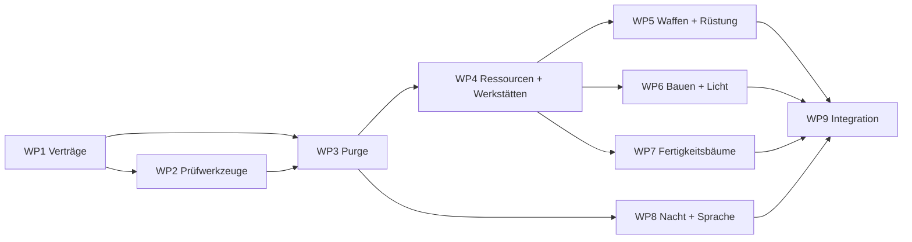

# Plan-0001: Phase 1 — MVP „700 & Grauen"

- **Status:** Entwurf
- **Datum:** 2026-11-07
- **Autor:** LupusMalus (Solo-Projekt mit Claude)
- **Basis-PRD:** Standalone — Grundlage sind [GDD](../GDD.md) §5 (Roadmap Phase 1, D49) und die
  zehn Feature-Dokumente F-01, F-02, F-03, F-04, F-05, F-08, F-12, F-17, F-18, F-21
- **Verantwortlich:** LupusMalus
- **Zielversion:** 7 Days to Die V 3.40, Build 10 (D52)

> **Markierung jedes Schritts** nach globaler Arbeitsanweisung:
> `[Claude-prüfbar]` erledigt Claude vollständig samt Prüfbefehl ·
> `[braucht Nutzer]` braucht einen Spielstart, einen Server, ein Urteil oder einen Playtest.
> Die Nutzer-Punkte stehen am Ende noch einmal gesammelt als Prüfliste.

## Kontext / Motivation

Phase 0 ist fertig: die Mod lädt, prüft ihre Spielfassung und patcht nichts
([F-00](../features/F-00-mod-fundament.md)). Der Kurz-Check der Schnittstellen Prio 1–10 ist
durch, und er hat die Lage für Phase 1 entscheidend verbessert:
**Phase 1 braucht keinen einzigen Harmony-Patch.**

Das ist keine Vermutung, sondern das Ergebnis von elf Leitfragen gegen die echten
Konfigurationsdateien und die echten Metadaten
([Kurz-Check Prio 2–10](../rea/findings/02-10-schnittstellen-kurzcheck.md)). Drei Annahmen waren
zu pessimistisch — die Fackel-Brenndauer ist XML (`PlantGrowing`), die Währung ist XML
(`currency_item`), der Blockschaden pro Gegner ist XML (`BlockDamage`) — und der Code hängt
fast nicht an den fünf Vanilla-Attributen, was die sechs eigenen Fertigkeitsbäume zu XML-Arbeit
macht.

Damit ist Phase 1 ein **reines Daten- und Dokumentationsvorhaben**: XML, Localization,
Balancing-Tabellen und drei Prüfwerkzeuge. Das ist der Grund, diesen Plan jetzt zu schreiben und
nicht später — der riskanteste Teil (brauchen wir C#? wo?) ist beantwortet, bevor eine Zeile
Inhalt entsteht.

Was Phase 1 **nicht** ist: der optische Bruch (Phase 2, F-16), Magie (F-15), das Furcht-System
B3 (F-17), Schild-Blocken und Schadensarten (F-02 Rest), Learning by Doing (F-21). Gegner,
Waffen und POIs bleiben Vanilla-Modelle mit neuen Namen.

## Ziele

Messbar, abgeleitet aus der MVP-Definition im GDD §5:

- **Z1** Eine neue RWG-Welt ist von Tag 1 bis **nach der ersten Seuchennacht** durchspielbar,
  ohne Absturz und ohne XML-Fehler im Protokoll.
- **Z2** **Null** Anachronismen in Loot, Rezepten, Händlerware, Startausrüstung und Texten —
  nachgewiesen durch ein Prüfwerkzeug, nicht durch Durchklicken.
- **Z3** Der Pfad T0 → T4 ist in Waffen, Rüstung, Werkstätten und Bauteilen **sackgassenfrei**
  herstellbar — nachgewiesen durch eine Rezeptgraph-Prüfung.
- **Z4** Jeder sichtbare Text liegt auf **Deutsch und Englisch** vor; keine Pflichtspalte ist leer.
- **Z5** Nächte sind spürbar dunkler und nebliger als Vanilla; Feuer ist der Grund, eines zu
  machen (Licht als Ressource, Säule P4).
- **Z6** Sechs eigene Fertigkeitsbäume ersetzen das Vanilla-Attributsystem; kein
  Vanilla-Attribut- oder Perkname ist sichtbar.
- **Z7** Die Mod läuft auf **SP, Dedicated Server und einem zweiten Client** identisch.

## Arbeitspakete (Workstreams)

Neun Pakete. Die Zahl liegt über dem üblichen Rahmen von 3–7, weil Phase 1 zehn Features
umfasst; deshalb sind die Meilensteine unten besonders eng geschnitten. Schätzungen sind
**Arbeitstage**, nicht Kalendertage.

---

### WP1: Verträge und Modlet-Gerüst

**Zweck:** Festlegen, *wie* gebaut wird, bevor Inhalt entsteht — Modlet-Grenzen, Namensraum,
XPath-Regeln, Ladereihenfolge. Nach globaler Regel „Verträge zuerst" nimmt der Nutzer sie ab,
erst dann beginnt WP3.
**Rolle:** Claude (Entwurf) → Nutzer (Abnahme)
**Schätzung:** M (5 Tage)

**Schritte:**

1. **WP1.1** `[Claude-prüfbar]` `docs/contracts/01-modlet-grenzen.md`: Welche Modlets es gibt,
   was in welches gehört, in welcher Reihenfolge sie laden. ~~Vorschlag: ein Modlet pro
   Feature-Gruppe (`700_core`, `700_items`, `700_blocks`, `700_progression`,
   `700_localization`, `700_ui`)~~ — **entschieden als D53: acht Modlets, geschnitten nach
   Feature-Gruppe statt nach Vanilla-Datei** (`700_00_Core`, `700_10_Purge`, `700_20_Material`,
   `700_30_Ausruestung`, `700_40_Bauen`, `700_50_Fortschritt`, `700_60_Welt`,
   `700_90_Sprache`). Der Schnitt nach Datei wäre falsch gewesen: `items.xml` gehört zu fünf
   Features, nicht zu einem.
2. **WP1.2** `[Claude-prüfbar]` `docs/contracts/02-namensraum.md`: Präfix-Regeln für Item-,
   Block-, Buff-, Perk- und Localization-Kennungen. Ein Name, der im Spiel sichtbar ist, läuft
   immer über Localization, nie über die Kennung. Enthält die **belegte** Laderegel
   `^[0-9a-zA-Z_\-]+$` für den Mod-Namen.
3. **WP1.3** `[Claude-prüfbar]` `docs/contracts/03-xpath-regeln.md`: Nur zielgenaue,
   additive Änderungen (`append`, `set`, `remove`), **kein** Ersetzen ganzer Dateien — sonst
   bricht jede andere Mod. Dazu die D5-Regeln für XUi aus Spec 01 §4.1.
4. **WP1.4** `[Claude-prüfbar]` `docs/contracts/04-pruefwerkzeuge.md`: Was die drei Werkzeuge aus
   WP2 als Eingabe nehmen, was sie ausgeben, welcher Exit-Code was heißt. C#, kein Python
   (globale Regel), Fortsetzung des Musters von `tools/meta`.
5. **WP1.5** `[Claude-prüfbar]` Leere Modlet-Ordner samt `ModInfo.xml` anlegen, Build-Skript auf
   acht Modlets umstellen, Paketprüfung grün.
6. **WP1.5b** `[braucht Nutzer]` **Rauchtest im Spiel:** lädt das Gerüst, bevor Inhalt drin ist?
   *(Im ersten Entwurf war dieser Schritt fälschlich als `[Claude-prüfbar]` markiert — ein
   Spielstart ist er nicht.)*
7. **WP1.6** `[braucht Nutzer]` **Abnahme der Verträge.** Ohne sie beginnt WP3 nicht.

**Ergebnis:** Vier Verträge in `docs/contracts/`, ein ladendes leeres Modlet-Gerüst,
Nutzer-Abnahme.

#### Stand 2026-11-07: WP1.1 bis WP1.5 erledigt

| Schritt | Ergebnis |
|---|---|
| WP1.1–WP1.4 | Vier Verträge in [`docs/contracts/`](../contracts/README.md). **Acht Modlets statt sechs** (D53) — Bauen und Fortschritt bekamen eigene Schichten. |
| WP1.5 | `mod/` in acht Modlet-Ordner umgebaut, `build.ps1` und `smoke.ps1` darauf umgestellt, eine Fassung für alle acht aus `Directory.Build.props`. **104 geprüft, 0 rot.** |
| WP1.5b | offen, braucht einen Spielstart |
| WP1.6 | offen, braucht die Abnahme |

Dabei kamen vier Dinge heraus, die dieser Plan vorher nicht wusste — sie stehen im Finding
[WP1-modlet-lader-und-xml-patcher.md](../rea/findings/WP1-modlet-lader-und-xml-patcher.md) und
haben **R6 entschärft** (bedingte XML-Blöcke mit `mod_loaded` statt C#) und **WP2 verbilligt**
(das Spiel legt die gemergte Config nach jedem Start selbst als `ConfigsDump` ab, kein Nachbau
des XML-Patchers nötig).

---

### WP2: Prüfwerkzeuge

**Zweck:** Die drei Signale, an denen Z2, Z3 und Z4 hängen. Nach Projektregel 5 zählt ein Check
erst, wenn er **einmal nachweislich an einem falschen Eingabewert gescheitert** ist.
**Rolle:** Claude
**Schätzung:** M (6 Tage)

**Schritte:**

1. **WP2.1** `[Claude-prüfbar]` `mod700check anachronisms`: durchsucht die **gemergte** Config
   nach einer Denylist (Schusswaffen, Munition, Fahrzeuge, Elektronik, Konserven, Medikamente,
   Treibstoff, Beton, Industriestahl) in Loot, Rezepten, Händlerware und Startausrüstung.
   Gegenprobe: ein eingeschmuggelter `gunPistol`-Eintrag muss **rot** werden.
2. **WP2.2** `[Claude-prüfbar]` `mod700check recipes`: baut den Rezeptgraphen und meldet
   Sackgassen (ein Item ist herstellbar, aber keine seiner Zutaten erreichbar) und Zyklen.
   Gegenprobe: ein Rezept mit erfundener Zutat muss **rot** werden.
3. **WP2.3** `[Claude-prüfbar]` `mod700check localization`: meldet leere Pflichtspalten (DE, EN)
   und Kennungen, die im Spiel sichtbar sind, aber keinen Eintrag haben. Gegenprobe: eine
   geleerte DE-Spalte muss **rot** werden.
4. **WP2.4** `[Claude-prüfbar]` Die Gegenproben im README der Werkzeuge als Tabelle festhalten,
   wie bei `tools/meta` bereits geschehen — damit ein späteres „grün" etwas bedeutet.
5. **WP2.5** `[Claude-prüfbar]` `.claude/verify.json` anlegen, damit der Prüfbefehl des Projekts
   erzwungen wird und keine Antwort mehr ohne Lauf endet.

**Ergebnis:** Drei Werkzeuge, jedes einmal nachweislich rot und dann grün, plus ein
Projekt-Prüfbefehl.

#### Stand 2026-11-07: WP2 erledigt

Ein Werkzeug `mod700check` mit drei Befehlen (`tools/check/`), signiert, 0 Warnungen.
`tools/check/gegenproben.ps1`: **11 Gegenproben, 0 fehlgeschlagen.**
`tools/check/check-all.ps1` ist der Prüfbefehl, in `.claude/verify.json` eingetragen.

Zwei Annahmen liegen bewusst außerhalb des Codes, in nachlesbaren Dateien:
`denylist.txt` (27 Verbote, 19 Freigaben nach D9) und `world-roots.txt`.

**Die Kalibrierung war der Ertrag.** Der erste `recipes`-Lauf gegen unverändertes Vanilla
meldete 38 Sackgassen — nicht Vanilla war kaputt, sondern meine Wurzelmenge unvollständig.
Alle 38 gingen auf acht Kennungen zurück (sechs Schmelz-Einheiten der Esse,
`bucketRiverWater`, `domesticatedChicken`), die über Mechaniken kommen, für die kein
XML-Attribut existiert. Mit `world-roots.txt` ist Vanilla grün: **633 Rezepte, 0 Sackgassen,
0 Zyklen.** Eine Gegenprobe prüft darum nicht das Werkzeug, sondern diese Annahme: ohne die
Datei muss auch der saubere Prüfsatz rot werden.

**`check-all.ps1` ist jetzt rot, und das ist richtig:** `anachronisms` findet 138 erreichbare
Anachronismen in Vanilla. Das ist das Bild **vor** WP3. Ein Prüfbefehl, der vor der Arbeit
grün ist, prüft nichts.

---

### WP3: F-01 Anachronismen-Purge

**Zweck:** Alles entfernen oder sperren, was es um 700 nicht gab — und die Systeme, die später
umgedeutet werden, **erhalten**.
**Rolle:** Claude
**Schätzung:** L (12 Tage)
**Hängt an:** WP1 (Abnahme), WP2.1

**Schritte:**

1. **WP3.1** `[Claude-prüfbar]` Bestandsaufnahme: alle Items, Rezepte, Loot-Gruppen und
   Händlergruppen gegen die Denylist, als Liste mit Entscheidung je Eintrag
   (sperren / umdeuten / an F-15 übergeben).
2. **WP3.2** `[Claude-prüfbar]` ~~**Sperren statt löschen** (`CreativeMode="None"`, kein Rezept,
   kein Loot). Begründung steht in F-01: gelöschte Items, die in POIs oder Quests referenziert
   werden, brechen hart. Welche Referenzen genau brechen, zeigt der Protokolllauf in WP3.6.~~
   **Erledigt 2026-11-07** — `items.xml`, `blocks.xml`, `recipes.xml`. Loot ist WP3.3.
3. **WP3.3** `[Claude-prüfbar]` ~~Loot-Tabellen leeren bzw. umbiegen (`loot.xml`).~~
   **Erledigt 2026-11-07** — geleert, nicht umgebogen; 217 von 1016 Gruppen stehen leer da.
4. **WP3.4** `[Claude-prüfbar]` ~~Händlerware und Quest-Belohnungen bereinigen, Startausrüstung
   auf T0 (Lumpen, Steinwerkzeug) setzen.~~ **Erledigt 2026-11-07.**
5. **WP3.5** `[Claude-prüfbar]` **D9 wahren:** Geschütztürme, Generator, Solar, Batterien, Kabel,
   Schalter, Sensoren, elektrische Fallen, Drohne und Sprengstoff werden **nur in ihrer modernen
   Erscheinung** gesperrt — Klassen und Logik bleiben, weil F-15 (Phase 2) sie als Runensteine,
   Kraftsteine und Runenfallen weiterverwendet. Das ist belegt tragfähig: die Stromklassen
   `Powered`, `PoweredLight`, `ElectricWire`, `BladeTrap` sind ein fertiges Leitungssystem.
6. **WP3.6** `[braucht Nutzer]` Spielstart mit abgeschaltetem EAC, neue RWG-Welt, Protokoll auf
   Referenzfehler durchsuchen. `tools/build/smoke.ps1` prüft das Protokoll selbst.
7. **WP3.7** `[braucht Nutzer]` Drei Spieltage ohne modernes Item im Inventar oder Angebot.

**Ergebnis:** `mod700check anachronisms` meldet 0 Treffer; die später umzudeutenden Systeme sind
noch vollständig vorhanden.

**Bekannte MVP-Lücke:** Vanilla-POIs behalten modernes Dekor (Blöcke in Prefabs). Das ist F-07,
Phase 2, und bleibt in Phase 1 so stehen — ehrlich benannt statt stillschweigend.

#### Stand 2026-11-07: WP3.1 erledigt, und die Schätzung ist zu niedrig

Befund: [WP3-bestandsaufnahme-anachronismen.md](../rea/findings/WP3-bestandsaufnahme-anachronismen.md).

| | |
|---|---|
| erreichbare Kennungen in Vanilla | **1129** |
| von der Denylist verboten | 254 (erster Lauf: 138) |
| durch Freigabe erlaubt | 31 |
| **von keiner Regel berührt** | **844** |

Drei Defekte in der Denylist aus WP2, alle behoben:

1. **Zu weite Präfixe.** `gun*` und `ammo*` nahmen 27 Bögen, Armbrüste, Pfeile und Bolzen mit,
   obwohl P3 und D8 sie als Inhalt nennen → **D54**. Dazu `resourceForgedSteel` (**D55**) und
   vier plausible Heilmittel (**D56**). 32 der 138 waren Fehltreffer meiner Liste.
2. **Kategorienfehler bei D9.** Geschütztürme, Generator, Solar, Batterien, Relais und
   Sprengstoff standen als **Freigaben** — damit wären `autoTurret`, `generatorbank`,
   `solarbank` und ein Dutzend mehr in Phase 1 herstellbar geblieben, und die Prüfung hätte
   dazu „0 rot" gemeldet. D9 wird in Vertrag 03 §4 gewahrt (kein `remove` auf die
   Definition), nicht durch eine Freigabe im Prüfwerkzeug.
3. **Vergleich ohne Rücksicht auf Gross-/Kleinschreibung.** `drugs*` meldete drei Treffer und
   liess zwölf Drogen durch; die drei trafen nur, weil `drugs` case-insensitiv auf `drugS`
   passt. `IgnoreCase` ist entfernt, zwei neue Gegenproben halten es fest (13 insgesamt).

**Folge für die Schätzung:** WP3 stand auf 12 Tagen und auf der Annahme einer im Wesentlichen
fertigen Denylist. Die Zahl der XPath-Zeilen wächst etwa auf das Doppelte bis Dreifache, und
die Sichtung der 844 kommt als eigener Posten dazu. Siehe auch das neue Risiko **R13**.

**Entschieden (Nutzer, 2026-11-07): Urteil nach Eigenschaften**, festgelegt in
[Vertrag 04 §3a](../contracts/04-pruefwerkzeuge.md) (Entwurf, wartet auf Abnahme). Gemessen
vor der Entscheidung: 945 der 1129 erreichbaren Kennungen tragen eine auswertbare Eigenschaft,
nur 6 gar keine. Eigenschaften trennen Pistole von Bogen, Strom von Nicht-Strom und
Entwickler- von Spielinhalt — bei Konserven, Medikamenten und Einzelgängern wie dem Klimagerät
sind `Group` und `Tags` dagegen **identisch**, dort bleibt der Name das einzige Signal. Die 95
Waffen- und Rüstungs-Mods werden über `installable_tags` abgeleitet statt aufgezählt.

**Neuer Schritt, vor WP3.2:**

- **WP3.1b** `[Claude-prüfbar]` ~~`anachronisms` auf das Urteil nach Eigenschaften umbauen,
  mit den fünf Gegenproben aus Vertrag 04 §3a. Schätzung: M (2 Tage).~~ **Erledigt
  2026-11-07.** Danach erst die 800 sichten und die XPath-Zeilen schreiben.

#### Stand 2026-11-07: WP3.1b erledigt

| | vorher | nachher |
|---|---|---|
| verbotene Kennungen | 254 | **298** |
| davon nach Eigenschaft | — | 61 |
| davon über Mod-Ableitung | — | 22 |
| davon nach Name | 254 | 215 |
| ungeprüft | 844 | **800** |
| Gegenproben | 13 | **19** |

Drei Zeilen der Regeltabelle in Vertrag 04 §3a hielten der Messung nicht stand und sind dort
berichtigt (die Tags `ammo44Magnum` und `ammoShotgun` gibt es nicht; `Group = Special Items`
trifft 28 statt 14 und keinen `TEST_ITEM`; die Admin-Regel trifft 13 statt 4). Eine vierte
Zahl war ein Fehler in meinem Messskript — 533 statt 28 — und wäre beinahe in den Vertrag
gewandert. Seitdem gilt: Zahlen in Dokumenten kommen aus dem Werkzeug, nicht aus einem
Hilfsskript ohne Gegenproben.

- **WP3.1c** `[Claude-prüfbar]` ~~Die 512 ungeprüften Kennungen sichten: jede bekommt ein
  Urteil (verboten, aufgeschoben mit Arbeitspaket, oder durch Freigabe erlaubt), jedes Urteil
  einen nachlesbaren Grund. Schätzung: M (3 Tage).~~ **Erledigt 2026-11-07.**

#### Stand 2026-11-07: WP3.1c erledigt — `ungeprueft` ist 0

| | vorher | nachher |
|---|---|---|
| ungeprüft | 512 | **0** |
| verbotene Kennungen | 356 | **592** |
| davon nach Eigenschaft | 85 | 123 |
| davon nach Name | 251 | 441 |
| davon über `Unlocks`-Ableitung | 20 | 27 |
| aufgeschoben (mit WP) | 157 | **170** |
| durch Freigabe erlaubt | 31 | **270** |
| Eigenschaftsregeln | 6 | **9** |
| Gegenproben | 19 | **28** |

Die 1129 erreichbaren Kennungen teilen sich jetzt restlos auf (592 + 170 + 270 + 24 Baupläne
+ 73 Loot-Gruppen = 1129). Vier neue Mittel haben rund 68 davon ohne Namensregel beantwortet:
`sprengkoerper` (`Class = ItemClassTimeBomb`), `robotik`, `moderner_werkstoff`
(`Tags` enthält `challenge_*`), `CreativeMode = Dev` — und die `Unlocks`-Ableitung gilt jetzt
in beide Richtungen, was 34 Baupläne ohne eigene Zeile erledigt. Der Rest sind über
vierhundert inhaltliche Urteile in `denylist.txt` und `aufschub.txt`.

**Zwei Dinge brauchen den Nutzer, bevor WP3.2 XPath schreibt:**

1. **Vertrag 04 §3b** ist geschrieben, gemessen und **nicht abgenommen**. Er geht über das
   am 2026-11-07 abgenommene §3a hinaus (vier Regeln, beidseitige Ableitung, Aufschub als
   verbindliche Betriebsart, `freigaberegeln_ohne_treffer`).
2. **Drei Sichtungsgruppen** sind inhaltliche Entscheidungen und keine Messungen: die 16
   Rüstungsgarnituren fallen alle (nur `armorPrimitive*` bleibt, bis WP5 F-03 liefert); die
   Pflanzen der Neuen Welt fallen (Mais, Kartoffel, Kürbis, Blaubeere, Yucca, Kaffee,
   Chrysantheme, Baumwolle — Yuccafaser und Baumwolle nach WP4 aufgeschoben, weil sie die
   Faserkette tragen); Vanillas Währung ist nach WP4 aufgeschoben statt gesperrt, sonst endet
   der Handel vor dem Ersatz. Nachzulesen in
   [WP3-bestandsaufnahme-anachronismen.md](../rea/findings/WP3-bestandsaufnahme-anachronismen.md)
   Abschnitt 5a.

#### Stand 2026-11-07: §3b abgenommen, WP3.2 erledigt

Der Nutzer hat Vertrag 04 §3b und die drei Sichtungsgruppen am 2026-11-07 abgenommen.
`mod/700_10_Purge/Config/` hat jetzt **912 Patchzeilen**: 437 in `items.xml`, 106 in
`blocks.xml`, 369 in `recipes.xml`. `build.ps1` packt sie (8 Modlets, 12 Dateien).

**Die Patches sind erzeugt, nicht geschrieben.** `mod700check purge-patch` baut sie aus
`denylist.txt` und `aufschub.txt` — derselben Liste, aus der auch `anachronisms` urteilt.
592 Kennungen auf sieben Dateien von Hand zu verteilen hiesse, dieselbe Liste zweimal zu
führen, und die Prüfung würde den Unterschied nicht sehen: sie liest die gemergte Config,
nicht unsere Patches. Der XPath kommt aus der tatsächlichen Elternkette im Quell-XML, nicht
aus einer Annahme über das Schema. Nachtrag dazu in Vertrag 03 §4 und Vertrag 04 §3c.

`check-all.ps1` vergleicht ab jetzt, ob die Dateien im Modlet noch zur Denylist passen
(`purge-patch --vergleiche`). Nachgewiesen, dass dieser Vergleich rot werden kann: eine
Änderung am Kopftext machte alle drei Dateien `patchdatei-veraltet`, die Neuerzeugung machte
sie wieder grün.

| | Zahl |
|---|---|
| Patchzeilen | 912 |
| `patches_ohne_treffer` | 0 |
| `wege_uebrig` (Nachprobe) | 0 |
| `remove_auf_definition` (D9) | 0 |
| `patchdateien_abweichend` | 0 |
| Gegenproben | 28 → **33**, 0 fehlgeschlagen |

**Eine Berichtigung am Planschritt WP3.2 selbst:** `CreativeMode="None"` ist **keine Sperre
für den Spieler.** Es nimmt den Gegenstand aus dem Kreativmenü und aus der Entwicklerliste,
nicht aus dem Spiel. Als Absichtserklärung in den Daten ist es richtig, als Wirkung nicht.
Unerreichbar wird ein Gegenstand allein durch die entfernten Wege — und davon fehlen noch
Loot (493 Kennungen), Händler (348), Quest-Belohnungen (50) und Startausrüstung (1). Das sind
WP3.3 und WP3.4.

#### Stand 2026-11-07: WP3.3 und WP3.4 erledigt — der Purge ist vollständig

`mod/700_10_Purge/Config/` hat jetzt **1780 Patchzeilen** in sieben Dateien, alle erzeugt:

| Datei | Zeilen | was |
|---|---|---|
| `items.xml` | 437 | `CreativeMode=None` |
| `blocks.xml` | 106 | `CreativeMode=None` |
| `recipes.xml` | 369 | Rezepte entfernt |
| `loot.xml` | 467 | Loot-Einträge entfernt |
| `traders.xml` | 348 | Händlerware entfernt |
| `quests.xml` | 50 | Belohnungslisten gekürzt bzw. entfernt |
| `entityclasses.xml` | 3 | Startausrüstung gekürzt |

Dazu **von Hand** `mod/700_30_Ausruestung/Config/entityclasses.xml`: die T0-Startausrüstung
(Wasser, Lumpen, Steinaxt, Fackel, Wundauflage, Dukes Brief bis WP8). Das ist die Grenze
zwischen den Modlets und zugleich zwischen erzeugt und geschrieben — was aus der Denylist
folgt, wird erzeugt; was eine Entscheidung ist, wird geschrieben. Nahrung ist bewusst **nicht**
dabei: Vanilla gab eine Dose Chili, F-01 nimmt sie weg, und ein Ersatz wäre Inhalt (F-19,
Phase 2). Der Spieler startet hungrig.

**Zwei neue Wächter:**

- **Listen werden gekürzt, nicht entfernt.** Vanilla hat 256 Quest-Belohnungen, deren `id`
  eine Liste ist, und die Startausrüstung ist auch eine. Nur Gesperrtes darin → der Eintrag
  fällt; gemischt → die Liste wird gekürzt, mit Stückzahlen (`drinkJarBoiledWater=2` bleibt
  `=2`). Wer hier blind `remove` nimmt, nimmt dem Spieler die erlaubten Einträge mit.
- **Die Gesamtprobe.** Jede Datei einzeln zu prüfen sagt nicht, ob der Satz *zusammen* alle
  fünf Wegarten schließt — eine Kennung, die nur noch in der Startausrüstung steht, wäre in
  jeder Einzelprobe grün. `gesperrt_und_noch_erreichbar` wendet alle 1780 Zeilen auf Kopien an
  und rechnet die Erreichbarkeit neu: **0**, mit `--ohne-entfernen` **592**.

| | Zahl |
|---|---|
| Patchzeilen | 1780 |
| `gesperrt_und_noch_erreichbar` | 0 |
| `wege_uebrig` (alle fünf Dateien) | 0 |
| `patches_ohne_treffer` | 0 |
| `remove_auf_definition` (D9) | 0 |
| `patchdateien_abweichend` | 0 |
| Gegenproben | 33 → **35**, 0 fehlgeschlagen |

**Ein Nebeneffekt, der benannt gehört:** 217 von 1016 Loot-Gruppen enthalten nach dem Patch
keinen Eintrag mehr. Sie bleiben absichtlich stehen — Behälter und Quest-Belohnungen zeigen
auf ihre Namen, und ein fehlender Name bricht hart. Umgebogen werden sie mit F-05 in WP4. Ob
das Spiel eine leere Gruppe stillschweigend hinnimmt, eine Protokollzeile schreibt oder beim
Würfeln abbricht, **weiß hier niemand** — das ist der erste Punkt für WP3.6.

**Was offen bleibt:** WP3.5 (D9 wahren) ist durch den Wächter `remove_auf_definition 0` und
durch die Bauart gedeckt — Entfernungen treffen nur Wege, Klassen bleiben vollständig stehen.
WP3.6 und WP3.7 brauchen den Nutzer: Spielstart mit abgeschaltetem EAC, Protokoll auf
Referenzfehler und leere Loot-Gruppen durchsehen, dann drei Spieltage. Erst dieser Lauf macht
aus 1780 gerechneten Zeilen einen Nachweis.

> **BERICHTIGUNG, 7. November 2026 (gefunden in WP4.1).** Der Absatz über die Gesamtprobe sagt
> „alle fünf Wegarten". Es sind **sechs**: `blocks.xml` trägt
> `<drop event="Harvest|Destroy|Fall" name="…"/>`, und das war in `Reachability` kein Weg. Der
> Purge war damit **nicht vollständig**, auch wenn jede Zahl oben stimmt — sie beantworteten
> eine zu kleine Frage. Gemessen: **26 gesperrte Kennungen in 869 Abwurfzeilen** blieben zu
> haben, darunter `resourceScrapPolymers` aus 163 Zeilen, `resourceMechanicalParts` aus 127
> und `resourceElectricParts` aus 115 — ein zerschlagenes Sofa gab Kunststoff.
>
> Geschlossen in WP4.1: der sechste Weg steht in `Reachability`, `purge-patch` schreibt 41
> Abwurf-Entfernungen, und `gesperrt_und_noch_erreichbar` ist wieder 0 — jetzt für die
> richtige Frage. Aufgefallen ist es nicht durch eine Prüfung, sondern weil eine Zahl in WP4
> (585 Abwurfzeilen für Schrotteisen) nicht zu „vollständig" passte. Was daraus für die
> Prüfwerkzeuge folgt, steht in Vertrag 04 §3d; dass es keinen siebten Weg gibt, ist damit
> **nicht** gezeigt.

---

### WP4: F-05 + F-04 — Ressourcen, Ketten, Werkstätten

**Zweck:** Das Rückgrat. Ohne Rohstoffe und Werkstätten hat kein Rezept in WP5 bis WP7 eine Basis.
**Rolle:** Claude
**Schätzung:** ~~L (18 Tage)~~ → **L (15 Tage)**, seit WP4.4 nach WP5 und Phase 2 verschoben ist
(D57, 8. November 2026). Die drei Tage wandern mit: **WP5 steigt von 16 auf 17 Tage** (WP5.5b,
der Webstuhl, kostet mit dem vorhandenen Klon-Muster rund einen Tag), die übrigen zwei liegen in
Phase 2 bei F-15 und F-19 und zählen hier nicht mehr mit.
**Hängt an:** WP3

**Schritte:**

1. ~~**WP4.1** `[Claude-prüfbar]` Ressourcen umdeuten (F-05-Tabelle): Raseneisenerz → Luppe →
   Schmiedeeisen, Holzkohle, Kalk, Lehm, Bernstein, Salz.~~ **Namen und Urteile erledigt
   2026-11-07**; Erz-Häufigkeit (D31) offen, siehe Stand.
2. ~~**WP4.2** `[Claude-prüfbar]` **Währung auf Silber** (D30). Das ist belegt eine Zeile:
   `currency_item` in `traders.xml`; `casinoCoin` kommt im Code an keiner Stelle vor.~~
   **Erledigt 2026-11-07 — und zwar in null Zeilen `traders.xml`**, siehe Stand.
3. ~~**WP4.3** `[Claude-prüfbar]` Die fünf Vanilla-Werkstätten umdeuten: Feuerstelle,
   Zimmermannsbank, Rennofen, Esse + Amboss, Kräuterküche, Kalkofen.~~
   **Erledigt 2026-11-08.**
4. ~~**WP4.4** `[Claude-prüfbar]` Die vier geklonten Werkstätten: Runenritzer-Bank, Webstuhl,
   Räucherkammer, Trockengestell. Jede mit Bau-Rezept, Brennstoffregel bzw. Werkzeugslots und
   **mindestens fünf Rezepten**.~~ — **verschoben am 8. November 2026 (D57)**, nicht gestrichen:
   Webstuhl → **WP5.5b** (mit den Gambeson-Teilen), Räucherkammer → **F-19, Phase 2**,
   Runenritzer-Bank → **F-15, Phase 2**. Begründung und Messung unten im Stand.
5. ~~**WP4.5** `[Claude-prüfbar]` Brennstoff- und Werkzeugslot-Regeln nach dem
   Vanilla-Forge-Prinzip (D26).~~ **Erledigt 2026-11-08.**
6. ~~**WP4.6** `[Claude-prüfbar]` Die Beispielkette aus F-04 vollständig durchziehen:
   `Raseneisenerz + Holzkohle → Luppe → Schmiedeeisen → Klinge → Spatha`. Stahl per Aufkohlen,
   Damast erst mit Meister-Abschrift.~~ **Erledigt 2026-11-08**, Damast bleibt bei WP7.
7. ~~**WP4.7** `[Claude-prüfbar]` `mod700check recipes` grün: kein T0→T4-Pfad mit Sackgasse.~~
   — **soweit erledigt, wie es ohne Spielstart geht (8. November 2026).** `kette-pruefen.ps1`
   löst alle Verweise auf (0 unaufgelöst); Erreichbarkeit von T0 und Zyklen bleiben bei
   **WP3.6**, weil `recipes` eine gemergte Quelle braucht. Siehe Stand.

**Ergebnis:** Eine vollständige, geprüfte Rohstoff- und Werkstattkette von T0 bis T4.
**Erreicht am 8. November 2026, mit zwei benannten Einschränkungen:** die Kette steht und ist
verweisgeprüft, aber nicht im Spiel gelaufen (WP3.6), und sie endet bei T3 (Tiegelstahl) —
Damast (T4) hängt an der Meister-Abschrift und damit an WP7. Von den neun Werkstätten in F-04
liegen sieben in Phase 1 — sechs Namen auf fünf umgedeuteten Vanilla-Blöcken (`forge` trägt
Rennofen und Esse) und der Webstuhl in WP5.5b —, zwei in Phase 2 (D57).

**Stand WP4.1 und WP4.2 (7. November 2026): umgedeutet, nicht ersetzt.**

Der Plan dachte sich WP4.1 als „Ressourcen umdeuten" und WP4.2 als „eine Zeile `currency_item`".
Gebaut ist etwas Billigeres und Reversibleres: **keine Zeile `traders.xml`, keine Zeile
`items.xml`, 26 Zeilen Sprache.** `casinoCoin` *ist* der Silberpfennig, `resourceScrapIron`
*ist* das Raseneisenerz. D30 nennt das ausdrücklich so — „**Silber** (Sceattas bzw. Denare) als
1:1-Umdeutung der Vanilla-Dukes" —, und der Weg trägt alle 166 Verweise auf `casinoCoin` und
alle 585 Abwurfzeilen auf `resourceScrapIron` mit, ohne eine davon anzufassen.

Das steht und fällt mit einer Frage, die vorher niemand geprüft hatte: **überschreibt eine
Modlet-Zeile einen Vanilla-Sprachschlüssel?** Der WP1-Befund klang nach *nein* („verliert den
zweiten stillschweigend"). Gelesen im ausgelieferten Code (`mod700meta`, weil REA an dieser
Assembly abbricht) ist die Antwort **ja**: `addCsv` lädt für Vanilla mit `false` und nimmt
`Dictionary::Add`, für Modlets mit `true` und nimmt `Dictionary::set_Item`. Befund:
[WP4-localization-ueberschreibt-vanilla.md](../rea/findings/WP4-localization-ueberschreibt-vanilla.md);
WP1 §6 ist berichtigt.

| | |
|---|---|
| umgedeutet | 13 Kennungen, je Name + Beschreibung = 26 Schlüssel |
| Verbot → Freigabe | `resourceScrapIron*`, `resourceScrapBrass*`, `resourceScrapLead*`, `resourceLeadBundle`, `resourceYuccaFibers`, `resourceCropCottonPlant`, `casinoCoin` |
| Aufschübe eingelöst | 8 von 8 mit Adresse WP4 (170 → 160 aufgeschoben) |
| bleibt verboten | `oldCash` — Silber ersetzt die Marke, nicht den Geldschein |
| neue Dateien | `mod/700_90_Sprache/Config/Localization.csv`, `tools/check/vanilla-keys.txt` |
| Gegenproben | 35 → **38**, 0 fehlgeschlagen |

**Was in WP4.1 offen bleibt, und warum:** die Erz-Häufigkeit (D31, „Eisen ist der Engpass")
ist **nicht** gesetzt. Beim Nachsehen stellte sich heraus, dass `terrOreIron` mit 105 pro
Abbau nicht die Hauptquelle ist: Vanilla verteilt `resourceScrapIron` über **585 Zeilen** in
`blocks.xml`, Autowracks und Schrotthaufen geben 70–180 pro Ernte. Die Erzader herunterzusetzen
wäre eine Zahl, die nichts bewirkt, und „Setzung für WP9" dazuzuschreiben wäre eine Ausrede.
Der Engpass hängt an der Bergeökonomie der Welt (F-17/F-18) und an WP9 — und an derselben
585-Zahl, die den sechsten Weg aufgedeckt hat. Kalk, Bernstein und Salz fehlen ebenfalls: sie
sind neue Gegenstände und gehören zu den Werkstätten, die sie verarbeiten (WP4.3 bis WP4.6).

**Stand WP4.3, WP4.5 und WP4.6 (8. November 2026): die Werkstätten stehen, die Kette läuft.**

F-04 ordnet fünf Vanilla-Blöcke sechs Namen zu — `forge` trägt **zwei**, weil Rennofen und
Esse in Vanilla ein Block mit drei Werkzeugslots sind. Daraus folgt der Trick von WP4.6:
**getrennt wird durch das Werkzeug, nicht durch den Block.**

| 700-Werkstatt | Vanilla | was wirklich geändert wurde |
|---|---|---|
| Feuerstelle | `campfire` | Sprache; Werkzeugslots von 3 auf 2 (siehe unten) |
| Zimmermannsbank | `workbench` | nur Sprache |
| Rennofen und Esse | `forge` | nur Sprache; Vanillas drei Slots reichen |
| Kräuterküche | `chemistryStation` | nur Sprache |
| Kalkofen | `cementMixer` | Sprache **+ Brennstoffkammer** (`Modules`, plus ihr XUi-Fenster) |

Der Kalkofen ist die einzige echte Verhaltensänderung: Vanillas Betonmischer hat
`Modules="output"` und damit kein Feuer — er rührt. Kalk wird gebrannt, also bekommt er eine
Brennstoffkammer, und weil ein Modul ohne Fenster eine Kammer ist, die niemand öffnen kann,
auch das Fenster in `XUi_InGame/xui.xml`.

**Die Kette (WP4.6), fünf Schritte, vier davon werkzeuggebunden:**

```
Raseneisenerz 10 + Holzkohle 5   --(Esse, Blasebalg)--> Luppe
Luppe 1 + Holzkohle 2            --(Esse, Amboss)-----> Schmiedeeisen
Schmiedeeisen 5 + Holzkohle 10   --(Esse, Tiegel)-----> Tiegelstahl     (T3, Aufkohlen)
Schmiedeeisen 5 + Holzkohle 2    --(Esse, Amboss)-----> Klinge
Klinge 1 + Holz 10 + Leder 5     --(Zimmermannsbank)--> Spatha
```

Drei neue Gegenstände (`itm700_luppe`, `itm700_klinge`, `itm700_spatha`), und **Vanillas
Umweg fällt**: die vier Rezepte, die aus Schrott bzw. Schmelzeinheit direkt Schmiedeeisen
oder Stahl machen, sind entfernt. Ohne das wäre die Luppe Zierde — wer den kürzeren Weg hat,
nimmt ihn.

**Holzkohle ist Zutat, nicht Brennstoff.** D26 sagt „Vanilla-Forge-Prinzip" für den
Brennstoff, und das heißt: die Kammer nimmt alles mit `FuelValue` — Holz 50, Holzkohle 100,
dazu Stoff, Leder, Fett, Federn. Holzkohle wäre dort nur doppelt so gut wie Holz, nicht
*nötig*. Ohne sie kommt aber kein Eisen aus dem Erz. Darum steht sie als Zutat in jedem
Glied: der Zwang sitzt an der Stelle, an der die Prüfung ihn sehen kann, und der
Brennstoffgrid bleibt Vanilla.

**Ein gesperrter Gegenstand in einem Werkzeugslot.** Vanillas Werkzeugfenster der Feuerstelle
verlangt `toolCookingPot,toolCookingGrill,toolBeaker`. Das Becherglas steht auf der Denylist;
der Purge nimmt ihm alle Wege, sieht aber XUi nicht an — ein Werkzeugslot ist kein Weg, auf
dem man etwas *bekommt*. Übrig blieb ein dritter Platz, den niemand füllen kann. Jetzt zwei
Slots, und das ist genau, was F-04 der Feuerstelle zuschreibt („Topf, Spieß"). **Daraus folgt
allgemein: der Purge deckt Wege, nicht Verweise.** Werkzeugslots, `RepairItems` und
Prefab-Inhalte nennen gesperrte Kennungen weiter. Diese Stelle ist von Hand gefunden, nicht
von einer Prüfung — als offener Punkt in Vertrag 04 vermerkt.

| | Zahl |
|---|---|
| Patchdateien neu | 5 (`items`, `recipes`, `blocks`, `XUi_InGame/windows`, `XUi_InGame/xui`) |
| eigene Rezepte | 5, davon 4 werkzeuggebunden |
| Vanilla-Rezepte entfernt | 4 (2× Schmiedeeisen, 2× Tiegelstahl) |
| Sprachschlüssel | 42 (vorher 26) |
| Gegenproben | 38 → **40**, 0 fehlgeschlagen |
| Paket | 8 Modlets, 23 Dateien (vorher 18) |

**WP4.7 ist nur zur Hälfte möglich, und das liegt nicht an WP4.** `mod700check recipes`
prüft eine *Quelle*, und unsere Modlets stehen in keiner, die ohne Spielstart zu haben ist:
der vorhandene `ConfigsDump` ist vom 7. Juli und kennt sie nicht. „recipes grün" heißt heute
**„Vanilla hat keine Sackgasse"** und sagt über unsere Kette nichts. Dafür gibt es jetzt
`tools/check/kette-pruefen.ps1`: es löst jeden Verweis unserer Rezepte auf — Ergebnis,
Zutaten, Werkzeug — gegen Vanilla und unsere eigenen `items.xml`. Gemessen 5 Rezepte,
0 unaufgelöste Verweise; rot vorgeführt an `testdaten/kette-rot.xml` mit drei erfundenen
Namen, darunter der realistische Fall `resourceCole` statt `resourceCoal`. Was es **nicht**
prüft: Erreichbarkeit von T0 aus, Zyklen, und ob der XML-Patcher des Spiels unsere XPaths
trifft. Das bleibt WP3.6.

**WP4.4 ist nicht angefangen, und zwar absichtlich — hier steht eine Entscheidung an.**
F-04 nennt drei Klone, nicht vier (der Plan hat „Räucherkammer / Trockengestell" in zwei
Zeilen getrennt), und F-04 schreibt jedem zu, was er erzeugen soll:

| Klon | erzeugt laut F-04 | in Phase 1 vorhanden |
|---|---|---|
| Runenritzer-Bank | Runen, Runensteine, Glutladungen **(F-15)** | nichts — F-15 ist Phase 2 |
| Webstuhl | Tuch, Gambeson-Teile, Segeltuch | nur Tuch (`resourceCloth`); Gambeson ist F-03/WP5, Segeltuch wäre neu |
| Räucherkammer / Trockengestell | Konserven **(F-19)** | nichts — F-19 ist Phase 2 |

Gemessen: nach dem Purge sind in ganz Vanilla noch 252 Rezepte übrig (Zimmermannsbank 71,
Esse 36, Feuerstelle 14, Kräuterküche 4, Kalkofen 3, ohne Werkstatt 124). Darunter ist
**kein** Satz von fünf, der auf einen Webstuhl, eine Räucherkammer oder eine Runenbank
gehört. Das Akzeptanzkriterium „jede Werkstatt … mindestens fünf Rezepte" ist in Phase 1
also nur zu erfüllen, indem Phase-2-Inhalt vorgezogen wird — und **D50 verbietet das
ausdrücklich** („nur Features der aktuellen Phase umsetzen").

Drei Wege, und die Wahl gehört dem Nutzer (Projektregel 4):
1. **Die drei Blöcke jetzt bauen, leer.** Block, XUi-Fenstergruppe, Bau-Rezept — je rund
   zwanzig Zeilen. Sie stehen dann in der Welt und haben zu wenige Rezepte; „mindestens
   fünf" wird in Phase 2 nachgezogen. Das Kriterium bleibt bis dahin offen und sichtbar.
2. **WP4.4 verschieben**, in die Pakete, die den Inhalt bringen (F-15 und F-19 in Phase 2,
   Gambeson in WP5). Phase 1 endet dann mit fünf Werkstätten statt acht.
3. **D50 für WP4.4 beugen** und den Inhalt jetzt erfinden. Das wäre eine neue D-Zeile.

Empfehlung: **Weg 2.** Eine Werkstatt ohne Rezepte ist für den Spieler eine Enttäuschung und
für den Prüfer ein dauerhaft offenes Kriterium; der Webstuhl lohnt sich, sobald F-03 in WP5
die Gambeson-Teile bringt, und dann in einem Stück.

> **ENTSCHIEDEN am 8. November 2026: Weg 2, verschieben.** Festgehalten als **D57** im GDD
> §7.4, nachgezogen in F-04 (Phasen-Zeile, Klon-Tabelle, Akzeptanzkriterium). Verschoben heißt
> nicht gestrichen und nicht „irgendwann": jeder Klon hat ab jetzt eine Adresse —
> **Webstuhl → WP5.5b** in diesem Plan, zusammen mit den Gambeson-Teilen aus WP5.5;
> **Räucherkammer/Trockengestell → F-19** (Phase 2); **Runenritzer-Bank → F-15** (Phase 2).
> Das Akzeptanzkriterium „mindestens fünf Rezepte" wird für diese drei dort abgenommen, nicht
> hier. Gebaut war nichts davon, es gibt also keinen Rückbau — WP4.4 hat nie eine Zeile
> geschrieben. Was bleibt: Phase 1 hat keine eigene Textil-, Konserven- oder Runenwerkstatt,
> und wer die F-04-Tabelle liest, muss D57 daneben lesen.

---

### WP5: F-02 (Basis) + F-03 — Waffen, Rüstung, Qualität, Verschleiß

**Zweck:** Der spielbare Kern: mittelalterliche Waffen und Rüstung mit zwei Qualitätsachsen und
spürbarem Verschleiß.
**Rolle:** Claude
**Schätzung:** ~~L (16 Tage)~~ → **L (17 Tage)**, seit der Webstuhl als WP5.5b aus WP4.4 hierher
verschoben ist (D57, 8. November 2026).
**Hängt an:** WP4

**Schritte:**

1. ~~**WP5.1** `[Claude-prüfbar]` Sieben Nahkampfwaffen auf Vanilla-Basis (Keule, Handbeil, Sax,
   Speer, Spatha, Breitaxt, Streitkolben) samt Rezepten.~~ **Erledigt 2026-11-08**, und es sind
   16 geworden statt sieben — siehe Stand.
2. **WP5.2** `[Claude-prüfbar]` Fernkampf: Schleuder, Selbstbogen, Langbogen, Armbrust (selten,
   D8) und die Munition (Feuerstein-, Knochen-, Eisenpfeile, Bolzen, Schleudersteine).
   — **wartet auf das Urteil über die sieben modernen Kennungen**, siehe Stand.
3. ~~**WP5.3** `[Claude-prüfbar]` **Zwei Qualitätsachsen** (D23): Material als Grundstufe
   (Knochen < Bronze < Schmiedeeisen < Stahl < Damast), Handwerksqualität als Feinstufe
   (Vanilla 1–6 umbenannt: grob, einfach, solide, gut, meisterlich, legendär).~~
   **Handwerksqualität erledigt 2026-11-08** (sieben Sprachschlüssel); die Materialstufe
   steckt in den Gegenständen selbst, siehe Stand.
4. ~~**WP5.4** `[Claude-prüfbar]` Verschleiß und Reparatur: Schleifstein (einfach, kostet
   Maximal-Haltbarkeit) gegen Esse (voll).~~ **Erledigt 2026-11-08 nach D60**, ohne den
   Verlust an Maximal-Haltbarkeit — den kennt Vanilla nicht. Siehe Stand.
5. ~~**WP5.5** `[Claude-prüfbar]` Rüstung T0–T4 nach der F-03-Tabelle, mit Gewichts- und
   Ausdauer-Malus über die vorhandene Rüstungsmechanik; Set-Boni umgedeutet.~~
   **Erledigt 2026-11-08 nach D61** — **drei Stufen plus T0 statt fünf**, zwölf Rüstungsteile.
   Siehe Stand.
6. ~~**WP5.5b** `[Claude-prüfbar]` **Der Webstuhl**, hierher verschoben aus WP4.4 (D57,
   8. November 2026). Klon-Block, XUi-Fenstergruppe, Bau-Rezept, ~~Werkzeugslot
   Weberschiffchen~~ — und als Rezepte die Gambeson-Teile aus WP5.5.~~ **Erledigt 2026-11-08,
   ohne den Werkzeugslot** (Abweichung von F-04, begründet im Stand und im Block-Kommentar).
7. ~~**WP5.6** `[Claude-prüfbar]` Balancing-Tabelle unter `docs/balancing/` — eine Zeile pro
   Waffe mit Zweck, Schaden, Reichweite, Ausdauer, Tier.~~ **Erledigt 2026-11-08** —
   [0001-wp5-waffen-ruestung-und-kosten.md](../balancing/0001-wp5-waffen-ruestung-und-kosten.md),
   16 Waffen, 4 Rüstungsstufen, 17 eigene Rezepte. **Drei Widersprüche gefunden**, einer davon
   gehört dem Nutzer. Siehe Stand.
8. **WP5.7** `[braucht Nutzer]` Spieltest: Tooltip verständlich? Ist jeder Waffe ihr Zweck
   anzusehen?

**Ergebnis:** Alle Waffen und Rüstungsteile T0–T4 herstellbar, zwei Qualitätsachsen im Tooltip,
Verschleiß und zwei Reparaturwege, plus eine Balancing-Tabelle in `docs/balancing/`.

**Vor dem Bauen geklärt (8. November 2026): drei Vorgaben hielten der Messung nicht stand.**
WP5 beginnt nicht mit XML, sondern mit drei Entscheidungen, weil F-02 und F-03 an drei Stellen
von einer Spielfassung ausgehen, die V 3.40 nicht ist:

| Vorgabe | gemessen | Entscheidung |
|---|---|---|
| Machete als Basis für Sax und Spatha, Feuerwehraxt für die Breitaxt | beide in WP3 gesperrt; Vanilla hat kein weiteres Klingenmodell über Messerlänge und keine zweite lange Axt | **D58**: umdeuten statt sperren, wie D54 bei den Bögen |
| Fünf Rüstungsgarnituren Primitive→Steel | 178 Rüstungsteile, davon **sechs erreichbar**; die Garnituren sind DLC-/Event-Inhalt ohne Weg. Vanilla trägt Rüstung über drei Gewichtsklassen | **D59**: eigene Teile auf `armorLight/Medium/HeavyMaster`, vier Slots je Stufe, Meshes aus den gesperrten Garnituren geborgt |
| Schleifstein kostet Maximal-Haltbarkeit | Vanilla kennt `RepairTools`, `RepairAmount`, `RepairTime`, `Degradation*` — keinen Verlust an Maximal-Haltbarkeit | **D60**: zwei Reparatur-Gegenstände (Schleifstein teilweise, Schmiedeflicken an der Esse voll); der Verlust wandert nach Phase 2 |

Dazu ein Befund, der **Arbeit wegnimmt**: die Handwerksqualität aus WP5.3 ist reine
Sprachdatei. `QualityInfo::GetQualityLevelName` liest sieben Schlüssel `lblQuality*`;
`qualityinfo.xml` enthält nur Farben, die Stufennamen stehen dort als XML-Kommentar und sind
für einen Patch unerreichbar. Beleg und Grenzen:
[WP5-qualitaetsnamen-sind-sprachschluessel.md](../rea/findings/WP5-qualitaetsnamen-sind-sprachschluessel.md).

**WP5 löst außerdem zwei Aufschübe ein**, die seit WP3 auf dieses Paket zeigen:
`resourceRepairKit` und `resourceArmorCraftingKit` (`tools/check/aufschub.txt`). Beide sind
Vanilla-Mechanik in Gegenstandsform; mit WP5.4 und WP5.5 gibt es einen Ersatz, und erst dann
dürfen sie fallen.

**Stand WP5.1 (8. November 2026): 16 Waffen statt sieben, und der Grund ist ein Loch.**

Der Plan nannte sieben Waffen. Gebaut sind 16 — nicht aus Eifer, sondern weil beim Lesen der
Vanilla-Rezepte eine Lücke aufgefallen ist, die größer ist als WP5: **von den 247 Rezepten,
die den Purge überleben, sind 94 toter Buchstabe.** Mindestens eine ihrer Zutaten ist
gesperrt, der Gegenstand bleibt erlaubt, das Rezept bleibt stehen, und im Handwerksfenster ist
es grau. Bei den Waffen ist der Grund immer derselbe: fast jedes Vanilla-Waffenrezept ab T1
verlangt **Panzerband** (40 Rezepte), die Schlagringe dazu Mechanikteile (34).

Kein Lauf hatte das gemeldet. `anachronisms` urteilt über Kennungen und nicht über
Zutatenlisten; `recipes` prüft eine Quelle, in der unsere Modlets nicht geladen sind — dort
ist Panzerband noch da. Seit diesem Paket zählt `purge-patch` es mit
(`rezepte_mit_gesperrter_zutat`), mit zwei Gegenproben, und der Hinweis sagt selbst, dass die
Zahl eine **Arbeitsliste und kein Fortschrittsbalken** ist: sie entsteht gegen Vanilla, unsere
Ersätze stehen trotzdem weiter darin. Vertrag 04 §5b.

Darum deckt WP5.1 jede Nahkampfwaffe ab, die den Purge überlebt hat, und nicht nur die sieben
aus der F-02-Tabelle:

| Stufe | Waffe | Vanilla-Kennung | Rezept |
|---|---|---|---|
| T0 | Keule | `meleeWpnClubT0WoodenClub` | Vanilla unberührt (keine gesperrte Zutat) |
| T0 | Knochenmesser | `meleeWpnBladeT0BoneKnife` | Vanilla unberührt |
| T0 | Jagdspeer | `meleeWpnSpearT0StoneSpear` | Vanilla unberührt |
| T0 | Steinhammer | `meleeWpnSledgeT0StoneSledgehammer` | Vanilla unberührt |
| T0 | Faustriemen | `meleeWpnKnucklesT0LeatherKnuckles` | Vanilla unberührt |
| T1 | Sax | `meleeWpnBladeT1HuntingKnife` | Klinge + Holz + Leder, Bank |
| T1 | Ango | `meleeWpnSpearT1IronSpear` | Schmiedeeisen + Holz + Leder, Bank |
| T1 | Eisenfaust | `meleeWpnKnucklesT1IronKnuckles` | Schmiedeeisen + Leder, Esse/Amboss |
| T2 | Bartaxt | `meleeToolAxeT2SteelAxe` | Schmiedeeisen + Holz + Leder, Esse/Amboss |
| T2 | Eisenhammer | `meleeWpnSledgeT1IronSledgehammer` | Schmiedeeisen 20 + Holz + Leder, Esse/Amboss |
| T3 | **Spatha** | `meleeWpnBladeT3Machete` | Klinge + Holz + Leder, Bank — **Freigabe D58** |
| T3 | **Breitaxt** | `meleeToolAxeT1IronFireaxe` | Tiegelstahl + Holz + Leder, Esse — **Freigabe D58** |
| T3 | Streitkolben | `meleeWpnClubT3SteelClub` | Tiegelstahl + Holz + Leder, Esse/Amboss |
| T3 | Stahlfaust | `meleeWpnKnucklesT3SteelKnuckles` | Tiegelstahl + Leder, Esse/Amboss |
| T4 | Flügellanze | `meleeWpnSpearT3SteelSpear` | Tiegelstahl + Holz + Leder, Esse/Amboss |
| T4 | Streithammer | `meleeWpnSledgeT3SteelSledgehammer` | Tiegelstahl 12 + Holz + Leder, Esse/Amboss |

11 Vanilla-Rezepte entfernt, 11 eigene geschrieben; fünf T0-Rezepte bleiben unberührt, weil
sie keine gesperrte Zutat tragen. Panzerband ist überall zu **Leder** geworden (Riemen und
Wicklung), Mechanikteile zu **Schmiedeeisen**.

**itm700_spatha aus WP4.6 ist weg, und das ist eine Berichtigung.** Er erbte vom Jagdmesser,
weil die Machete gesperrt war — eine Spatha mit der Reichweite, dem Schlag und der Animation
eines Messers. Genau das stand als Grenze im Kopf der Datei. Mit D58 ist die Spatha die
Machete; das Rezept hat dieselben Zutaten und steht jetzt in `700_30_Ausruestung`. Die Kette
in `700_20_Material` endet an der **Klinge** — dieses Modlet trägt nach Vertrag 01 die Kette,
nicht die Waffen.

**Ein zweiter Prüfer war blind.** `kette-pruefen.ps1` hatte zwei feste Pfade auf
`700_20_Material`. Die neuen Waffenrezepte in `700_30_Ausruestung` hat es **nicht gesehen und
weiter grün gemeldet**. Es sucht die Dateien jetzt selbst (`mod/**/recipes.xml`,
`mod/**/items.xml`, ohne das erzeugte `700_10_Purge`): 15 Rezepte, 12 werkzeuggebunden,
0 unaufgelöste Verweise — vorher sah derselbe Lauf 4 davon.

**Stand WP5.3 und WP5.4 (8. November 2026): Qualitätsnamen und zwei Reparatur-Gegenstände.**

**WP5.3** ist eine Sprachdatei-Arbeit, sieben Zeilen: `lblQualityBroken` bis
`lblQualityLegendary` heißen jetzt zerbrochen, grob, einfach, solide, gut, meisterlich,
legendär. Die Bauform `{0} (…)` ist übernommen, weil das `{0}` den Gegenstandsnamen aufnimmt
— eine Zeile ohne `{0}` liefert einen Tooltip ohne Waffennamen. Die **Materialstufe** aus D23
(Knochen < Bronze < Schmiedeeisen < Stahl < Damast) hat in Vanilla kein Gegenstück und steckt
in den Gegenständen selbst, nicht in diesen sieben Schlüsseln. Welcher Schlüssel zu welcher
Zahl gehört, ist **gelesen und nicht gemessen** — ein Gegenstand je Stufe in WP3.6 klärt es.

**WP5.4** baut nach D60 zwei Gegenstände statt einer Mechanik:

| Gegenstand | herstellbar | `RepairAmount` | Vergleich |
|---|---|---|---|
| Schleifstein | überall, 20 Stein + 2 Holz | 400 | Feldstein 300, Stoff 50 |
| Schmiedeflicken | **Esse + Amboss**, 2 Schmiedeeisen + 1 Holzkohle → 2 Stück | 32000 | Vanillas Reparatur-Kit 32000 |

Acht Waffen zeigten auf das gesperrte `resourceRepairKit` und zeigen jetzt auf beide; drei
weitere erben es von einer der acht (`meleeToolAxeT2SteelAxe` von der Breitaxt,
`meleeWpnKnucklesT3SteelKnuckles` von der Eisenfaust, `meleeWpnSpearT3SteelSpear` vom Ango)
und folgen von selbst, weil `Extends` nach dem Patchen aufgelöst wird. Die fünf T0-Waffen
bleiben unberührt: sie reparieren in Vanilla schon mit Holz, Knochen, Stein und Stoff — genau,
was ein Mensch um 700 getan hätte.

**Dass beide an derselben Waffe wirken, ist eine Setzung aus zwei Belegen und einer
Gewohnheit.** `ItemClass::RepairTools` hat den Typ `DataItemArrayRepairTools` und liefert über
`get_Item(int)` ein `DataItem<string>` — es ist ein Array. Vanilla schreibt überall nur **einen**
Namen hinein, sagt also nichts über das Trennzeichen; jede andere Array-Eigenschaft der
`items.xml` trennt mit Komma (`Group`, `Tags`, `Modules`, in XUi `required_tools`). Trägt das
Spiel nur den ersten Namen, repariert nur der Schleifstein — und das fällt erst im Spiel auf.
**WP3.6.**

**Der Aufschub ist halb eingelöst, und das steht so in `aufschub.txt`.** `resourceRepairKit`
darf erst fallen, wenn auch die `armor*Master`-Klassen nicht mehr darauf zeigen; das ist
WP5.5. `resourceArmorCraftingKit` hängt ganz an der Rüstung. Teilweise eingelöst ist nicht
eingelöst, also bleiben beide Zeilen stehen.

**Was WP5.1 absichtlich nicht anfasst:** keine Zahlen an den Waffen (Schaden, Reichweite,
Haltbarkeit, Ausdauer bleiben Vanilla — WP5.6 und WP9), keine Perk-Marken (F-21 in WP7, D47;
bis dahin sind die Rezepte ohne `learnable` von Anfang an bekannt), keine `*Parts` als Zutat
(sie bleiben als Altmetall aus Ruinen das Ventil für den Eisenengpass aus D31 und haben nur
einen Namen bekommen), und kein `resourceLegendaryParts` — es ist gesperrt, also ist Vanillas
legendäre Stufe über Zutaten nicht erreichbar. Wie Qualität 6 verdient wird, entscheidet F-21
in WP7.

**Stand WP5.2 und WP5.5 (8. November 2026): beide nicht angefangen, beide mit Grund.**

**WP5.2 (Fernkampf) hängt an einer offenen Frage des Nutzers.** Die Kennungen, die dort
umgedeutet werden sollen, stehen gleichzeitig auf der Liste der sieben modernen Kennungen, die
das Urteil durchlässt: `gunBowT3CompoundBow`, `gunBowT3CompoundCrossbow`,
`gunBowT1IronCrossbow`, `ammoArrowExploding`, `ammoArrowSteelAP`. Ob ein Compoundbogen bleibt
und was aus Spreng- und Panzerpfeilen wird, ist eine Inhaltsentscheidung (Projektregel 4, D54
spricht nur von Pfeilen) — und sie bestimmt, welches Vanilla-Modell Langbogen und Armbrust
werden. Dazu gemessen: Vanilla hat sechs Fernkampfwaffen (`gunBowT0PrimitiveBow`,
`gunBowT1WoodenBow`, `gunBowT1IronCrossbow`, `gunBowT1DevCrossbow`, `gunBowT3CompoundBow`,
`gunBowT3CompoundCrossbow`) und zehn Geschosse. **Für die Schleuder (T0) gibt es keine
Vanilla-Grundlage** — sie wäre der erste Gegenstand dieses Pakets ohne Vorfahren, und das
gehört in dieselbe Entscheidung.

**WP5.5 (Rüstung): die drei Messungen sind erledigt, und sie haben eine vierte Frage
aufgedeckt.** Vollständig in
[WP5-ruestung-in-v340.md](../rea/findings/WP5-ruestung-in-v340.md); hier das Ergebnis:

1. **Die Modelle.** Ein Rüstungsteil trägt seinen Körper nicht als `Meshfile`, sondern in
   einem `<property class="SDCS">` mit einem `Prefab` unter `Entities/Player/{sex}/Gear/…` —
   und **alle vier Teile einer Garnitur zeigen auf denselben Pfad**; `EquipSlot` entscheidet,
   welcher Teil erscheint. Elf Garnituren holen ihren Helm aus einer `HeadgearMorphMatrix` mit
   `{race}{variant}{hair}` — von dort borgen wir nicht. **Fünf Garnituren des Grundspiels
   brauchen keine Kopf-Matrix**: `armorPrimitive` (`Gear/Fiber/`, unser T0, erlaubt) und die
   vier gesperrten `armorAssassin`, `armorNomad`, `armorRaider`, `armorRogue`
   (`Gear/Assassin|Nomad|Raider|Stealth/`). Vier geborgte Garnituren für T1 bis T4 — das geht
   genau auf. Alles andere liegt unter `@:DLC/…` oder `@:TwitchDrops/…` und fehlt auf dem
   Rechner, der das DLC nicht hat.
2. **Der Set-Bonus** hängt an `ArmorGroup` und steht zentral in `buffs.xml`: vier Teile
   derselben Gruppe → `buff<Set>SetBonus`, gestaffelt über `ArmorGroupLowestQuality` in sechs
   Stufen. Behalten unsere Teile die Gruppe der Garnitur, von der sie den Prefab borgen, dann
   **wirkt Vanillas Bonus unverändert** und es sind nur drei Sprachschlüssel zu setzen. Kein
   `buffs.xml`-Patch. Das geht nur, weil die Vanilla-Garnitur unerreichbar ist: die Gruppe
   lässt sich nur noch mit **unseren** vier Teilen vollmachen.
3. **Die Zahlen sind nicht zu erfinden.** Gemessen an neun Garnituren: `PhysicalDamageResist`,
   `DegradationMax`, `Mobility` und `StaminaChangeOT` hängen **allein an der Gewichtsklasse**
   und sind über alle Garnituren derselben Klasse identisch — leicht 8→12,3 ohne Malus, mittel
   13→17,3 bei −5 % Mobilität, schwer 18→21 bei −7,5 %. Unsere Teile nehmen die Zahlen ihrer
   Klasse. Der Punkt ist damit erledigt und nicht nach WP9 verschoben.

**Die vierte Frage: V 3.40 hat keine Rüstungsstufen.** Drei Gewichtsklassen, und sonst nichts
— die Stufe eines Rüstungsteils ist seine **Qualität 1–6**, also Handwerksqualität und keine
Materialstufe. F-03 will fünf Stufen. **Fünf auf drei geht nicht auf**, und das ist eine
Entscheidung des Nutzers, weil die F-03-Tabelle daran hängt:

1. **Fünf Namen, drei Klassen.** T3 und T4 beide schwer, Unterschied nur in Name, Rezept,
   Preis und Set-Bonus — **nicht im Schutz**. Ein langes Kettenhemd, das nicht besser schützt
   als ein kurzes, ist eine Enttäuschung, sobald jemand die Werte vergleicht.
2. **Drei Rüstungsstufen in Phase 1**, plus T0: Lumpen (primitiv), Wolle und Leder (leicht),
   Gambeson (mittel), Kettenhemd (schwer). T4 wird zur Qualitätsspitze des Kettenhemds statt
   zu einem eigenen Gegenstand. Änderung an der F-03-Tabelle, aber keine stille Lücke — und
   D23s zwei Achsen bleiben genau so stehen, wie sie gedacht waren: Material als Grundstufe,
   Handwerksqualität als Feinstufe.
3. **Eigene Zahlen je Stufe**, über `armorHeavyMaster` hinaus. Erfundene Zahlen ohne
   Balancing-Grundlage; die gehören nach WP9, und bis dahin stünde WP5.5 still.

Empfehlung: **Weg 2.** Er kostet eine Zeile in der F-03-Tabelle und spart fünf erfundene
Zahlen und einen enttäuschenden T4. „Rüstung ist teuer, schwer und spürbar" (F-03) trägt nur,
wenn die Stufen sich auch messbar unterscheiden.

**Der Nutzer hat am 8. November 2026 Weg 2 gewählt** („Drei plus T0") → **D61**. Gebaut wurde
danach; was dabei herauskam, steht im nächsten Stand.

**Vorgezogene Notiz für Phase 2:** `EnumDamageTypes` enthält `Piercing`, `Slashing`, `Bashing`,
`Crushing` bereits, und `DamageSource` trägt ein `DamageTypeTag`. Die Schadensarten müssen in
Phase 2 nicht erfunden werden. In Phase 1 bleiben sie **aus** (D50, strikte Phasen).

---

**Stand WP5.5 und WP5.5b (8. November 2026): zwölf Rüstungsteile, der erste eigene Block — und
vier Werkstätten, die niemand bauen konnte.**

**Was gebaut ist.** Zwölf Rüstungsteile in `mod/700_30_Ausruestung/Config/items.xml`, je vier
Slots auf drei Gewichtsklassen, dazu siebzehn neue Rezepte:

| Stufe | Teile | Klasse | Prefab (Aussehen) | `ArmorGroup` (Bonus) | hergestellt |
|---|---|---|---|---|---|
| T0 | `armorPrimitive*` (umgedeutet) | primitiv | `Gear/Fiber/` | `groupPrimitive` — **keiner, Vanilla hat dafür keinen** | Vanilla |
| T1 | Lederwams, Lederkappe, Wollhandschuhe, Wickelschuhe | leicht | `Gear/Stealth/` | `groupNomad` — Nahrung und Wasser je Ausdauerpunkt | von Hand |
| T2 | Gambeson, Stepphaube, Stepphandschuhe, Steppschuhe | mittel | `Gear/Assassin/` | `groupAssassin` — Gegner verliert die Spur schneller | **am Webstuhl** |
| T3 | Kettenhemd, Spangenhelm, Armschienen, Beinschienen | schwer | `Gear/Raider/` | `groupRaider` — 20–45 % weniger kritische Verletzungen | Esse mit Amboss |

**Prefab und `ArmorGroup` sind zwei unabhängige Anleihen**, und jede ist nach ihrem eigenen
Maßstab gewählt: der Pfad bestimmt das Aussehen, die Gruppe den Bonus. Darum trägt T1 das
Aussehen der Rogue-Garnitur und den Bonus der Nomad-Garnitur. Zwei Dinge sind **nicht** gebaut
und benannt statt weggelassen: die **Slot-Vergünstigungen** (Vanillas Tragkraft am Rumpf,
Laufgeschwindigkeit an den Schuhen, Schleichbonus) hängen an der Garnitur und bräuchten je Teil
einen `item_display_info`-Eintrag — unsere Teile erben `DisplayType` vom Master, und die
Vergünstigungen gehören in WP5.6. Und **Armschienen statt Kettenhandschuhe**: Fingerhandschuhe
aus Kette sind Hochmittelalter, Schienen aus Eisenstreifen auf Leder sind für Vendel und
Valsgärde belegt und sitzen in denselben beiden Slots.

**Der Webstuhl ist der erste eigene Block des Projekts.** `blk700_webstuhl`, voll
ausgeschrieben statt per `Extends` von `workbench` — die Werkbank bringt `RepairItems` und
Bergungs-Abwürfe mit gesperrten Kennungen mit, und wie sich eine neu deklarierte `drop`-Liste
gegen die geerbte verhält, ist nicht gemessen. Eigene Fenstergruppe
`workstation_blk700_webstuhl` in `XUi_InGame/xui.xml` (fünf von fünf laufenden Werkstätten
machen es so; der kürzere Weg `WorkstationWindow` kommt in ganz `blocks.xml` **einmal** vor, an
einem Block mit `CreativeMode="Dev"` und auskommentiertem Bau-Rezept). Bau-Rezept an der
Zimmermannsbank, **fünf Rezepte** darauf — Steppbahn plus die vier Gambeson-Teile —, damit ist
F-04s Kriterium erfüllt, mit zwei benannten Abweichungen: **kein Werkzeugslot** (Weberschiffchen
wäre ein XUi-Werkzeugfenster plus Gegenstand plus `Modules`-Zeile für eine Feinheit, die kein
Rezept der Phase 1 braucht) und **das Modell sieht aus wie die Zimmermannsbank** (Vanilla hat
keinen Webstuhl; eigenes Modell in Phase 2, D3/F-16).

**DIE VIERTE BERICHTIGUNG DIESES ARBEITSPAKETS, UND DIE SCHWERSTE: vier von fünf Werkstätten
waren nicht zu bauen.** Beim Lesen des Webstuhl-Musters gemessen — WP4.3 hat die fünf
Vanilla-Werkstätten umgedeutet und nie nachgesehen, ob ihr **Bau-Rezept** nach dem Purge noch
geht:

| Werkstatt | gesperrte Zutat | berichtigt mit |
|---|---|---|
| Feuerstelle | — | ging schon |
| Zimmermannsbank | `resourceMechanicalParts`, `resourceDuctTape` | Leder (Riemen) |
| Rennofen + Esse | `resourceDuctTape`, `resourceMetalPipe` | Lehm (Ofenwand) |
| Kräuterküche | `toolBeaker`, `resourceMetalPipe`, `resourceAcid` | Lehm; Eisen von 100 auf 20 |
| Kalkofen | `resourceSpring`, `smallEngine`, `resourceMechanicalParts` | Bruchstein und Lehm |

**Ohne Esse kein Schmiedeeisen, ohne Schmiedeeisen keine Klinge, keine Spatha, kein
Kettenhemd.** Die ganze Kette aus WP4.6 stand auf einem Block, den niemand bauen kann, und
F-04s Kriterium „jede Werkstatt hat ein Bau-Rezept" war auf dem Papier abgehakt. Gefunden hat es
nicht ein Blick, sondern die Zählung `rezepte_mit_gesperrter_zutat` aus WP5.1 — die 94 toten
Rezepte, von denen hier vier standen. Geändert wird so wenig wie möglich: gesperrte Zutat
heraus, zeitgemäße hinein, der Rest der Vanilla-Zeile samt `tags` bleibt stehen. Patches in
`mod/700_40_Bauen/Config/recipes.xml`.

**Das Nähzeug (D62), und warum es eine Frage an den Nutzer war.** Die fünf
Rüstungs-Basisklassen zeigten auf das gesperrte `resourceRepairKit` — ohne Zutun wäre die ganze
neue Rüstung unreparierbar. D60 nennt aber **zwei** Reparatur-Gegenstände, und beide sind für
Metall; ein Wetzstein am Wollhemd ist eine Inhaltsentscheidung und keine, die nebenbei fällt
(Projektregel 4). Gewählt: Vanillas `resourceSewingKit`, in der Denylist längst freigegeben und
mit den Tags `armorLightSkill/MediumSkill/HeavySkill` versehen, bekommt **ein Rezept** (es hatte
keines — gemessen: der Name kommt in ganz `recipes.xml` nicht als Rezeptname vor) und **einen
`RepairAmount`** (ohne den repariert ein Gegenstand nichts).

**Der Aufschub auf das Reparatur-Kit: 13 von 23 eingelöst, gezählt statt geschätzt.**

| Gruppe | Anzahl | Stand |
|---|---|---|
| Waffen | 8 | Schleifstein und Schmiedeflicken (D60, WP5.4) |
| Rüstungsklassen | 5 | Nähzeug bzw. Schmiedeflicken (D62, WP5.5) |
| Bögen | 4 | **offen** — WP5.2, hängt am Urteil über die modernen Kennungen |
| Werkzeuge | 5 | **offen** — Spitzhacke, Schaufel, Klauenhammer; F-05, kein Paket der Phase 1 |
| `partsMaster` | 1 | **offen** — WP7 |

`resourceArmorCraftingKit` dagegen **ist eingelöst**: unsere zwölf Teile brauchen ihn nicht, die
Zeile ist aus `aufschub.txt` gefallen, und die Purge-Patches sind neu erzeugt — damit nimmt der
Purge ihm jetzt seine Wege. Das hebt die Zahl der gesperrten Kennungen von 590 auf **591** und
die Patchzeilen von 1807 auf **1810**.

**Ein Prüfer, der nur ein falsches Rot zeigte — und was daran das Glück war.** `kette-pruefen`
las Vanillas `blocks.xml`, unsere aber nicht, und meldete darum `blk700_webstuhl` als „nirgends
definiert". Diesmal war der Fehler ein falsches **Rot**; genau darum fiel er auf. Hätte das
Projekt den Block ohne Rezept gebaut, wäre er umgekehrt gelaufen und ein Tippfehler in einem
Blocknamen wäre nie aufgefallen — dieselbe Bauart wie der feste Pfad aus WP5.1. Behoben, und
nach Projektregel 5 mit **zwei Gegenproben** belegt (neue Hilfsfunktion `Test-Script`, weil auch
ein PowerShell-Skript ein Prüfwerkzeug ist): der saubere Satz löst den eigenen Block auf, der
vertippte Blockname bleibt rot. Vertrag 04 §5a Nachtrag WP5.5b, **Abnahme offen**.

**Nachweis (Befehl und Zahlen).**
`powershell -NoProfile -ExecutionPolicy Bypass -File tools/check/check-all.ps1`, mit gesetztem
`SDTD_PATH`:

| Prüfung | Ergebnis |
|---|---|
| Gegenproben | **44**, 0 fehlgeschlagen (vorher 42) |
| `anachronisms` | 591 rot, 176 Hinweise — **die bekannte Grundlast**: der ConfigsDump vom 7. Juli kennt unsere Modlets nicht, aufgelöst erst in WP3.6 |
| `recipes` | 0 rot |
| `purge-patch --vergleiche` | 0 rot, `patchdateien_abweichend 0`, `wege_uebrig 0`, `patches_ohne_treffer 0` |
| `localization` | 0 rot, **142 Schlüssel** (vorher 95), 106 freigegebene Vanilla-Schlüssel |
| `kette-pruefen` | 0 rot, **32 eigene Rezepte**, 17 werkzeuggebunden, 18 eigene Definitionen |

**Ohne `SDTD_PATH` hätte dieser Lauf die beiden Prüfungen übersprungen, die die Arbeit
wirklich angesehen haben** — und dabei wäre auch der XML-Fehler durchgegangen, den
`kette-pruefen` gefunden hat: meine Kommentartrenner `----------------` enthalten `--`, und das
ist in einem XML-Kommentar verboten. Das Spiel hätte die Datei abgewiesen. Vermerkt als
Arbeitsgewohnheit: `check-all.ps1` ohne gesetzten Spielpfad ist ein halber Lauf.

**Was dieser Stand nicht behauptet.** Kein Spielstart. Ob ein geborgter Gear-Prefab lädt, wenn
kein Vanilla-Gegenstand mehr darauf zeigt; ob eine fremde `ArmorGroup` mit unseren vier Teilen
auslöst; ob die Fenstergruppe `workstation_blk700_webstuhl` gefunden wird; ob `RepairTools` mit
zwei Namen beide annimmt (Setzung aus WP5.4); und ob die geborgten Garnituren in einem
Frühmittelalter-Spiel erträglich **aussehen** — das steht alles in WP3.6 und WP5.7, nicht hier.

---

**Stand WP5.6 (8. November 2026): die Tabelle steht, und sie findet drei Widersprüche.**

[docs/balancing/0001-wp5-waffen-ruestung-und-kosten.md](../balancing/0001-wp5-waffen-ruestung-und-kosten.md)
— 16 Nahkampfwaffen mit Schaden, Block, Hieben pro Minute, Ausdauer, Reichweite und
Haltbarkeit; vier Rüstungsstufen mit Schutz, Mali und Set-Bonus; und die Kosten aller 17
eigenen Rezepte, umgerechnet auf **Raseneisenerz**, weil D31 Eisen zum spürbaren Engpass macht.
Reine XML-Messung, kein Spielstart. Schaden je Sekunde und Schaden je Ausdauerpunkt sind daraus
gerechnet und als gerechnet gekennzeichnet.

**Vanillas Staffelung trägt** — Schaden/s 10–15 (T0), 16–24 (T1), 26,6 (T2), 27–32 (T3) —, und
unsere Umdeutung hat sie nicht verschoben. Die drei Widersprüche sitzen woanders:

1. **DIE BREITAXT IST DIE SCHWÄCHSTE WAFFE DES SATZES ÜBER T0 — UND DIE TEUERSTE AXT.** F-02
   nennt sie „T3–T4, schwer, Rüstungsbrecher". Gemessen ist sie `meleeToolAxeT1IronFireaxe`:
   **T1**, 15 Schaden, 16,3 Schaden/s, 0,82 Schaden je Ausdauer — der schlechteste Wert über T0.
   Ihr Rezept aus WP5.1 kostet **8 Schmiedestahl = 400 Raseneisenerz**; die Bartaxt, die F-02
   bei T0–T2 führt, kostet 100 und schlägt fast doppelt so hart, die Spatha kostet 50 und
   schlägt härter. **Die Reihenfolge steht auf dem Kopf.** Drei Wege, Empfehlung ist der
   **Tausch der beiden Vanilla-Basen** (Breitaxt ← Stahlaxt, Bartaxt ← Feuerwehraxt): er kostet
   zwei Zeilen Umdeutung und **null erfundene Zahlen**, und D58s Grundgedanke bleibt. Die Wahl
   gehört dem Nutzer, weil D58 und die F-02-Tabelle daran hängen (Projektregel 4).
2. **Beide Äxte sind in Vanillas Buchführung Werkzeuge** (`tool`, `perkMiner69r`,
   `harvestingSkill`), keine Waffen: Kämpfen mit der Breitaxt steigert **Bergbau**, und die
   Kampf-Perks greifen an ihr nicht. Ihr hoher `BlockDamage` (47 und 89) ist der Grund, warum
   sie trotzdem taugen — sie sind zum Abbauen gebaut. Ändern heißt `Tags` bearbeiten, also
   **F-21 in WP7**.
3. **T1 schützt wie T0.** `armorPrimitiveMaster` trägt Vanillas leichte Klasse, also hat die
   Lumpengarnitur denselben `PhysicalDamageResist` 8 → 12,3 wie Wolle und Leder. T1 bringt
   stattdessen einen Set-Bonus, 2–5 statt 1–2 Modplätze, 4,1 % Widerstand gegen kritische
   Verletzungen und den Tag `biomeChallenge`. Für eine Stufe, die als „Wollkleidung und
   Lederwams" verkauft wird, ist das wenig — **Spieltest WP5.7, dann WP9.**

Dazu eine Zahl, die vorher niemand gesehen hat: **eine vollständige T3-Garnitur kostet 550
Raseneisenerz, ein Streithammer 600.** Eine Rüstung, die billiger ist als eine einzelne Waffe,
dreht die Reihenfolge, in der man sich ausrüstet. Für WP9 vermerkt, nicht geändert.

**Was die Tabelle ausdrücklich nicht tut:** Zahlen ändern. WP5.1 bis WP5.5 haben an Schaden,
Reichweite, Haltbarkeit und Ausdauer **nichts** angefasst — die Waffen tragen Vanillas Werte,
und das bleibt so, bis der Nutzer über Punkt 1 entscheidet und WP9 den Rest nimmt. Nicht
gemessen und darum nicht behauptet: ob `PhysicalDamageResist` abgezogen oder prozentual
gerechnet wird (also wie viele Hiebe ein Kettenhemd aushält) und ob `MaxRange` und das `Range`
des Speer-Angriffsblocks dieselbe Strecke beschreiben.

**Nur Dokumentation.** Kein Code, kein XML, keine Prüfzahl berührt.

---

### WP6: F-18 + F-08 — Bauen, Befestigung, Licht und Feuer

**Zweck:** Basenbau in Materialien von 700, und Licht als Ressource statt als Selbstverständlichkeit.
**Rolle:** Claude
**Schätzung:** M (9 Tage)
**Hängt an:** WP4

**Schritte:**

1. ~~**WP6.1** `[Claude-prüfbar]` Upgrade-Pfad umdeuten: Rahmen → Flechtwerk → Fachwerk →
   Bruchstein → Mörtelstein. Vanilla-Blockformen bleiben (P5), nur Material und Rezept neu.~~
   **Erledigt am 2026-11-08.** Der Pfad hängt an fünf Blöcken mit `shapes="All"`; die Zuordnung
   ist die Reihenfolge ihrer Material-Haltbarkeit (100 – 500 – 1500 – 5000 – 10000). Zwei
   Aufwertungskosten umgebogen (Fachwerk → Bruchstein: 25 Stein statt 10 Betonmischung;
   Bruchstein → Mörtelstein: 10 Mörtel statt 10 Schmiedestahl), zwei Reparaturstoffe, ein
   Abwurf, ein `damage_category`. **D63** deutet dafür `resourceCement` → Branntkalk,
   `resourceConcreteMix` → Mörtel, `concreteShapes` → Bruchstein und `steelShapes` →
   Mörtelstein um; Denylist 591 → **587**, Patchzeilen 1810 → **1797**. Nebenbefund: **der
   Kalkofen aus WP4.3 hatte kein Erzeugnis**, weil sein einziges Produkt gesperrt war.
   Keine Zeile Rezeptarbeit nötig — Vanillas Ketten sind schon Kalkbrennen und Kalkmörtel.
   `kette-pruefen` bekam eine dritte Verweisklasse (umgebogene `<set>`-Werte, 5 gezählt) und
   zwei Gegenproben, 47 → **49**. Offen und gezählt: die Baustoffnamen stehen an **jeder
   einzelnen Form** (830 Schlüssel beginnen mit einem der vier Wörter, bei mindestens 200 ist
   der Rest ein Formname) — WP6.1 hat die fünf Gruppenbeschreibungen und zwei Baustoffnamen
   umbenannt, die Formnamen nicht. Das ist ein Werkzeug, keine Handarbeit, und gehört zu F-12
   in WP8. Siehe [F-18](../features/F-18-bauen-befestigung.md).
2. ~~**WP6.2** `[Claude-prüfbar]` Verteidigungsbauten: Palisade, Spitzpfähle, Graben, Wehrgang,
   Torhaus, Schwingbalken-Falle, Pechtopf.~~ **Erledigt am 2026-11-08: vier stehen, zwei
   brauchten nie einen Block, zwei sind aufgeschoben.** **Spitzpfähle** und **Eisenspitzen**
   standen in Vanilla fertig (`trapSpikesWoodDmg0`, `Damage 33`, Rezept 20 Holz) — nur
   umbenannt. **Palisade**: acht Blöcke, die Vanilla modelliert und nie freigegeben hat
   (`CreativeMode="Dev"` unter `Entities/BanditProps`), jetzt baubar mit Rezepten nach Größe
   (50 Holz je Abschnitt von 3×4 gegen 96 für dieselbe Fläche als gebaute Wand); die
   **gespitzten Abschnitte tun jetzt wirklich weh** — in Vanilla sind ihre Spitzen rein
   kosmetisch, jetzt tragen sie `Class="Damage"` mit 15 (`BlockTrunkTip` **erbt** gemessen von
   `BlockDamage`, deshalb `Damage` und nicht `TrunkTip`). **Torhaus-Tor**: `doorWoodLargeGate`
   war vollständig, nur das Rezept fehlte. **Graben** und **Wehrgang** brauchen keinen Block —
   der eine wird gegraben, der andere aus den Formen gebaut, die WP6.1 umgedeutet hat (P5).
   **Schwingbalken-Falle** und **Pechtopf** aufgeschoben nach **F-15, Phase 2**: beide brauchen
   einen Auslöser, keine der 50 Blockklassen in V 3.40 hat ein Pendel, und Vanillas einzige
   mechanische Fallenklasse (`BladeTrap`) hängt am gesperrten Strom — das wäre C#, und Phase 1
   steht ohne Harmony-Patch. Ein brennender Platz als Pechtopf-Ersatz steht mit
   `blk700_holzfeuer` aus WP6.4 schon. Eigener `DescriptionKey` für das Tor, weil Vanillas
   `doorGroupDesc` gemessen von **55** Blöcken geteilt wird. Siehe
   [F-18 → Wehrbauten](../features/F-18-bauen-befestigung.md).
3. ~~**WP6.3**~~ **Erledigt am 2026-11-08 — und zwar durch Messen statt Ändern.** Mörtelstein
   **ist** Vanilla-Stahl (`steelShapes`, `Msteel_shapes`, 10 000 `MaxDamage`, unverändert), also
   steht D29s Ziel schon durch die Zuordnung aus WP6.1. Ein Abschlag hätte unsere Basen
   **stärker** gemacht als Vanillas, nicht gleich stark — und WP6.4 wirkt im selben Paket
   schon in dieselbe Richtung. **D65** hebt darum die erste Hälfte von D29 auf; der
   Blockschaden bleibt, wie Vanilla ihn setzt. Nebenbei drei Dinge gemessen, die der Plan
   nicht wusste: die Leiter hat **neun** Stufen von 7 bis 500 (nicht einen Wert), sie steht als
   `Action0/DamageBlock` in `items.xml` (~45 Werte), und `MaterialBlock::MaxIncomingDamage`
   deckelt den Schaden **je Schlag** — ein gemessener, in Vanilla genau einmal benutzter Hebel,
   der nach WP6.7 drei Zeilen kostet, falls der Spieltest zeigt, dass T4 zu früh erreichbar
   ist. Zahlen und die drei verworfenen Wege:
   [Balancing WP6 §2–§3](../balancing/0002-wp6-bauen-licht-und-blockschaden.md).
   Der ursprüngliche Schritt lautete: **D29 umsetzen:** Blockschaden der Seuchentoten senken, damit
   Mörtelstein etwa so hält wie Vanilla-Stahl. Das ist belegt XML — ~~`BlockDamage` ist eine
   Eigenschaft in `entityclasses.xml`~~ **berichtigt 2026-11-08:** der normale
   Nahkampf-Blockschaden steht am Angriffs-*Gegenstand* `meleeHandZombie01` in `items.xml`
   (`passive_effect name="BlockDamage" base_set 100`). In `entityclasses.xml` steht
   `BlockDamage` nur an Sprengkörpern (`zombieFatCop` 500, `zombieDemolition` 5000) und
   Fahrzeugen/Geschützen — `passive_effect name="BlockDamage"` kommt dort **null**-mal vor.
   Nachweis: [WP6-Finding §1](../rea/findings/WP6-brenndauer-und-blockschaden.md). D29 bleibt
   unberührt, nur die Datei war falsch benannt. Ausgleich: mehr Schaden gegen Spieler, plus
   einzelne Brecher-Typen für die Seuchennacht — die Sprengkörper-Werte bleiben dafür stehen.
4. ~~**WP6.4** `[Claude-prüfbar]` Lichtquellen: Fackel (Hand, Wand), Kienspan, Öllampe,
   Feuerkorb.~~ **Erledigt am 2026-11-08.** Vier Lichtquellen: Wandfackel (30),
   Wand- und Standkerze (15), Öllampe in vier Varianten (60), **Holzfeuer** neu (45) — Zahlen
   sind `GrowthRate` in Minuten und **unkalibriert bis WP6.6**. Fünf neue Blöcke, davon vier
   erloschene Zustände; die Wandfackel brauchte **keinen**, weil Vanillas `torchWallHolder`
   schon der kalte Halter **und** der Weg zurück ist (`UpgradeBlock` mit einer Fackel).
   **Die Öllampe war nicht baubar** — Vanillas Rezept verlangt 5 × `resourceOil` (gesperrt);
   jetzt Tierfett, dazu Reparatur von `resourceElectricParts` auf `resourceForgedIron` und
   `TraderStageTemplate` auf `baseTier0`. **Zwei benannte Abweichungen von F-08:** der
   Kienspan entfällt (kein Vanilla-Modell, seine Rolle füllt die Unschlittkerze), und der
   „Feuerkorb" heißt Holzfeuer, weil das Modell ein Glutbett ist und der Name dem folgt, was
   man sieht. **Eigener `DescriptionKey` für die Lampen**, weil Vanillas
   `blockVariantHelperGroupDesc` gemessen von **50** Blöcken geteilt wird — Waffenschränke,
   Garagentore, Stühle. `kette-pruefen` bekam eine vierte Verweisklasse (`Next`, `ToBlock`,
   `Item`, `Extends`, Abwürfe, Reparaturstoffe in eigenen Definitionen — **46 aufgelöst**) und
   eine Gegenprobe, 49 → **50**. Siehe
   [F-08](../features/F-08-licht-feuer-verteidigung.md).
5. ~~**WP6.5**~~ **Erledigt am 2026-11-08, zusammen mit WP6.4** — die Brenndauer ist keine
   eigene Baustufe, sondern der `PlantGrowing`-Block an jeder Lichtquelle. Gesetzt sind
   `Next`, `GrowthRate`, `FertileLevel="0"`, `LightLevelStay="0"`, `LightLevelGrow="0"`,
   `GrowIfAnythinOnTop="true"` und **`IsRandom="false"`**. Das letzte ist Absicht: Vanilla
   setzt `GrowthDeviation` in ganz `blocks.xml` **null**-mal, es gibt also keinen Wert, an dem
   die Einheit abzulesen wäre, und eine geratene Streuung kann eine Fackel in Sekunden ausgehen
   oder Tage brennen lassen. Erst die Brenndauer messen (WP6.6), dann streuen. **Nebenbei
   gelöst:** das Nachlegen von Brennstoff, das F-08 nach Phase 2 verschoben hatte — ein
   `UpgradeBlock` auf dem erloschenen Block genügt, weil der neue Block seine Uhr beim Setzen
   selbst startet. Der ursprüngliche Schritt lautete:
   **Brenndauer per XML** — `Class="PlantGrowing"`, `Next` auf den
   erloschenen Zustand, `GrowthRate` als Brenndauer in Minuten, ~~`IsRandom` für Streuung~~
   **berichtigt 2026-11-08:** `IsRandom` ist nur der Schalter, die Breite der Streuung heißt
   **`GrowthDeviation`** (ein Gauss-Wurf mal diesem Wert); ohne ihn streut nichts, auch mit
   `IsRandom="true"` nicht. Weitere gelesene Schlüssel: `FertileLevel`, `LightLevelStay`,
   `LightLevelGrow`, `IsGrowOnTopEnabled`, `GrowOnTop`, `GrowIfAnythinOnTop` (der Tippfehler
   ist im Spiel). Zustand und Netzsynchronisierung erledigt damit das Spiel. **Zwei neue
   Vorbehalte**, beide aus [WP6-Finding §2](../rea/findings/WP6-brenndauer-und-blockschaden.md):
   die Brenndauer wird mit einem spielweiten `CropGrowthModifier` multipliziert, und ein
   nicht erfüllter Verbleib-Test ersetzt den Block durch **Luft** statt ihn ausgehen zu
   lassen. Deshalb bodenständige Lichtquellen zuerst; die Wandfackel ist eine Nutzer-Frage.
   Zu bestimmen bleibt die Zahl.
6. **WP6.6** `[braucht Nutzer]` Lasttest: 200 Fackeln, keine messbaren Server-Frame-Einbrüche.
   **Dazu drei Dinge, die nur dieser Test beantworten kann:** (a) eine Wandfackel in einem
   **geschlossenen** Raum abbrennen lassen und nachsehen, ob ein Halter hängt oder Luft ist
   (Prüfliste 11); (b) eine **Öllampe unmittelbar nach dem Setzen** ansehen — leuchtet sie?;
   (c) **die Einheit von `GrowthRate` messen** (real oder ingame, und wie stark der
   `CropGrowthModifier` eingreift), denn erst danach lässt sich `GrowthDeviation` setzen.
7. **WP6.7** `[braucht Nutzer]` Balancing-Test: hält eine verteidigte T3-Basis eine Seuchennacht
   der passenden Gamestage — und eine unverteidigte nicht?

**Ergebnis:** Baubarer Pfad T0–T4 ohne Beton und Stahl; Fackeln, die ausgehen.

---

**Stand WP6 (8. November 2026): WP6.1 bis WP6.5 stehen, WP6.6 und WP6.7 warten auf das Spiel.**

Fünf von sieben Schritten sind erledigt, und drei davon dadurch, dass eine Annahme des Plans
beim Nachsehen nicht hielt:

| Schritt | Ergebnis |
|---|---|
| **WP6.1** Ausbaupfad | Fünf Stufen, zwei Aufwertungskosten umgebogen, ein `damage_category`. **D63** deutet Branntkalk, Mörtel, Bruchstein und Mörtelstein um — Denylist 591 → **587**. Nebenbefund: der Kalkofen aus WP4.3 hatte kein Erzeugnis |
| **WP6.2** Wehrbauten | Vier stehen, zwei brauchten nie einen Block, zwei aufgeschoben nach F-15. Acht Palisadenteile lagen als Dev-Requisite im Spiel; die gespitzten tun jetzt wirklich weh |
| **WP6.3** D29 | **Keine Zahl geändert** — Mörtelstein *ist* Vanilla-Stahl, D29s Ziel stand schon. **D65** hebt die erste Hälfte von D29 auf |
| **WP6.4** Lichtquellen | Vier, davon drei umgedeutet und eine neu. Für die Wandfackel war **eine Zeile** nötig: Vanillas `torchWallHolder` ist der kalte Halter *und* der Weg zurück |
| **WP6.5** Brenndauer | `PlantGrowing` an jeder Lichtquelle. **Löst nebenbei ein Phase-2-Kriterium** (Brennstoff nachlegen) und lässt `GrowthDeviation` bewusst leer |

**Dreimal lag der Plan daneben, und jedes Mal auf dieselbe Art: eine Datei oder ein
Schlüsselname war nie nachgesehen worden.** `BlockDamage` steht nicht in `entityclasses.xml`;
die Streuung heißt `GrowthDeviation`, nicht `IsRandom`; und `resourceClay` gibt es nicht
(mein eigener Fehler aus WP5.5b). Alle drei sind berichtigt und mit Nachweis belegt.

**`kette-pruefen` hat in diesem Paket vier neue Verweisklassen bekommen**, jede nach demselben
Muster: eine Kennung, die weder in einem Rezept noch in einem einfachen Attribut stand.
Eingehängte Zutaten, `RepairTools`-Kommalisten, umgebogene `<set>`-Werte und die Attribute
eigener Blockdefinitionen — **46 + 6 + 6 Verweise**, die vorher niemand ansah. Gegenproben
42 → **50**. Zweimal hat der Prüfer sich im selben Lauf bezahlt: einmal fand er
`resourceClay` nicht (die Lücke), einmal fand er `----` in einem XML-Kommentar in Sekunden.

**Was in diesem Paket noch niemand im Spiel gesehen hat:** alles. Das ist geschriebenes und
auflösbar geprüftes XML. Die drei Fragen, die nur WP6.6 beantworten kann, stehen dort
ausdrücklich, und die Breitaxt-Entscheidung aus WP5.6 ist weiter offen.

---

### WP7: F-21 (Bäume) — ~~Sechs~~ **Fünf** Fertigkeitsbäume (D66)

**Zweck:** Das Vanilla-Attributsystem ~~vollständig ersetzen~~ **umdeuten** (D66). **Nur die
Bäume** — Learning by Doing ist Phase 2, und der Runenkundige mit ihr.
**Rolle:** Claude
**Schätzung:** L (14 Tage)
**Hängt an:** WP4 (Rezepte müssen existieren, um sie zuzuordnen)

**Schritte:**

1. ~~**WP7.1** `[Claude-prüfbar]` Sechs Attribute anlegen: Krieger, Jäger, Handwerker,
   Runenkundiger, Heiler, Transport & Logistik.~~ **Erledigt 2026-11-08**, aber dreifach
   anders als geplant: **fünf** statt sechs (der Runenkundige hat in Phase 1 keinen Inhalt,
   D66), **umgedeutet** statt angelegt, und **Fuhrmann** statt „Transport & Logistik".
   Die Zuordnung steht auf den Gegenstands-Marken, nicht auf den Perk-Namen:
   `attStrength` → Handwerker (18 lebende Marken), `attAgility` → Jäger (17),
   `attFortitude` → Krieger (4), `attPerception` → Fuhrmann (4), `attIntellect` →
   Heiler (0). 115 Localization-Schlüssel, erzeugt von `tools/gen/wp7-baumtexte.ps1`.
   Die Annahme des Plans („nur `attFortitude` steht im Code") war **halb richtig**: es
   sind zwei, `attcrafting` steht ebenfalls drin — was Schritt 3 unten schon wusste.
2. ~~**WP7.2** `[Claude-prüfbar]` Perks je Baum, mit Freischaltstufen und Beschreibungstexten.~~
   **Erledigt 2026-11-08, bis auf die Rang-Texte.** 13 Unterbereiche an ihre Bäume (8
   umgehängt), 38 Perks zugeordnet, **105 `progression_name`-Zeilen** berichtigt und 9
   Gegenstands-Marken umgehängt — erzeugt von `tools/gen/wp7-perks.ps1`, weil jeder Perk,
   der sein Attribut wechselt, sechs Zeilen braucht und eine vergessene ihn unerreichbar
   macht, ohne Fehlermeldung. **Zwei weitere Perks sind dabei als tot aufgefallen**
   (`perkIntellectMastery` wirkt nur auf Fahrzeuge, `perkFlurryOfIntellect` auf zwei
   gesperrte Gegenstände) — WP7.3 verbirgt jetzt **zwölf** statt zehn.
   **Vanilla gibt allen fünf Nahkampf-Bereichen denselben Schlüssel**
   (`skillCombatPerksName`, vier davon unsere); sie tragen darum `prk700_`-Schlüssel.
   **Offen und dem Nutzer vorzulegen:** Handwerker und Heiler tragen nur **4** Perks statt
   der neun aus D67 — der Purge hat `attIntellect` vollständig geleert (Elektrik,
   Geschütztürme, Fahrzeuge) und die Keulen sind zum Krieger gewandert. Krieger 9,
   Jäger 12, Fuhrmann 9.
   **Nicht gemacht:** die Rang-Texte, rund 450 Schlüssel. Sie beschreiben die Wirkung, und
   die ändern wir nicht — sie gehören zu WP8.5 (D7).
3. **WP7.3** `[Claude-prüfbar]` Vanilla-Attribute und -Perks sperren bzw. in die neuen Bäume
   umhängen. **Achtung:** `attcrafting` wird von `XUiC_CategoryList::SetupCategoriesByWorkstation`
   gelesen — der Behälter `attCrafting` bleibt bestehen, auch wenn er leer wirkt.
   **Erster Teil erledigt 2026-11-08:** zwanzig tote Zweige tragen `hidden="true"` — zehn
   Perks und zehn Handwerks-Stufen, deren Gegenstände der Purge vollständig entfernt hat
   (gemessen Marke für Marke gegen 361 entfernte Rezepte). **Gelöscht wird keiner:**
   `perkJunkMiner` steht 792 Mal in `blocks.xml`, `perkGunslinger` 149 Mal in `items.xml`.
   **Gemessene Grenze:** `hidden` verbirgt nur den Knoten, nicht seine Kinder — Vanillas
   `attGeneralPerks` ist `hidden="true"` und seine Perks stehen trotzdem im Fenster.
   Was noch fehlt: das Umhängen selbst, zusammen mit WP7.2.
4. **WP7.4** `[Claude-prüfbar]` Die ~~152~~ **133** Magazine (`<book>`) umdeuten — 152
   Knoten sind 19 Reihen à 7 Bücher plus je einen `*Complete`-Eintrag; sechs Reihen sind
   gemessen tot, und die Wirkung sitzt an den einzelnen `<book>`-Knoten, nicht an den
   Gruppen (deren `<effect_group/>` ist leer): in Phase 1 bleiben sie das
   Fortschrittsmittel, nur als **Abschriften** benannt. Learning by Doing ersetzt sie erst in
   Phase 2.
5. **WP7.5** `[Claude-prüfbar]` Rezepte aus WP4–WP6 an Grundfähigkeiten binden: ohne
   Grundfähigkeit ist ein Rezept gesperrt. **Der Weg ist gemessen:** ein Rezept ist genau
   dann sperrbar, wenn seine `tags` die Marke `learnable` tragen (`Recipe::IsUnlocked`
   prüft `get_IsLearnable`; `Recipe::.cctor` liest `"learnable"`). Vanilla: 391 von 633
   tragen sie, 39 tragen `always_unlocked`, 203 keines von beidem und sind von Anfang an
   verfügbar. **Unsere 42 eigenen Rezepte tragen keine `tags`** und sind damit heute offen.
6. **WP7.6** `[braucht Nutzer]` Spieltest: trägt jeder Baum einen Build bis T4, ohne
   Sackgasse? Dazu zwei Punkte, die nur ein Lauf beantwortet: stehen die fünf Bäume mit
   unseren Namen im Fertigkeitsfenster, und sind die zwanzig verborgenen Zweige wirklich
   weg (Prüfliste 13 und 14)?

**Ergebnis:** ~~Sechs~~ **Fünf** Bäume, kein sichtbarer Vanilla-Attribut- oder Perkname.

---

### WP8: F-17 (B1, B8) + F-12 — Nacht, sichere Orte, Sprache und UI

**Zweck:** Die Atmosphäre und die Sprache. Macht aus dem Datenberg ein Spiel, das nach 700 klingt.
**Rolle:** Claude
**Schätzung:** M (10 Tage)
**Hängt an:** WP3 (Texte folgen dem Inhalt)

**Schritte:**

1. **WP8.1** `[Claude-prüfbar]` **B1 Echte Dunkelheit.** Belegt XML: `worldglobal.xml` führt die
   Himmelswerte als Tag-/Nacht-Paare (`ambientEquatorScale .7,.45`, `ambientGroundScale .3,.05`,
   `ambientSkyScale 1,.7`, `ambientMoon .8,.4`). Nachtwerte senken, Mondphasen gewichten.
2. **WP8.2** `[Claude-prüfbar]` Nebel pro Biom (`<Fog range prob>`), in Wald, Moor und Flusstal
   dichter. Ein **eigenes** Wetterspektrum bleibt Phase 2 (Assets).
3. **WP8.3** `[Claude-prüfbar]` **B8 Sichere Orte** als Buff-Aura um brennende Feuerstellen.
   Reines XML, keine offene Frage.
4. **WP8.4** `[Claude-prüfbar]` **B2, soweit XML:** Vanilla-Sounds umdeuten und zuordnen,
   Seuchentote leiser stellen. **Die Stille-Logik (Tiere verstummen, wenn Seuchentote nahe sind)
   braucht C# und rutscht in Phase 2** — ehrlicher Schnitt, siehe R1.
5. **WP8.5** `[Claude-prüfbar]` `docs/glossar.md` als verbindliche Begriffsquelle, dann
   `Config/Localization.csv` mit **DE und EN** für alle neuen und umgedeuteten Einträge (D7).
   Achtung auf die Spaltenlage: fünf Metadatenspalten vorweg, und `Context / Alternate Text`
   steht **zwischen** `english` und `german`.
6. **WP8.6** `[Claude-prüfbar]` Namensregeln für das fiktive Mischland (D1) anwenden; Mod-Name
   über **einen** Schlüssel `700_modName` (D6), damit die Umbenennung später eine Zeile ist.
7. **WP8.7** `[Claude-prüfbar]` XUi-Theming additiv: Farben, Rahmen, Schriften aus vorhandenen
   Atlas-Sprites, Präfix `700_`, kein Layout-Umbau (D5).
8. **WP8.8** `[Claude-prüfbar]` `mod700check localization` grün.
9. **WP8.9** `[braucht Nutzer]` **Welche Referenz-UI-Mods gelten** (offene Frage Q8)? Danach
   Testmatrix fahren: Mod plus jede Referenz-UI-Mod, keine XML-Fehler im Protokoll.

**Ergebnis:** Dunklere, nebligere Nächte; vollständige DE/EN-Texte; UI im Setting-Ton.

---

### WP9: Integration, Balancing, Playtest

**Zweck:** Aus acht Paketen ein Spiel machen und beweisen, dass es Z1 und Z7 erfüllt.
**Rolle:** Claude (Messung) + Nutzer (Urteil)
**Schätzung:** M (10 Tage)
**Hängt an:** WP5, WP6, WP7, WP8

**Schritte:**

1. **WP9.1** `[Claude-prüfbar]` Alle Prüfwerkzeuge in einem Lauf, plus `smoke.ps1`: ein Befehl,
   eine Ausgabe, Exit 0 oder 1.
2. **WP9.2** `[braucht Nutzer]` **Dedicated Server** aufsetzen, Mod laden, zweiter Client
   verbindet sich. Damit werden die statischen S/C-Zuordnungen aller Befunde bestätigt
   (Projektregel 5) — und die drei offenen F-00-Kriterien geschlossen.
3. **WP9.3** `[braucht Nutzer]` Vollständiger Durchlauf Tag 1 bis nach der ersten Seuchennacht.
4. **WP9.4** `[Claude-prüfbar]` Balancing nachziehen: Eisen-Ausbeute, Blockschaden,
   Fackel-Brenndauer, Seuchennacht-Härte — jede Änderung mit Begründung in `docs/balancing/`.
5. **WP9.5** `[Claude-prüfbar]` Rückschau: was in Phase 1 nicht fertig wurde, ehrlich in Phase 2
   schreiben statt die Phase aufblähen (GDD §5).
6. **WP9.6** `[braucht Nutzer]` Entscheidung über den ersten öffentlichen Release (D46).

**Ergebnis:** Ein spielbarer MVP mit Nachweisen statt Statusmeldungen.

## Abhängigkeiten

| Von | Nach | Typ |
|---|---|---|
| WP1.6 Vertrags-Abnahme | WP3 Start | **extern, blockierend** (Nutzer) |
| WP2.1 Denylist-Werkzeug | WP3.1 | intern |
| WP1 | WP2 | intern |
| WP3 | WP4 | intern |
| WP3 | WP8 | intern |
| WP4 | WP5, WP6, WP7 | intern |
| WP2.2 Rezeptgraph | WP4.7 | intern |
| WP5, WP6, WP7, WP8 | WP9 | intern |
| Spielstart mit EAC aus (Nutzeraufgabe) | WP3.6, jede Laufzeitprüfung | **extern, blockierend** |
| Dedicated Server (Nutzeraufgabe) | WP9.2 | **extern, blockierend** für Z7 |
| Referenz-UI-Mods benennen (Q8) | WP8.9 | extern (Nutzer) |



**Kritischer Pfad:** WP1 → WP2 → WP3 → WP4 → WP7 → WP9 = 5 + 6 + 12 + 18 + 14 + 10 = **65 Tage**.
WP5, WP6 und WP8 laufen parallel dazu; eine Verzögerung dort kostet nichts, solange sie vor WP9
fertig werden. Zyklen: keine — geprüft, insbesondere die Gefahr WP4 ↔ WP7 (Rezepte brauchen
Fähigkeiten, Fähigkeiten brauchen Rezepte). Aufgelöst, indem WP7 nur Bäume und Perks definiert
und die Rezept-Bindung erst in WP7.5 nach WP4 passiert.

## Risiken & Mitigationen

| # | Risiko | Wahrscheinlichkeit | Impact | Mitigation |
|---|---|---|---|---|
| **R1** | **Phase 1 ist zu groß.** Zehn Features, 100 Arbeitstage. Die Phase bläht sich auf, statt zu enden. | hoch | hoch | Zwei Schnitte sind **schon gemacht**: B2-Stille-Logik und F-02-Schadensarten gehen nach Phase 2. Nach M2 den MVP-Schnitt erneut prüfen; was nicht trägt, rutscht ehrlich weiter (GDD §5). Harte Regel: kein Feature aus Phase 2 kommt herein (D50). |
| **R2** | **Kein Spielstart mit dieser Mod.** EAC verhindert das Laden von Code-Mods — belegt, und auf diesem Rechner im Juli-Protokoll schon einmal eingetreten (`AntiCheat enabled, mod skipped…` für TFPs eigenes Harmony-Modlet). Ohne Start gibt es keine Laufzeitbestätigung. | hoch | hoch | Nutzeraufgabe, offen. **Blockiert M1 und WP1.5b.** Teilausweg: nur `700_00_Core` trägt eine DLL, die reinen XML-Modlets sollten mit aktivem EAC laden — Folgerung, beim ersten Start mitzuprüfen. *(Berichtigt: „es gibt kein Protokoll" war falsch. Zwölf Protokolle liegen unter `%APPDATA%\7DaysToDie\logs\`, die neueste vom 30. Juli 2026 mit V 3.1.0. Ich hatte unter `LocalLow` gesucht, wo das Spiel nichts ablegt; `smoke.ps1` hatte denselben Fehler und ist behoben.)* |
| **R3** | **Kein Dedicated Server auf diesem Rechner.** Die S/C-Zuordnung aller Befunde bleibt Indiz statt Nachweis (Projektregel 5); Z7 ist nicht prüfbar. | hoch | hoch | Nutzeraufgabe, offen. Falls kein Server kommt: Z7 streichen und das im Plan vermerken, statt es unbewiesen als erfüllt zu führen. |
| **R4** | **TFP liefert ein Spiel-Update.** Signaturen oder Config-Schlüssel ändern sich mitten in Phase 1. | mittel | mittel | Der Build-Guard meldet die Abweichung beim Start; `mod700meta verify` gegen `tools/meta/expect/` zeigt gebrochene Signaturen. Da Phase 1 **keinen** Patch enthält, ist die Angriffsfläche klein — XML-Schlüssel sind stabiler als Methodensignaturen. |
| **R5** | **Löschen bricht Referenzen.** Ein entferntes Item steckt noch in einem POI oder einer Quest. | hoch | mittel | Grundsatz „sperren statt löschen" (WP3.2). Protokolllauf in WP3.6 deckt auf, was trotzdem bricht. |
| **R6** | **UI-Mod-Kompatibilität (D5).** Welche Referenz-UI-Mods gelten, ist offen (Q8). | ~~mittel~~ niedrig | mittel | **Entschärft am 2026-11-07:** `XmlPatchConditionEvaluator` bietet `mod_loaded`, `game_version` und `xpath` als Bedingungen in bedingten XML-Blöcken. Ein XUi-Patch lässt sich damit auf das Vorhandensein einer anderen Mod stützen — ohne C#, was hier befürchtet worden war. WP8.9 zieht die Q8-Entscheidung weiterhin früh; die additiven XPath-Regeln aus WP1.3 bleiben Pflicht. |
| **R7** | **Balancing D29 nur im Playtest messbar.** Ob Mörtelstein wie Vanilla-Stahl hält, zeigt keine Zahl im Voraus. | hoch | mittel | WP6.3 setzt begründete Startwerte, WP9.4 zieht nach. Der Zielwert steht in `docs/balancing/`, damit die Korrektur nachvollziehbar bleibt. |
| **R8** | **Vanilla-Perks sperren bricht die UI.** `attcrafting` wird von `XUiC_CategoryList` gelesen; ein leerer Behälter kann die Werkbank-Kategorien zerlegen. | mittel | mittel | WP7.3 behält die Behälter-Attribute und hängt nur ihren Inhalt um. Prüfung: Werkbank öffnen, Kategorien zählen. |
| **R9** | **Rezeptgraph-Sackgasse in WP4.** Ein Item ist herstellbar, aber keine Zutat erreichbar — in der Kette `Raseneisenerz → Luppe → Schmiedeeisen → Klinge → Spatha` über fünf Stufen leicht zu übersehen. (WP4 war mit 18 Tagen das größte Paket; seit D57 sind es 15, am Risiko ändert das nichts — die Kette ist gleich lang.) | mittel | hoch | `mod700check recipes` (WP2.2) prüft das maschinell, nicht von Hand, und läuft als WP4.7 gegen jede Kette. Gegenprobe gehört zur Abnahme des Werkzeugs. Zwischen-Check für WP4 bei M2. |
| **R10** | **Prüfwerkzeuge in Python gebaut.** Verstoß gegen die globale Regel. | niedrig | mittel | In WP1.4 als C# festgeschrieben, Muster von `tools/meta` wird fortgeführt. Der Hook `policy-guard.py` fragt zusätzlich nach. |
| **R11** | **Zwei Qualitätsachsen in einem Tooltip.** D23 will Material *und* Handwerksqualität getrennt sichtbar machen. Ob der Vanilla-Item-Tooltip beides lesbar darstellen kann, ist **nicht geprüft** — Vanilla kennt nur eine Achse (Qualität 1–6). | mittel | mittel | Vor WP5.3 kurz prüfen, ob sich Material über den Item-Namen und Handwerksqualität über die Vanilla-Stufe abbilden lässt (zwei Items je Material statt eine zweite Achse). Fällt das durch, wird D23 auf eine Achse reduziert — mit dem Nutzer, als neue D-Zeile. |
| **R13** | **Die Denylist weiss nur, was ich beim Schreiben zu bedenken dachte.** WP3.1 hat drei Defekte gefunden (zu weite Präfixe, D9 als Freigabe statt als Klassenschutz, Vergleich ohne Rücksicht auf die Schreibung) — und 852 der 1139 erreichbaren Kennungen hat die Liste nie angesehen. Ein Prüfwerkzeug, das „0 rot" meldet, während ein Generator herstellbar ist, ist schlimmer als keines. | **eingetreten** | hoch | Alle drei behoben, zwei neue Gegenproben. Für die 852 ist die Methode offen: weitere Namensmuster oder ein Urteil nach Eigenschaften (`items.xml` `Group`, Block-`Class`). Letzteres urteilt über das, was ein Gegenstand *ist*, und hätte `motionsensor`, `switch` und `spotlightPlayer` ohne eine Regel gefunden. Der Nachweis bleibt in jedem Fall der `ConfigsDump`-Lauf aus WP3.6, nicht der Vorlauf. |
| **R12** | **Die Zahl in der Schätzung ist geraten.** 100 Arbeitstage für zehn Features ist eine Analogie, keine Messung — es gibt keinen Vorlauf, an dem sich das kalibrieren ließe. | hoch | mittel | Nach M1 die tatsächlich gebrauchten Tage von WP1 und WP2 gegen die Schätzung halten und den Rest des Plans mit dem gemessenen Faktor neu rechnen. Das ist der einzige ehrliche Weg. |

## Meilensteine

Die Daten unterstellen **drei Arbeitstage pro Woche** — ein Solo-Projekt neben anderem. Bei fünf
Tagen pro Woche verschieben sich alle Termine um gut 40 % nach vorn. **Diese Annahme gehört vom
Nutzer korrigiert**, sie ist die wackeligste Zahl im Plan (R12).

- **M1 (2026-12-05) — Fundament bestätigt.** Verträge abgenommen (WP1.6), Modlet-Gerüst lädt,
  drei Prüfwerkzeuge je einmal nachweislich rot und dann grün (WP2). **Und:** die Mod ist
  einmal im Spiel gelaufen, mit Protokoll (löst R2). Messbar: `smoke.ps1` ohne `-SkipLog`
  endet mit Exit 0.
- **M2 (2027-02-13) — Die Welt ist von 700.** Purge durch (WP3), Ressourcen, Währung und
  Werkstätten stehen (WP4). Messbar: `check-anachronisms` 0 Treffer, `check-recipes` grün für
  T0→T4. **Hier wird der MVP-Schnitt überprüft** (R1) und die Schätzung neu gerechnet (R12).
- **M3 (2027-05-01) — Spielbar bis T4.** Waffen, Rüstung, Bauen und Licht stehen (WP5, WP6).
  Messbar: jede Waffe und jedes Rüstungsteil herstellbar, Upgrade-Pfad T0–T4 baubar, eine
  Fackel geht nach der gesetzten Zeit aus.
- **M4 (2027-07-10) — MVP-Playtest.** Bäume, Nacht und Sprache stehen (WP7, WP8); ein
  Durchlauf Tag 1 bis nach der ersten Seuchennacht ist absolviert (WP9). Messbar: Z1 bis Z6
  erfüllt und belegt; Z7 nur, wenn R3 aufgelöst wurde.

## Erfolgskriterien

Phase 1 ist fertig, wenn **alle** folgenden Punkte mit einem Befehl und seinen Zahlen daneben
belegt sind — nicht mit einer Statusmeldung:

- `mod700check anachronisms` meldet **0 Treffer** in Loot, Rezepten, Händlerware und
  Startausrüstung *(Z2)*
- `mod700check recipes` meldet **0 Sackgassen** und **0 Zyklen** auf dem Pfad T0 → T4 *(Z3)*
- `mod700check localization` meldet **0 leere Pflichtspalten** in DE und EN *(Z4)*
- `tools/build/smoke.ps1` endet mit **Exit 0**, Protokoll ohne `ERR` und ohne XML-Fehler *(Z1)*
- Ein Durchlauf **Tag 1 bis nach der ersten Seuchennacht** auf einer neuen RWG-Welt, ohne
  Absturz *(Z1)*
- Nächte sind **messbar dunkler** als Vanilla (Werte in `worldglobal.xml` dokumentiert) und eine
  Fackel erlischt nach der gesetzten Zeit *(Z5)*
- **Sechs Bäume** vollständig, kein Vanilla-Attribut- oder Perkname sichtbar *(Z6)*
- Dedicated Server **und** zweiter Client laden die Mod, beide protokollieren die Version *(Z7,
  hängt an R3)*
- Jedes Pflichtdokument ist mitgezogen: Verträge in `docs/contracts/`, Balancing in
  `docs/balancing/`, Glossar, und dieser Plan ist auf dem Stand der Realität

## Zeitschätzung (Gesamt)

| Paket | Größe | Tage |
|---|---|---|
| WP1 Verträge und Gerüst | M | 5 |
| WP2 Prüfwerkzeuge | M | 6 |
| WP3 F-01 Purge | L | 12 |
| WP4 F-05 + F-04 Ressourcen, Werkstätten | L | ~~18~~ 15 |
| WP5 F-02 (Basis) + F-03 Waffen, Rüstung | L | ~~16~~ 17 |
| WP6 F-18 + F-08 Bauen, Licht | M | 9 |
| WP7 F-21 Fertigkeitsbäume | L | 14 |
| WP8 F-17 (B1, B8) + F-12 Nacht, Sprache | M | 10 |
| WP9 Integration, Balancing, Playtest | M | 10 |

- **Summe Arbeitspakete:** ~~100~~ **98 Tage** (D57: WP4 −3, WP5 +1; die übrigen zwei Tage
  liegen jetzt in Phase 2 bei F-15 und F-19 und zählen hier nicht mehr)
- **Puffer (25 %):** 25 Tage
- **Zuschlag für die sechs Risiken mit Wahrscheinlichkeit „hoch"** (R1, R2, R3, R5, R7, R12 —
  je 1–2 Tage auf das betroffene Paket): 8 Tage
- **Gesamt:** ~~133~~ **131 Arbeitstage**
- Bei 3 Tagen/Woche: ≈ 44 Kalenderwochen → **Mitte September 2027**
- Bei 5 Tagen/Woche: ≈ 27 Kalenderwochen → **Mitte Mai 2027**

Die beiden Daten bleiben stehen: zwei Tage weniger verschieben bei 3 bzw. 5 Tagen pro Woche
keine ganze Woche. Kein Paket ist XL. WP4 liegt mit 15 Tagen nicht mehr am oberen Rand von L;
der Zwischen-Check in M2 bleibt trotzdem, weil die Risiko-Zeile R9 (Rezeptgraph-Sackgasse) an
der Kette hängt und nicht an der Paketgröße.

## Prüfliste für den Nutzer

Die Punkte, die Claude nicht erledigen kann — gesammelt, in der Reihenfolge, in der sie gebraucht
werden:

1. **Spiel einmal mit abgeschaltetem EAC starten**, Welt laden, beenden. *(Blockiert M1 und jede
   Laufzeitaussage. Aufgabe liegt offen.)*
2. **Dedicated Server** installieren — oder entscheiden, dass Z7 gestrichen wird. *(Blockiert
   WP9.2 und drei F-00-Kriterien. Aufgabe liegt offen.)*
3. **Verträge abnehmen** (WP1.6), nachdem Claude sie entworfen hat. *(Blockiert WP3.)*
   Dazu sind inzwischen drei **Berichtigungen** gekommen, die je eine eigene Abnahme brauchen:
   Vertrag 04 §3a (Erreichbarkeit), Vertrag 04 §3d samt den §5-Nachträgen (der sechste Weg,
   `vanilla-keys.txt`, `--prefix` als Liste, `kette-pruefen.ps1` — jetzt auch mit §5b
   `rezepte_mit_gesperrter_zutat` und §5a Nachtrag WP5.5b, eigene Blöcke) und **Vertrag 02 §5**
   — der Sprachschlüssel IST die Kennung, der alte Aufbau `700_itm_spatha` ist nicht umsetzbar.
4. **Referenz-UI-Mods benennen** (Q8) für die Kompatibilitäts-Testmatrix. *(Braucht es erst
   für WP8.9.)*
5. **Durchsatz-Annahme korrigieren:** drei Arbeitstage pro Woche, oder andere Zahl?
   *(Verschiebt alle Meilensteine.)*
6. **Spieltests urteilen:** Waffenzweck erkennbar (WP5.7), **ob die vier geborgten
   Rüstungs-Garnituren in einem Frühmittelalter-Spiel erträglich aussehen** (WP5.7; ein anderer
   Prefab-Pfad ist eine Zeile je Stufe, siehe D61), jeder Baum tragfähig bis T4 (WP7.6),
   Fackel-Last (WP6.6), T3-Basis gegen Seuchennacht (WP6.7), drei Tage ohne Anachronismus
   (WP3.7), Durchlauf bis zur ersten Seuchennacht (WP9.3).
7. **Release-Entscheidung** nach dem Playtest (D46, WP9.6).
8. **Sieben moderne Kennungen urteilen**, die das Anachronismus-Urteil heute auf `erlaubt`
   stehen lässt, weil keine Regel sie dem Namen nach trifft: `gunBowT3CompoundBow`,
   `gunBowT3CompoundCrossbow`, `gunBowT1IronCrossbow`, `ammoArrowExploding`, `ammoArrowSteelAP`,
   `modArmorCoolingMesh`, `tableSaw` (dazu `modRoboticDroneWeaponMod`, das trotz der Regel
   `modRoboticDrone*` über die Mod-Ableitung durchfällt). D54 spricht nur von Pfeilen; ob ein
   Compoundbogen, eine Armbrust oder eine Tischkreissäge bleiben darf, ist eine
   **Inhaltsentscheidung** (Projektregel 4). *(Blockiert nichts, verfälscht aber die
   Purge-Zahlen, solange sie offen ist.)*
9. ~~**WP4.4 entscheiden**: die drei Werkstatt-Klone jetzt leer bauen, verschieben (Empfehlung)
   oder D50 beugen.~~ **Entschieden am 8. November 2026: verschieben** (D57). Webstuhl nach
   WP5.5b, Räucherkammer nach F-19, Runenritzer-Bank nach F-15.
10. **Über die Breitaxt entscheiden** (WP5.6, 8. November 2026). Sie soll „T3–T4, schwer,
    Rüstungsbrecher" sein und ist gemessen die schwächste Waffe über T0 — T1, 15 Schaden,
    während ihr Rezept 400 Raseneisenerz kostet und die Bartaxt bei 100 fast doppelt so hart
    schlägt. Drei Wege in der Balancing-Tabelle §2.1: **Tausch der beiden Vanilla-Basen**
    (Empfehlung, keine erfundene Zahl), eigene Zahlen (dann WP9), oder die Rolle berichtigen.
    Hängt an **D58** und an der F-02-Tabelle. *(Blockiert nichts, aber je später, desto mehr
    Rezepte und Sprachzeilen hängen an der falschen Zuordnung.)*
11. **Die Wandfackel im geschlossenen Raum abbrennen lassen** (WP6.1/WP6.5, 8. November 2026).
    Nach **D64** bekommen alle vier Lichtquellen `PlantGrowing`, auch die Wandfackel — und
    gemessen ersetzt `CheckPlantAlive` einen Block bei Nichterfüllung durch **Luft** statt ihn
    ausgehen zu lassen. Vanillas Höhlenpilze belegen, dass `FertileLevel`, `LightLevelStay` und
    `LightLevelGrow` mit `0` offen sind; sie stehen aber auf **Boden**, und eine Wandfackel hat
    **Luft unter sich**. Der Test muss darum ausdrücklich eine Wandfackel **in einem
    geschlossenen Raum** stehen lassen, bis die Brenndauer abgelaufen ist, und danach nachsehen,
    ob dort ein erloschener Halter hängt oder nichts. Eine im Freien beweist es nicht.
    → gehört in den Lasttest WP6.6.
12. **Entscheiden, ob Fackeln weiter Schreier anziehen dürfen** (WP6.4, 8. November 2026).
    Gemessen nach D64: `wallTorchLightPlayer` trägt schon `Class="TorchHeatMap"`, und ein Block
    hat genau **eine** Klasse. `PlantGrowing` ersetzt die ganze Kette
    `BlockTorchHeatMap : BlockTorch : BlockParticle`. Aufnehmen und Flamme lassen sich mit
    gewöhnlichen Eigenschaften zurückholen (`CanPickup`, `ParticleName`/`ParticleOffset`);
    **die Schreier-Meldung nicht** — `AIDirector::NotifyActivity` wird für Fackeln allein von
    `BlockTorchHeatMap::UpdateTick` gerufen. Folge: Fackeln machen keine Hitze mehr auf der
    Karte. Das entlastet den Spieler — **und D29 entlastet ihn im selben Paket schon.** Zwei
    Entlastungen aus einem Arbeitspaket, von denen nur eine gewollt war. Darum sollte die Zahl
    in **WP6.3 erst nach WP6.7** festgezogen werden, nicht vorher. Nachweis:
    [WP6-Finding §2a](../rea/findings/WP6-brenndauer-und-blockschaden.md).
    *(Blockiert WP6.4 nicht — D64 steht. Es ändert, womit WP6.3 rechnet.)*

13. **Nachsehen, ob die fünf Bäume mit unseren Namen dastehen** (WP7.1, 8. November 2026).
    Fertigkeitsfenster öffnen: es müssen **Handwerker, Krieger, Jäger, Heiler, Fuhrmann**
    stehen, nicht Strength, Fortitude, Agility, Intellect, Perception — und auf den
    **Kategorie-Knöpfen der Werkbank** dieselben fünf Wörter, weil
    `XUiC_CategoryList::SetupCategoriesByWorkstation` den kleingeschriebenen Kurznamen
    zeigt. Steht dort noch englisch, hat eine der 115 Localization-Zeilen den falschen
    Schlüssel. *(Belegt ist nur, dass jeder Schlüssel genau einmal in `progression.xml`
    steht und von dort gelesen wird — gesehen hat es niemand.)*

14. **Nachsehen, ob die zwanzig verborgenen Zweige weg sind** (WP7.3, 8. November 2026).
    Zehn Perks (Scharfschütze, Schrotflinte, Pistolero, MG, Sprengmeister, Elektriker,
    Geschütztürme, Schrauber, Erdbohrer, Verwerter) und zehn Handwerks-Stufen dürfen im
    Fenster nicht mehr auftauchen. **Worauf besonders zu achten ist:** `hidden` verbirgt
    gemessen nur den Knoten, nicht seine Kinder — Vanillas `attGeneralPerks` ist
    `hidden="true"` und seine Perks stehen trotzdem da. Tauchen die zehn Handwerks-Stufen
    weiter auf, obwohl jede ihre eigene Zeile hat, wirkt `hidden` an
    `crafting_skill` anders als an `perk`, und WP7.3 braucht einen zweiten Weg.
    Die drei Behälter-Attribute erscheinen weiter als Kategorie-Knöpfe an der Werkbank —
    das ist Vanilla-Verhalten, kein Fehler von uns.

## Offene Punkte

- ~~**Die Fackel-Zahl.** `GrowthRate` steht in Minuten, gewünscht ist eine Brenndauer in
  Ingame-Stunden. Der Umrechnungsfaktor hängt an der Tageslänge der Welt und ist nicht
  festgelegt. → WP6.5.~~ **Teilweise beantwortet am 2026-11-08:** `goDayNightLength` ist
  gemessen „wie viele Minuten in der realen Welt vergehen, bis im Spiel 24 Stunden vergangen
  sind", Vorgabe 60. Die Startwerte stehen (15/30/45/60 Minuten), **aber die Einheit von
  `GrowthRate` ist noch nicht belegt** — real oder ingame —, und `GetTickRate` multipliziert
  zusätzlich mit einem spielweiten `CropGrowthModifier`. **Bleibt offen bis WP6.6**, und
  solange bleibt `GrowthDeviation` ungesetzt.
- **B2 Stille-Logik.** „Tierlaute verstummen, wenn Seuchentote nahe sind" braucht C#. In diesem
  Plan nach Phase 2 verschoben. Falls das den MVP-Grusel zu stark schwächt, wäre es der erste
  Kandidat, Phase 1 doch um einen Patch zu erweitern — **das wäre eine Entscheidung des Nutzers**,
  keine stille Planänderung.
- **Zwei Entscheidungen warten, beide außerhalb Phase 1** und darum hier nicht aufgelöst:
  die Biomnamen (D43, F-07, Phase 2) und wie weit Learning by Doing gehen soll, wenn es C#
  kostet (F-21, Phase 2). Siehe
  [Kurz-Check Prio 2–10](../rea/findings/02-10-schnittstellen-kurzcheck.md).
- **Das Patch-Manifest bleibt in Phase 1 leer.** Wenn ein Paket doch einen Patch braucht,
  gilt Projektregel 2: erst Finding und Soll-Signatur, dann Code.

## Referenzen

- [GDD](../GDD.md) — Vision, Säulen, Roadmap §5, Entscheidungen D1–D64
- [Balancing WP5](../balancing/0001-wp5-waffen-ruestung-und-kosten.md) — 16 Waffen, 4
  Rüstungsstufen, 17 eigene Rezepte mit Erz-Äquivalent (WP5.6)
- [Spec 01 — Technischer Rahmen](../specs/01-technischer-rahmen.md) — Modlet-Architektur,
  Netz-Klassen, UI-Kompatibilität (D5)
- [Kurz-Check Prio 2–10](../rea/findings/02-10-schnittstellen-kurzcheck.md) — die Befunde, auf
  denen dieser Plan steht
- [Patch-Manifest](../rea/findings/patch-manifest.md) — leer, und das ist für Phase 1 richtig
- [Hook-Hypothesen](../rea/hook-hypothesen.md) — Status je Feature
- [F-00 Mod-Fundament](../features/F-00-mod-fundament.md) — Phase 0, drei Kriterien noch offen
- Feature-Dokumente der Phase 1: [F-01](../features/F-01-anachronismen-purge.md) ·
  [F-02](../features/F-02-waffen-kampf.md) · [F-03](../features/F-03-ruestung-kleidung.md) ·
  [F-04](../features/F-04-handwerk-werkstaetten.md) ·
  [F-05](../features/F-05-ressourcen-waehrung.md) ·
  [F-08](../features/F-08-licht-feuer-verteidigung.md) ·
  [F-12](../features/F-12-lokalisierung-ui.md) · [F-17](../features/F-17-grauen-bedrohung.md) ·
  [F-18](../features/F-18-bauen-befestigung.md) ·
  [F-21](../features/F-21-fertigkeiten-learning-by-doing.md)
