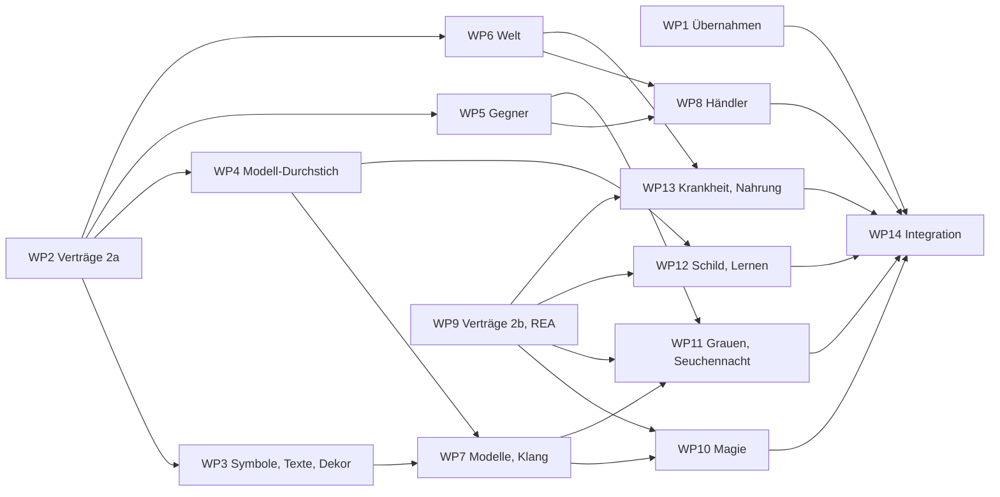

# Plan-0002: Phase 2 — „Leben in der Welt"

- **Status:** Entwurf — nicht abgenommen
- **Datum:** 2026-11-22
- **Autor:** LupusMalus (Solo-Projekt mit Claude)
- **Basis-PRD:** Standalone — Grundlage sind [GDD](../GDD.md) §4, §5 (Roadmap Phase 2), §7 und §8,
  die Feature-Dokumente F-02, F-06, F-07, F-09, F-10, F-11, F-15, F-16, F-17, F-19, F-21, die
  Prüfungen [0002](../pruefung/0002-erscheinung.md) und [0003](../pruefung/0003-gdd-setting.md) und
  die drei Konzeptpapiere unter [`docs/konzept/`](../konzept/)
- **Verantwortlich:** LupusMalus
- **Zielversion:** 7 Days to Die V 3.40, Build 10 (D52)
- **Vorgänger:** [Plan-0001](0001-phase-1-mvp-700-und-grauen.md) — gebaut, **nicht abgenommen**

> **Markierung jedes Schritts** nach globaler Arbeitsanweisung:
> `[Claude-prüfbar]` erledigt Claude vollständig samt Prüfbefehl ·
> `[braucht Nutzer]` braucht einen Spielstart, eine Installation, ein Urteil am Bildschirm, eine
> Abnahme oder eine Entscheidung.
> Die Nutzer-Punkte stehen am Ende noch einmal gesammelt als Prüfliste, die Entscheidungen im
> Abschnitt „Entscheidungen für den Nutzer" (`P2-E01 …`).
>
> **Größen:** je Schritt in Klammern — S bis 1 Tag, M bis 3 Tage, L bis 1 Woche. Je Paket gilt die
> Zahl in Arbeitstagen, in der Zählweise von Plan-0001; die Schrittgrößen sind eine Lesehilfe für
> die Reihenfolge, keine zweite Rechnung.
>
> **Fundstellen** stehen als `Datei:Zeile` oder Abschnitt dabei. Was nicht gemessen ist, heißt
> „ungemessen" oder „unbelegt".

## Stand der Schritte (autonomer Lauf)

Fortgeschrieben bei jedem Arbeitsschritt. „Gebaut" heißt: lokal committet, Prüfbefehl gelaufen,
**nicht** im Spiel gesehen und **nicht** abgenommen.

| Schritt | Stand | Wo |
|---|---|---|
| WP1.1 Übernahme-Inventar | geschrieben: 101 Zeilen gelesen (Plan-0001 Prüfliste und „Offene Punkte", N-01 bis N-51), jede hat ein Ziel. Neu dafür: zehn Zeilen im Spieltest (S-14 bis S-23, Teil B) und sieben Entscheidungen, die nur in Plan-0001 standen (N-52 bis N-58); S-08 berichtigt (braucht keinen Mitspieler); fünf Punkte ohne Ziel haben einen Vorschlag. WP1.7 bis WP1.9 hier nachgezogen | 0000-entscheidungen Abschnitt 8, Abschnitt 6 |
| WP1.2 Vertrag 01, Nachtrag „Test-Überlagerung" | geschrieben (Abnahme offen); abweichend vom Schritt liegt das Modlet unter `test/`, nicht unter `mod/` — so kann es nicht ins Paket geraten | Vertrag 01 „Nachtrag Phase 2, Teil 1", N-19 |
| WP1.3 Test-Überlagerung für T0 | gebaut: acht Lichtquellen auf `GrowthRate` 2; `build.ps1 -MitTest`, `smoke.ps1 -MitTest`, zehnte Prüfung, 18 Gegenproben. Installation nicht ausgeführt | `test/README.md`, S-06 |
| WP1.4 Textlücken, erster Stapel | gebaut (241 Zeilen) | `a3335ef`, D129 |
| WP1.5 Biom-Fortschritt, Weg A | gemessen (Finding F-17: `sandbox_override` setzt keinen Wert, der Optionscode ist rechenbar) und gebaut: eine vorgewählte Vorlage „Jahr 700" mit genau einer geänderten Einstellung; die Voreinstellung als Dokument | `docs/konzept/voreinstellung-700.md`, D136, N-32, N-13, S-11 |
| WP1.6 Vier Phase-1-Lücken | **vier von vier gemessen und gebaut:** Wasser gemessen — erreichbar, nichts gebaut (D134); Infektion gemessen und gebaut — Kräutersud (D133, N-30); Stromaufträge gemessen und gebaut — neue Auftragsregel der Sperrliste, drei Patchzeilen, acht Gegenproben (D135, N-31, N-14); Herausforderungen gemessen (35 = 16 Biom-Reihen + 9 + 10), neun mit lebendem Gegenstück umgebogen, 27 Textzeilen (D137, N-33, N-12); das Prüfwerkzeug findet unerfüllbare Ziele jetzt selbst (`unerfuellbares-ziel`, Zielaufschub, elf Gegenproben; D138, N-34); Finding F-18 gelesen; die zehn ohne Gegenstück entfernt, Verweise ins Leere und leere Gruppen prüft das Werkzeug (D139). Am Vorlauf 165 Herausforderungen, 16 unerfüllbar (Biom-Reihen, aufgeschoben an WP6.3). **Alle vier Lücken bearbeitet** | S-10, S-12, S-13, S-01 |
| WP2.1 „Phase 2 fertig heißt …" | als Vorschlag in GDD §5: fünf prüfbare Sätze und die Teilung 2a/2b | D140, N-72 |
| WP2.3 bis WP2.5 Nachträge zu den Verträgen 01, 02, 03 | geschrieben (Abnahme offen), nichts gebaut: vier neue Modlets und die Ablage der Assets; Präfixe und Namensmuster; die 52 Stammdateien vollständig gelesen, „sperren statt löschen" für Wesen. Fünf Stellen tragen `[verifizieren]` | D141, N-35 |
| WP2.2 Vertrag 05 (Entwurf) | geschrieben, am 2026-11-23 in drei Punkten präzisiert | `b2ddada`, N-71, N-18 |
| WP2.6 c/d, WP2.7 Prüfungen *symbole* und *asset-register* | gebaut, 27 Gegenproben | Vertrag 04 „Nachtrag Prüfungen der Phase 2, Teil 1" |
| WP2.6 a, WP2.7 Prüfung *wesen* | gebaut, in `anachronisms`: Wesenregeln `wesen:<Muster>` für Landschaftsgruppen, Verweise ins Leere, leere Gruppen; sechs Gegenproben. Die Sperrliste trägt noch keine Wesenregel (kommt mit WP5.4). Messung für WP5.4: 26 von 78 Klassen in den Landschaftsgruppen tragen einen der 17 neuzeitlichen Grundnamen | Vertrag 04 „Nachtrag Prüfungen der Phase 2, Teil 2", D142, N-36 |
| WP3.2 Beleg: Symbole aus dem Modlet | geschrieben | `57f721d`, Finding F-16 |
| WP3.3 Lizenzlage Meshy | gelesen; **Meshy gesperrt** (HTTP 402 auf dem Gratis-Tarif) | Vertrag 05 §5.1, N-64 |
| WP3.4 Symbol-Durchstich Silberpfennig | gebaut (Blender statt Meshy) | `f174d69`, D131, N-28, S-09 |
| WP3.6 Eigene Symbole, Rang 0 | **begonnen:** Schmiedeeisen, Tiegelstahl, Klinge (3 von rund 40). Offen: Trinkglas, die umgedeuteten Waffen, zwölf Rüstungsteile — organische Formen warten auf Meshy (N-64) | D132, N-29 |
| WP3.7 Denylist ergänzen | **gemessen, nichts gebaut:** alle sechs Kandidaten aus Prüfung 0002 §8 Nr. 2 sind ausdrückliche Freigaben der Sperrliste (D54 bis D56, abgenommen) — der Schritt braucht den Nutzer. Je Kennung Stand und Empfehlung; der Plasmastab existiert in V 3.40 nicht mehr | N-38, N-55 |
| WP3.8 Dekor der freien Landschaft | gebaut: 55 Dekor-Zeilen entfernt (12 Minen, 10 Wracks, Radkappen, Reifen, Schlackensteine, Schrotthaufen, Fässer, Müll) mit 30 Patchzeilen; gezählt an der Datei sind es 55, nicht 63. Angesehen und nicht angefasst: die 28 Zeilen `cnt…RandomLootHelper` (der Code entscheidet, was sie hinstellen), Kakteen, Straßen | D144, N-39, S-24 |
| WP3.9 Texte, nächste Stapel | **begonnen:** sechs Beschreibungen, die auf einen fremden Text zeigten (Schwere Armbrust, Feuertopfbolzen, Lamellenbesatz, Bogenteile, Rüstungsteile, leerer Wasserkrug) — fünf Patchzeilen, sechs Sprachzeilen. Offen: Rangtitel mit altem Perk-Namen; Behälter | D143, N-37, N-59, S-07 |
| WP4.1 Finding „Asset-Referenzen" | geschrieben (statisch): Bundle-Form `#@modfolder:…?<Asset>` und `#@modfolder(<Name>):…`, Endung frei, Asset-Name ohne Ordner; Gegenstände, Blöcke und Wesen laden über denselben Lader; **kein Material für Gegenstände aus XML**, für Wesen `AltMats`/`SwapMats`; Modell hängt ohne Versatz unter `Gunjoint`. Offen und nur im Spiel zu klären: Shader, Achsen in der Hand, Verhalten eines Wesens ohne `Game/Character`. 13 Soll-Signaturen in `tools/meta/expect/wp41.tsv` | `docs/rea/findings/F-16-asset-referenzen.md`, D146, N-66, S-25, Vertrag 05 §7 |
| WP4.2 Quell-Modelle ohne Unity | **Rundschild gebaut** (Blender-Skript, 1994 Dreiecke, drei gebackene Texturen 1024², GLB und FBX unter `dist/modelle/rundschild/`, zwei Ansichten im Repository); zwei Läufe ergeben dasselbe GLB Byte für Byte. Nicht in Unity und nicht im Spiel gesehen. **Offen:** das Meshy-Requisit (Meshy gesperrt, N-64) | D145, Vertrag 05 §7.1, N-65 |
| WP5.1 F-06 ausarbeiten | geschrieben: Messung (155 Klassen, 36 Grundnamen, 21 Tierklassen, 29 Landschaftsgruppen), vier Stufen, Namenstabelle DE/EN für alle Grundnamen und Tiere, Sagengestalten auf gemessener Basis, Spawn-Mix je Landschaft, „neun heraus, sechs bleiben", Frauen und Männer, Besitzer von „mehr Gefahr". **Nichts gebaut.** Offen: WP5.2 (Vertragsbezug), dann WP5.3 Namen | `docs/features/F-06-seuchentote-bestiarium.md`, D147, N-67 |
| WP5.2 Vertragsbezug | geprüft, drei Stellen in F-06 berichtigt: Namensmuster „Seuchentoter Knecht" (Vertrag 02 Teil B), Modlet `700_65_Wesen` statt `60_Welt` (Vertrag 01), Präfix `eg700_` für Gruppen (Vertrag 02 Teil A). Gelesen: wo ein Wesen-Name im Spiel erscheint (Meldungen im Chat, Karte, Twitch) | F-06 §2, Umsetzung |
| WP5.3 Namen | **gebaut:** 176 Sprachzeilen (155 Seuchentote, 21 Tiere) aus Tabelle und Erzeuger `tools/gen/wp5-wesen-namen.*`; 176 Schlüssel in `vanilla-keys.txt`; 55 Grundnamen als Vorschlag im Glossar, Prüfung *Glossar gegen Sprachdatei* grün. Vier Gegenproben des Erzeugers. **Offen:** die Sperrliste trägt noch keine Wesenregel (kommt mit WP5.4); im Spiel nicht gesehen | D148, N-67, S-26, Vertrag 04 Nachtrag WP5.3 |
| WP5.4 Gruppen | **gebaut (Landschaften):** Finding `docs/rea/findings/F-06-wesengruppen-laden.md` (fehlende Klasse, leere Gruppe, fehlende gerufene Gruppe = Ladefehler; erster Eintrag entscheidet über „Feindgruppe"; 10 Soll-Signaturen, verify Exit 0, Gegenprobe Exit 1). `purge-patch` kennt Wesenregeln (neun Gegenproben W7–W15); elf Wesenregeln in der Sperrliste; erzeugt `700_10_Purge/Config/entitygroups.xml` (72 Zeilen, 17 Klassen, 14 Gruppen). Neues Modlet `700_65_Wesen` (5 Zeilen: Nachrücker Sandheide-Nacht, Wolf statt Kojote und Berglöwe); `smoke.ps1` erwartet neun Modlets. Vorlauf: 9 Modlets, 2863 Operationen, 0 ohne Treffer; *anachronisms* am Vorlauf 0 rot. **Offen:** Gruppen je **Spielstufe** (Seuchennacht, Horden) sind WP5.6; im Spiel nicht gesehen; am alten Dump 17 neue rote Zeilen bis zum Spielstart (N-01) | D149, N-68, S-27, Vertrag 04 Nachtrag WP5.4 |
| WP5.5 Sagengestalten | **gebaut:** Finding `docs/rea/findings/F-06-wesen-farbe-und-stufen.md` (Farben sind `<color>`-Knoten, `MatColor` ist eine Leuchtfarbe und wird erst beim Erscheinen nachgeschlagen; Stufen gemessen — kein Stromschlag, kein Brand; 5 Soll-Signaturen, verify Exit 0, Gegenprobe Exit 1). **Spukhund** `ent700_spukhund` als eigene Klasse in `700_65_Wesen` (400 Lebenspunkte, Größe 1,2, Farbe `col700_spuk`), zwei Gruppen-Einträge, eine Sprachzeile, eine Glossarzeile. Prüfung `wesen-farbe-fehlt` mit zwei Gegenproben. Vorlauf: 2866 Operationen, 0 ohne Treffer. Nachzehrer, Schreiende, Moorleiche: Namen seit WP5.3, sonst nichts in XML zu tun. **Offen:** Irrlicht und Moorgeist (WP7); Name gegen Farbe der dritten Stufe (N-69); im Spiel nicht gesehen | D150, N-69, S-28, Vertrag 02 und 04 Nachträge |
| WP5.6 Seuchennacht-Gruppen | **gebaut, von niemandem gerufen:** Blockschaden aller Klassen der 322 Vanilla-Hordengruppen gemessen (Berstender 500, Verdammte 250, Büttel/Muhme/Hirte/Felswerfer/Moorleiche 100–200; Krieger 40, kein Brecher). Fünf Gruppen `eg700_brecherFrueh/Mittel/Spaet`, `eg700_anfuehrerFrueh/Spaet` (31 Einträge) in `700_65_Wesen`. Vorlauf: 2867 Operationen, 0 ohne Treffer; Prüfung *wesen* 1880 Gruppen, 0 Verweise ins Leere, 0 leere Gruppen. **Offen:** Einbau in `gamestages.xml` (F-09, WP11) | D151, N-96 |
| WP6.1 F-07 ausarbeiten | **geschrieben** (Teil „Ausarbeitung für Phase 2" in F-07): Messung (1 105 Orte, 487 mit Auftragsmarke je Stufe, 5 Händlerorte, Händler entstehen mit Ortschaften; 551 von 552 Neuzeit-Deko-Blöcken sind Modell-Blöcke), die fünf Landschaften nach biome.md, **Bedarfsrechnung** (elf Ortsentwürfe, zehn mit Auftragsmarke; eigener Händlerort; Siedlungsart „Weiler"), **Welt von 2a: Weg B + C** (weglassen + umkleiden), Wege, Nebel, Automaten, Beute, Fertigkarten, Reihenfolge. **Offen:** drei [verifizieren] für WP6.2 (Händler und Siedlungen, Auftragsreichweite, Modell-Tausch in mehrfeldrigen Blöcken) | D152, N-97 |
| WP6.2 Finding „Zufallswelt und Orte" | **geschrieben** (`docs/rea/findings/F-07-zufallswelt-und-orte.md`, Soll-Signaturen `tools/meta/expect/wp62.tsv`, 15 Zeilen, verify Exit 0, Gegenprobe Exit 1): `spawn_trader` wird geladen, aber nirgends gelesen — Händler sind gewöhnliche Orte über `prefab_spawn_adjust`; Fernstraßen hängen an `spawn_gateway`; Auftragsziele kommen aus dem Umkreis des Händlers nach Stufe; Orte speichern Blöcke per Name, darum trägt ein `<set>` auf `Model` (Weg C). **Unbelegt:** Wirkung von `max_count="0"`, ein Ort ohne Editor. **Offen:** S-29 (kleine Testwelt, 15 Minuten) | D153, N-98, S-29 |
| WP6.3 Biom-Fortschritt Weg B, Teil 1 (Mechanik) | **gebaut** (`700_60_Welt`: `items.xml`, `recipes.xml`, `challenges.xml`; Sperrliste: sechs Freigaben; Aufschub: vier Zeilen gestrichen, `=kein-aufschub`): Sude und Schutzstücke aus freien Zutaten, Ziele Erz und Zeug umgebogen. Am Vorlauf: 165 Herausforderungen, **0 unerfüllbar** (Ziel des Schritts: 0 gesperrte Kennungen in den Reihen); Gegenprobe ohne `challenges.xml`: 6 rot. **Offen:** Teil 2 Texte (§3.2–3.6), danach Vorlage auf „an" | D154, N-99, S-30 |
| WP6.3 Teil 2 (Texte, Vorlage) | **gebaut:** 165 Sprachzeilen (Schutzstücke, Sude, Gefahr, Stürme, die vier Reihen); Vorlage „Jahr 700" ohne `CDA`, der Biom-Fortschritt ist an. **WP6.3 damit abgeschlossen** bis auf S-30 im Spiel | D155, N-100, S-30 |
| WP6.4 Landschaften | **gebaut:** sechs Anzeigenamen `biome_*`; Bewuchs getauscht (30 Zeilen Kaktus, Yucca, Schneebeere → Heidestrauch, dürrer Busch, Aloe, Heidelbeere, verschneiter Busch; am Vorlauf 0 übrig, Vanilla 30). Wetter, Sturmtexte und Nebel brauchen nichts Neues (D97, WP6.3, D72). Glossar um 16 Zeilen ergänzt (Landschaften, Schutzstücke, Sude, Ernte). **Offen:** P2-E13 (N-101), S-30 | D156, N-101 |
| WP6.5 Filter Zufallswelt | **gebaut:** `700_60_Welt/rwgmixer.xml` — 7 Siedlungsarten auf `0, 0, 0` in allen vier Größen (28 Zahlen), 17 Neuzeit-Namensteile mit `weight="0.01"` (nicht `max_count="0"`, D153), Tankstellen-Pflicht weg; Händlerzeilen unberührt. Fabrik, Militärbasis, Red Mesa, Heerlager bewusst ungedämpft (Stufe 5). Vorlauf 2920 Operationen, 0 ohne Treffer; Gegenprobe greift. **Offen:** N-102, S-29 (1)–(3); Prüfung *welt* gibt es noch nicht (WP2.6) | D157, N-102 |
| WP6.6 Eigene Orte | **nicht begonnen, wartet auf den Nutzer:** ein Ort entsteht nur im Editor des Spiels (Finding F-07-zufallswelt-und-orte §5); wer baut, ist N-98. Die Entwürfe stehen in F-07 Abschnitt C | N-98 |
| WP6.7 Erzählende Umgebung | **gebaut (Schriften):** zehntes Modlet `700_70_Handel` mit zwölf Fundschriften `itm700_schrift…` (Erbe von `blankNoteMaster`, Text als Beschreibung, bleibt beim Lesen), 24 Sprachzeilen DE/EN, Beute-Gruppe `lg700_schriften` in sieben Vanilla-Gruppen (5–20 %); `smoke.ps1` erwartet zehn Modlets. Vorlauf 10 Modlets, 2929 Operationen, 0 ohne Treffer; Gegenprobe: falscher Beschreibungsschlüssel → *Sprachschlüssel* 2 rot. **Offen:** Requisiten und Inschriften an Orten (mit WP6.6), N-103, S-31 | D158, N-103 |
| WP8.1 F-10 ausarbeiten | **geschrieben** (F-10 Teil „Ausarbeitung", nichts gebaut): Messung (5 Händler, 4:05–21:50, 9 Auftragsarten, 347 + 55 Auftragstexte, 51 mit Neuzeit-Wörtern), fünf Posten mit Namen (Köhlerhof und Fährhof neu), Öffnungszeit 5:00–20:00, Auftragsarten gedeutet, Stimmen, Erscheinung, Reihenfolge. **Lore-Rahmen** `docs/lore.md`. **Offen:** N-104; Stufe 6 und ihre Orte [verifizieren] in WP8.4 | D159, N-104 |
| WP8.4 Aufträge, Teil 1 (Texte) | **gebaut:** 114 Sprachzeilen — alle Händleraufträge (Titel, Angebote, Abschlüsse), sieben Hortbriefe, der Weg zum nächsten Posten, Einführungshinweise, Reiter „Landschaften". Glossar: Personen in §11, Sperrmuster `white.?river`, `cassadore`. Sperrmuster vorher gegen die neuen Zeilen gelaufen: 0 Treffer; Prüfung *Glossar* 103 Muster, 0 abweichend. **Offen:** 276 Auftragszeilen (45 mit Neuzeit-Wörtern: Herausforderungs-Briefe, BasicSurvival), Stufe 6 [verifizieren], N-105 | D160, N-105 |
| WP8.4 Aufträge, Teil 2 (Texte) | **gebaut:** 55 Sprachzeilen — Händlergespräch (mit dem unerreichbaren Zweig „Hintergrund" nach lore.md), Lohn-Meldungen der Biom-Reihen, Sammelzeichen, Hort, Sperr-Meldungen. Reichweite gemessen: die 34 übrigen Neuzeit-Zeilen haben keinen Verweis in den Stammdateien. **WP8.4 Texte damit fertig** bis auf Stufe 6 [verifizieren] und N-106 (Zweig „Hintergrund" erreichbar machen?) | D161, N-106 |
| WP8.3 Sortimente | **gebaut:** `700_70_Handel/Config/traders.xml` — Schwerpunkt-Block jedes Händlers geleert und nach F-10 B neu gefüllt (9 bis 22 Einträge), unsere zwölf Rüstungsteile beim Fürstenhof, Öffnungszeit 5:00–20:00. Vorlauf 2937 Operationen, 0 ohne Treffer; *anachronisms* und *recipes* am Vorlauf 0 rot; Gegenprobe (Pistole) 1 rot. **Offen:** N-107; Lehrmeister mit eigenen Abschriften warten auf WP10/WP12; leere Rüstungsgruppen im allgemeinen Block (WP8.6) | D162, N-107 |
| WP8.5 Teil 1 Namen | **gebaut:** 42 Sprachzeilen — Namensschild, Sprecher, Postenname auf Karte (je zwei Orte), sieben Herausforderungen und ihre Gruppe; Glossar §11 mit 21 neuen Festbegriffen und 7 Verbotsmustern. Glossar-Prüfung 233 Festbegriffe, 110 Muster, 0 rot; Gegenproben: „Händler Rekt" → 1 rot, ein verändertes Namensschild → 2 rot. **Offen:** Teil 2 — Finding `TraderDialog` (Stimmen aus), kurze eigene Rede; N-106 (Zweig „Hintergrund"); N-108 | D163, N-108 |
| WP8.5 Teil 2 Stimmen | **Finding** `docs/rea/findings/WP8-haendlerstimmen-traderdialog.md`: `TraderDialog` = Ja/Nein 126, Vorgabe ein → Feld `TraderInfo::TraderDialog` → gelesen nur in `EntityTrader::PlayVoiceSetEntry` (187 Typen durchsucht); Lautsprecher-Ansagen (`BlockSpeakerTrader`) lesen es nicht. **Gebaut:** `EWA` im Code der Vorlage, Beschreibung nachgezogen. **Offen:** N-109 (Lautsprecher), Dedicated-Test; eigene kurze Rede der Figur geht ohne Klang nicht — Notiz Phase 3. **WP8.5 damit fertig bis auf N-106/N-108/N-109** | D164, N-109 |
| WP8.6 Beute | **gebaut:** F-05 „Beute in 700" (Messung, Bau, Plan je Ort); `700_70_Handel/Config/loot.xml` füllt sechs leere Vanilla-Gruppen (Heilmittel, Konserven, Munition, Getränke, Rüstung, Altmetall). Vorlauf 2943 Operationen, 0 ohne Treffer; leere Gruppen 240 → 227; 53 Behälter mit mehr Beute; Rüstung in 26 Behältern; *anachronisms* und *recipes* am Vorlauf 0 rot; Gegenprobe (Pistole in `groupAllArmor`) 1 rot. **Offen:** N-110; Beute je Ort wartet auf WP6.6 | D165, N-110 |
| WP8.2 Vertragsbezug | geprüft gegen Vertrag 01–03 (F-10 G2): sieben Punkte passen, **eine Abweichung berichtigt** — Namensschild der Händler jetzt „Amt + Name" nach Vertrag 02 Teil B (zehn Sprachzeilen, zehn Glossarzeilen; Glossar-Prüfung vorher 16 rot, danach 0 rot); Hinweis in Vertrag 03 B zu `subtitles.xml`. **WP8 damit fertig bis auf WP8.7 (Testlauf, braucht Nutzer) und N-104 bis N-110** | D166 |
| WP9.7 Gegenprobe Signatur-Check | **gemacht, mit Befund:** `mod700meta verify` gegen alle Soll-Dateien grün (6 Dateien, 64 Zeilen; neu `wp85.tsv` für das Händlerstimmen-Finding). Gegenprobe an vier falschen Fassungen: geänderte Signatur, fehlender Typ, fehlendes Member je Exit 1 — eine **vertippte Member-Spalte lief grün durch** (die Spalte diente nur der Meldung). **Berichtigt:** neues Urteil `member-mismatch` in `tools/meta/Mod700.Meta/Program.cs`; danach alle vier Exit 1. Werkzeug neu gebaut (0 Warnungen, 0 Fehler) und signiert (exe und dll `Valid`). | tools/meta/README.md, patch-manifest.md |
| WP9.1 Vertrag 06 | **Entwurf geschrieben** (D167, N-111): Modulgrenzen, Patch-Kopf, Patch-Arten, Register statt `PatchAll`, Schalter je Patch, Netz-Wachen, Verhalten bei fehlendem Ziel, Tests und Build; Abgleich mit dem Code (§11). Neue Soll-Dateien `v06-harmony.tsv` (5 Zeilen, gegen das vorgeladene HarmonyX) und `v06-kern.tsv` (3 Zeilen): `verify` je Exit 0, Gegenprobe (falscher Rückgabetyp) Exit 1. Abnahme in WP9.8. | contracts/06, contracts/README.md, patch-manifest.md |
| WP9.2 Vertrag 07 | **Entwurf geschrieben** (D168, N-112): Zustände je System mit einem Schreiber, Neustart-Übersicht, Regler aus/mild/voll als `cv700_grauenDaempfung` (0 = voll), Nahtstellen (`buff700_amfeuer` senkt das Grauen). **Neu gelesen:** `EntityBuffs::SetCustomVar` prüft das erste Zeichen auf `%`, `.`, `_` vor dem Senden, `Write` auf `.` vor dem Speichern — Indiz, Bestätigung S-32. Soll-Datei `v07-zustaende.tsv` (5 Zeilen): `verify` Exit 0, Gegenprobe Exit 1. | contracts/07, Vertrag 02 Klarstellung 1, S-32 |
| WP9.3 Findings F-21, F-02 | **gemacht, mit Befund** (D169, N-113): Vanilla zählt fertige Stücke beim Spieler (`_craftCount_<Gegenstand>`, `XUiC_RecipeStack::giveExp`, nachgereicht über `TileEntityWorkstation::CheckForCraftComplete`); `onSelfItemCrafted` wird nicht ausgelöst → Lernen durch Herstellen wahrscheinlich **ohne Patch**. `DamageEntity` rechnet beim Besitzer; keine zweite Hand; `ItemActionThrownWeapon` vorhanden, ungenutzt; Qualität `ushort`. Soll-Datei `wp93.tsv` (11 Zeilen): `verify` Exit 0, Gegenprobe Exit 1. Im Spiel: S-33. | findings/WP9-herstellen-und-schaden.md, hook-hypothesen.md, patch-manifest.md, F-21, Vertrag 07 §3.5 |
| WP9.4 Findings F-17, F-09 | **gemacht, mit Befund** (D170, N-114): 79 Buff-Bedingungen aus der DLL; `CompareLightLevel` (Licht am Spieler), `IsBloodMoon`, `IsAlly`, `IsLocalPlayer`, `IsDayNumber`, `GameStatInt` `BloodMoonDay`; Ziel-Arten `selfAOE`/`selfOtherPlayers` für „Mitspieler in der Nähe"; Wetter `bloodMoon` je Biom. Grauen damit XML, C# nur der Direktor (Planer `AIDirectorBloodMoonComponent`, `AIDirectorWanderingHordeComponent`). Nicht gelesen: Tierlaute, Vortag als XML-Differenz, ob ein Spektrum im Wetter das Rot ersetzt. Soll-Datei `wp94.tsv` (14 Zeilen): `verify` Exit 0, Gegenprobe Exit 1. Im Spiel: S-34. | findings/WP9-licht-und-seuchennacht.md, hook-hypothesen.md, F-17, F-09, Vertrag 07 |
| WP9.5 Findings F-15, F-19 | **gemacht, mit Befund** (D171, N-115): Odem-Kosten per XML (`ItemAction.ExecutionRequirements` aus `<requirement>` in `<action>`, `CanExecute`); Projektil-Klassen da; keine Meide-Zone (31 `EAI*`) → Bannkreis als Aura; vier `BiomeBadge`-Plätze für Amulette; Fertigkeitsleiste 8 Felder → 9 per XUi; Verderb nach Zeit **nicht** in XML (Metadaten ja, Zeitwert nein). Soll-Datei `wp95.tsv` (8 Zeilen): `verify` Exit 0, Gegenprobe Exit 1. Im Spiel: S-35. | findings/WP9-odem-und-verderb.md, hook-hypothesen.md, F-15, F-19, Vertrag 07 §3.4 |
| WP9.6 Triage | **gemacht** (D172, N-116): 21 Kandidaten. **Phase 2 braucht keinen Harmony-Patch.** 14× XML reicht (teils mit Asset), 1× XML vielleicht (Farbe der Seuchennacht), 3× **C# ohne Patch** über die Mod-API (Regler, Direktor, Vorboten — viertes Urteil, neu), 1× Patch in Phase 3 (Schild), 1× rutscht (Verderb mit Uhr; dazu rutscht die Meide-Zone als Teil des Bannkreises), 1× offen (Tierlaute). „Warum nicht XML?" in F-02, F-09, F-15, F-17, F-19, F-21. Zwei neue Punkte: WP9.9 (Feldprüfung in `verify`), WP9.10 (Test-Überlagerung für S-32 bis S-35). | rea/triage-phase-2.md, sechs Feature-Dokumente, patch-manifest.md |
| WP9.9 Feldprüfung | **gemacht:** `mod700meta verify` prüft Felder (Zeile `[static ]Typ Deklarierer::Name`, ohne Klammern); `members` gibt je Feld die Zeile aus. Neue Feldzeilen: `ModEvents::GameUpdate`, `PlayerSpawnedInWorld` (`v06-kern.tsv`), `GameStartDone`, `PlayerLogin` (`f00.tsv`). Alle 12 Soll-Dateien: 114 Zeilen, Exit 0. Gegenproben: vier Feld-Fehler (Typ, `static`, fehlt, Spalte) je Exit 1, drei alte Methoden-Gegenproben weiter Exit 1. `dotnet build -c Release`: 0 Warnungen, 0 Fehler; exe und dll signiert, `Valid`. | tools/meta (Program.cs, Naming.cs, README.md), patch-manifest.md, triage |
| WP9.10 Test-Überlagerung, Teil 1 | **Regeln gebaut** (D173, N-117): Vertrag 01 Nachtrag Teil 1d (Proben `t700_…` per `<append>`), `testueberlagerung-pruefen.ps1` Regeln 7–9, Gegenproben 311 → **316, 0 fehlgeschlagen** (5 neu, 1 angepasst). Der erste echte Lauf fand einen Fehlalarm der neuen Regel 9 (`ent700_` enthält `t700_`, 4 falsche Befunde) — berichtigt mit Wortgrenze, Gegenprobe dazu. Teil 2 (die Proben selbst) folgt. | Vertrag 01, tools/check, test/README.md |

Offen aus WP2.6/WP2.7: *welt*, *textluecken*.

## Kontext / Motivation

**Phase 1 ist gebaut, aber nicht abgenommen.** Der Prüfbefehl
`powershell -File tools/check/check-all.ps1` endet mit 225 Gegenproben, 0 fehlgeschlagen; 7
Prüfungen, **1 rot** (Exit 1). Rot ist `erreichbarer-anachronismus: resourceRepairKit`; erwarteter
Grund: der Spiel-Dump von 22:08 stammt aus einem Start vor der Sperre des Reparatur-Kits. Am Vorlauf
sind alle sieben grün — ein Vorlauf ist kein Nachweis
([0000-entscheidungen](../pruefung/0000-entscheidungen-fuer-den-nutzer.md):14–21). Nichts ist
gepusht, die Mod liegt nicht im Spielordner. Der Abschluss von Phase 1 (Plan-0001 WP9: Durchlauf bis
nach der ersten Seuchennacht, Balancing, Rückschau, Release-Entscheidung; Plan-0001:1786–1807) hat
nicht stattgefunden, und D92 bis D130 sind Vorschläge und Bauten des Nachtlaufs ohne Abnahme
(GDD.md:388–397).

**Dieser Plan entsteht trotzdem jetzt**, weil der Nutzer am 2026-11-22 autonomes Arbeiten „bis Ende
Phase 2" beauftragt hat, mit der Auflage, jede Entscheidung zu notieren
(0000-entscheidungen:6). Das steht quer zu D50 („jede Phase endet mit Playtest", GDD.md:211: „Erst
dann beginnt die nächste") und zur globalen Regel „Verträge zuerst … erst dann wird gebaut". Der
Plan löst das nicht still auf, sondern legt es als P2-E01 und P2-E02 vor, baut bis zur Antwort nach
Empfehlung und führt den Rückbau als Risiko R1.

**Was Phase 2 ist** (GDD.md:221): „Optischer Bruch geschlossen, Magie und Furcht da, Welt erzählt" —
F-16 zuerst, dann F-06, F-07, F-09, F-11, F-15 (Kern), F-17 (Rest), F-02 (Rest), F-19 (Basis), F-21
(Learning by Doing), F-10 (Basis). Technisch ist es die erste Phase mit **eigenen Assets** und mit
**Harmony-Patches**: das Patch-Manifest ist heute leer
([patch-manifest.md](../rea/findings/patch-manifest.md):9–13), und Phase 1 kam ohne eine Zeile C#
im Spielpfad aus.

**Vier Messwerte vom 2026-11-22 ordnen die Asset-Arbeit:**

1. Das Spiel läuft auf Unity **2022.3.62f2** (gemessen: ProductVersion der `UnityPlayer.dll` im
   Spielordner; deckt sich mit Spec 01:12 und :87).
2. **Kein Unity-Editor ist installiert** (gemessen: keine Hub-Liste, kein Editor-Ordner, kein
   Eintrag in der Deinstallationsliste). Eigene 3D-Modelle brauchen ein Asset-Bundle und damit den
   Editor; Installation und Lizenz-Anmeldung kann nur der Nutzer.
3. **Blender ist installiert** (Steam, `X:\SteamLibrary\steamapps\common\Blender`), läuft aber
   nicht. Blender-Skripte sind Python; im Projekt gilt das Python-Verbot.
4. **Symbole brauchen kein Unity** (gemessen): Vanillas Symbole sind lose PNG-Dateien, 160×160,
   32 Bit mit Alpha (`Data\ItemIcons`, 5 261 Stück); `CustomIcon` wählt eines beim Namen — im
   Nachtlauf an acht Gegenständen so gebaut (D130). **Ungemessen:** ob ein Modlet eigene PNGs in
   einem Ordner `ItemIcons` mitliefern kann (bekannte Modding-Praxis, für V 3.40 hier nicht belegt).

Dazu am selben Tag nachgesehen: Git LFS 3.8.1 ist installiert, eine `.gitattributes` gibt es nicht;
die Ordner `assets/` und `unity/` aus F-16 (F-16:21–27) gibt es nicht; `dotnet` 10.0.402 ist da.

**Folge:** „Eigene Symbole" ist das früheste Asset-Paket und ohne Unity machbar (WP3). „Eigene
Modelle" hängt am Unity-Editor und damit am Nutzer (WP4, WP7).

**Was Phase 2 nicht ist** (D50, nur als Notiz): F-13 Transport, F-14 Siedlung und Gesellen, F-20
Kult und Plünderer, Viehhaltung (F-19), Bann-Aufträge, Lore-Ketten und Eskorte (F-10), Gesellen
(F-04), Hochmagie und Wegsteine, die eigene Karte mit Küste und Westrand (F-07, D4), der tragbare
Runenstein und die Drohne als dienstbarer Geist (GDD.md:116, F-15:114–120), Kulturkreis-Varianten
von Waffen und Rüstung (waffen.md:1097–1098, ruestung.md:724), härtere Todesfolgen (Q17, P2-E20).

## Ziele

Messbar; die prüfbare Fassung steht unter „Erfolgskriterien".

- **Z1** Phase 1 ist ehrlich geschlossen: der Prüfbefehl ist an einem Dump des aktuellen Standes
  grün, die offenen Abnahmen sind entschieden, und was aus dem Nachtlauf „zu prüfen" ist, ist
  angenommen oder zurückgebaut.
- **Z2** Es gibt **einen reproduzierbaren Weg** vom Quell-Asset ins Spiel — für Symbole ohne Unity,
  für Modelle mit Unity — und jedes ausgelieferte Stück steht mit Quelle, Autor und Lizenz im
  Asset-Register (F-16:52–55).
- **Z3** Der optische Bruch ist für die **Rang-1-Liste** geschlossen (Symbole der Kernwirtschaft und
  der umgedeuteten Waffen und Rüstungen, die Waffen und Garnituren aus WP7), nachgewiesen je Kennung.
- **Z4** Gegner und Welt tragen das Setting: kein Wesen mit modernem Namen in einer Spawn-Gruppe,
  eine neue Zufallswelt ohne Stadt- und Straßenstrukturen (F-07:50), eigene Orte mit Auftragsmarke
  (F-07:51), ein lösbarer Biom-Fortschritt (D128).
- **Z5** Volksmagie ersetzt die gesperrte Technik: Runen, Tränke, Segen, Runenstein der Glut, Odem
  (GDD.md:197; F-15:108–112).
- **Z6** Furcht und Seuchennacht sind da: das Grauen wirkt in Stufen und ist regelbar (D13, D14),
  die Seuchennacht hat eigenen Text, eigene Optik und Vorboten (F-09:27–29).
- **Z7** Schild und Learning by Doing laufen serverfest (F-02:188, F-21:51–52).
- **Z8** Heilkunde und Ackerbau stehen; Verderb nur, wenn die Schnittstellen-Prüfung einen kleinen
  Eingriff zeigt (P2-E24).
- **Z9** **Kein Harmony-Patch ohne Beleg:** jede Zeile im Patch-Manifest hat Finding, Soll-Signatur
  und einen grünen `verify`-Lauf, und ihre Server/Client-Zuordnung ist im Lauf mit Mitspieler
  bestätigt oder ausdrücklich als „nur statisch belegt" markiert (Projektregeln 2 und 5).
- **Z10** Jeder sichtbare Text der Phase 2 liegt auf Deutsch und Englisch vor (D7).

## Teilung in 2a und 2b

Die Quellen tragen die Teilung aus dem Vorschlag D119 (GDD.md:428: „erst Assets, Welt und Gegner;
dann Magie, Furcht und die ersten Patches"), mit drei Schärfungen:

| Teil | Inhalt | Art der Arbeit | Pakete |
|---|---|---|---|
| **Vorlauf** | Übernahmen aus Phase 1 | Papier, XML, ein Sammellauf im Spiel | WP1 |
| **2a** | Asset-Pipeline, Erscheinung und Texte, Gegner, Welt, Händler | XML, Bilder, Modelle; **kein Harmony-Patch** | WP2–WP8 |
| **2b** | Magie, Furcht, Seuchennacht, Schild, Learning by Doing, Krankheit, Nahrung | XML und die **ersten Harmony-Patches** | WP9–WP13 |
| **Abschluss** | Integration, Playtest, Rückschau | Messung und Urteil | WP14 |

1. **F-10 (Basis) liegt in 2a**, weil es an F-07 hängt (Handelsposten sind Orte;
   [features/README.md](../features/README.md):21) und kein C# braucht.
2. **F-11 und F-19 liegen in 2b**, weil F-11 an F-19 hängt (README:22) und der Verderb eine offene
   Schnittstellen-Frage ist (F-19:22).
3. **Papier für 2b läuft vor**: Verträge und statische REA-Findings für 2b (WP9) brauchen weder
   Spiel noch Entscheidung und werden parallel zu 2a geschrieben. Gebaut wird 2b erst danach — das
   ist Vorarbeit auf dem Papier, kein Vorziehen (D50, D119).

Das Katalog-README führt F-09 als abhängig von F-17 und F-17 als abhängig von F-09 (README:20, :28).
Dieser Plan baut beide darum in **einem** Paket (WP11).

## Arbeitsweise ohne Nutzer

Der Nutzer ist während der Umsetzung nicht erreichbar. Daraus sieben Regeln für jeden Schritt:

1. **Drei Tore öffnet Claude nie selbst:** Push (0000-entscheidungen, N-10), Installation in den
   Spielordner und Spielstart (0000-entscheidungen, N-11), Änderung einer abgenommenen D-Zeile oder
   eines schon gebauten Namens (Projektregel 4; „Kein gebauter Name ist geändert", GDD.md:432).
2. **Fehlt eine Entscheidung, wird nach der Empfehlung aus `P2-E…` gebaut** und der Bau trägt
   „zu prüfen": eigener Commit je Entscheidung, damit er einzeln zurückgenommen werden kann; eine
   Vorschlagszeile im GDD nach dem Muster von Abschnitt 7.8; ein Eintrag in der einen Liste
   (0000-entscheidungen Abschnitt 7, dort N-60 ff.).
3. **Verträge zuerst, Abnahme nachgereicht** (P2-E02): der Vertrag wird geschrieben, bevor gebaut
   wird; fehlt die Abnahme, trägt er „Abnahme offen" und der Bau darauf „auf Vertragsentwurf".
4. **Ein Vorlauf ist kein Nachweis.** Ein Schritt mit `[Claude-prüfbar]` endet am Prüfbefehl mit
   Zahlen; was erst das Spiel zeigt, steht als eigene Zeile in einem Testlauf T0 bis T4.
5. **Spieltests gebündelt** (Vorgabe des Nutzers, Plan-0001:2346–2350): fünf Testläufe für die ganze
   Phase, kein Test je Paket, keine Wartetests in Echtzeit. Zeitabhängiges läuft über eine
   **Test-Überlagerung** mit verkürzten Werten (WP1.2), die nie ins Paket kommt. Jeder Lauf hat ein
   Drehbuch mit erwarteter Dauer.
6. **Kein Python im Projekt.** Werkzeuge in C# (.NET) oder PowerShell wie bisher; Unity-Editor-Skripte
   sind C#. ~~Blender-Automatisierung ist Python und bleibt Claudes eigenes Werkzeug außerhalb des
   Repositorys, bis der Nutzer anders entscheidet (P2-E08).~~ *Entschieden am 2026-11-23:* Python
   ist für Blender-Skripte erlaubt; sie liegen unter `tools/assets/blender/` (N-61). Sonst bleibt
   das Verbot.
7. **Spieldateien nie ins Repo und nie ins Paket** — das gilt neu auch für Bundles: kein
   Vanilla-Mesh, keine veränderte Vanilla-Textur, kein Vanilla-Prefab in unseren Dateien (Spec 01
   §6; D84 b, GDD.md:335).

## Arbeitspakete (Workstreams)

Vierzehn Pakete. Das liegt über dem Rahmen von 3–12; darum die Teilung in 2a (sieben Pakete) und 2b
(fünf Pakete) mit eigenem Vertragspaket am Anfang jedes Teils und mit Meilensteinen an den vier
Testläufen. Jedes Feature, das Prüfung 0003 §7 „dünn" nennt (0003:377–396), beginnt mit der
**Ausarbeitung seines Feature-Dokuments**, nicht mit dem Bau.

---

### WP1: Übernahmen aus Phase 1

**Zweck:** Den Stand von Phase 1 ehrlich schließen oder ehrlich offen führen, bevor Phase 2 darauf
baut.
**Rolle:** Claude (Vorbereitung) → Nutzer (ein Sammellauf, Abnahmen)
**Schätzung:** M (5 Tage)
**Hängt an:** —

**Schritte:**

1. **WP1.1** `[Claude-prüfbar]` **Übernahme-Inventar.** Jeder offene Punkt aus Plan-0001 (Prüfliste
   2, 5–7, 11–25, Plan-0001:1936 ff.; Offene Punkte, Plan-0001:2323 ff.) und jede Zeile N-01 bis
   N-51 bekommt ein Ziel: Testlauf T0, ein Paket dieses Plans oder „bleibt in Plan-0001". Fortgeschrieben
   wird die eine Liste (0000-entscheidungen), nicht eine zweite. (S)
2. **WP1.2** `[Claude-prüfbar]` **Vertrag 01, Nachtrag „Test-Überlagerung"** (Entwurf, Abnahme
   offen): ein Modlet `700_99_Test`, das Timer verkürzt (Brenndauer, später Verderb, Odem,
   Grauen), nur mit einem Schalter von `build.ps1` installiert wird und nie im Paket liegt;
   `smoke.ps1` meldet rot, wenn es im Paket steckt (Gegenprobe). Plan-0001 nennt genau das „nicht
   entworfen" (Plan-0001:2349–2350). (S)
3. **WP1.3** `[Claude-prüfbar]` Test-Überlagerung für T0 bauen: Wandfackel und Kerzenstumpf mit
   kurzem Timer (0000-entscheidungen, S-06; Q33). (S)
4. **WP1.4** `[Claude-prüfbar]` **Textlücken:** erst messen, welche Zeilen aus D129 gebaut sind
   (N-26 nennt sie „folgt"; D129 hat in GDD 7.8 keine eigene Zeile — siehe Offene Punkte). Dann
   übernehmen, was keinen neuen Namen trägt: Unterkleidung und Aufsätze (ruestung.md:741–742),
   Sturmtexte (biome.md:614, :641), die Zeilen aus
   [`0001-textentwurf.csv`](../pruefung/0001-textentwurf.csv) nach
   [0001-textluecken](../pruefung/0001-textluecken.md) §8 Nr. 1. Namen bleiben Vorschlag (P2-E11).
   Prüfbefehl: `check-all.ps1`, Glossar- und Sprachprüfung mit Zahlen. (M)
5. **WP1.5** `[Claude-prüfbar]` **Biom-Fortschritt, Weg A** (D128): aus den Dateien lesen, ob
   `sandbox_overrides.xml` die Option festsetzen kann (0002:306–313; ungemessen laut biome.md:654–656),
   und die empfohlene Voreinstellung „700" als Dokument entwerfen (D112). Gebaut wird höchstens eine
   Einstellung; Weg B ist WP6.3. (S)
6. **WP1.6** `[Claude-prüfbar]` **Vier Phase-1-Lücken messen und, falls reines XML, als
   Vorschlag bauen** (P2-E04): Wasser (D98: geht das Rezept des Tausammlers ohne gesperrte
   Teile?), Infektion (D99: ist `drugHerbalAntibiotics` nach dem Purge herstellbar?), Stromaufträge
   aus den Händlerlisten (D103), unerfüllbare Herausforderungen (D104: was tut das Spiel mit einer
   Gruppe unter zehn — aus den Dateien, sonst T0). Je Lücke ein eigener Commit. (M)
7. **WP1.7** `[braucht Nutzer]` **Testlauf T0 — Sammellauf Phase 1** (0000-entscheidungen
   Abschnitt 6): installieren, starten, Dump entsteht. *Nachgezogen am 2026-11-23 (WP1.1):* T0 hat
   zwei Teile — **Teil A** S-01 bis S-13 (die Bauten seit dem 22.11., rund 60 Minuten; das Nötigste
   ist S-01) und **Teil B** S-14 bis S-23 (Fenster und Texte der Phase 1, die noch niemand im
   Spiel gesehen hat, rund 45 Minuten; Empfehlung: mit dem Phase-1-Playtest zusammenlegen, N-58).
   ~~rund 30 Minuten, S-01 bis S-07, dazu die Bauten aus WP1.4 bis WP1.6~~
8. **WP1.8** `[Claude-prüfbar]` Nach T0: `check-all.ps1` gegen den neuen Dump. Erwartet ~~7~~ 10
   Prüfungen, 0 rot (0000-entscheidungen, N-01) — **ist es anders, wird zuerst die Ursache benannt**,
   bevor irgendein Phase-2-Schritt als belegt gilt. Stände in Plan-0001 nachziehen (vier Stellen
   nennt 0000-entscheidungen Abschnitt 8.4). (S)
9. **WP1.9** `[braucht Nutzer]` **Abnahmen und Urteile:** die offenen Nachträge der Verträge 01
   und 04 (~~N-15 bis N-17~~ N-12 bis N-19, N-34, N-36; die Nachträge für Phase 2 selbst — N-35 —
   gehören zu WP2.8); die Bauten ~~N-20 bis N-27~~ N-20 bis N-33; die sieben Entscheidungen, die
   bisher nur in Plan-0001 standen (N-52 bis N-58); P2-E01 (was aus dem Phase-1-Playtest wird).

**Ergebnis:** Ein grüner Prüfbefehl an einem Dump des aktuellen Standes — oder eine benannte
Ursache; eine Liste, in der jeder offene Phase-1-Punkt ein Ziel hat.

---

### WP2: Verträge 2a, Abschlusskriterien, neue Prüfungen

**Zweck:** Festlegen, *wie* 2a gebaut und geprüft wird, bevor Inhalt entsteht.
**Rolle:** Claude (Entwurf) → Nutzer (Abnahme)
**Schätzung:** M (9 Tage)
**Hängt an:** — (läuft parallel zu WP1)

**Schritte:**

1. **WP2.1** `[Claude-prüfbar]` **„Phase 2 fertig heißt …"** und die Teilung 2a/2b als
   Vorschlagszeile für GDD §5 (D119), aus den Erfolgskriterien dieses Plans. (S)
2. **WP2.2** `[Claude-prüfbar]` **Vertrag 05 — Asset-Pipeline** (Entwurf): Ordner `assets/`
   (Quellen) und `unity/` (Projekt); Bundle-Schnitt und -Namen (F-16:22); Symbol-Format (160×160,
   32 Bit mit Alpha, gemessen) und Ablage; Referenz-Syntax (aus dem Beleg WP3.2 und WP4.1); Felder
   des Asset-Registers `assets/ASSETS.md` (F-16:26; Spec 01:90); die Regel „nichts von Vanilla im
   Bundle" (Spec 01 §6); Budgets (Spec 01:92); **ein** Build-Befehl mit Exit-Codes; was ins Repo
   (LFS, Spec 01:91) und was ins Paket kommt; die Blender-Regel (P2-E08). (M)
3. **WP2.3** `[Claude-prüfbar]` **Vertrag 01, Nachtrag „Modlets der Phase 2":** wohin Wesen, Welt,
   Händler, Magie, Heilkunde und Nahrung gehören und ob neue Modlets entstehen; wo Bundles, Symbole
   und Prefabs liegen. Spec 01:66–68 legt sie ins Kern-Modlet — **offen und im Vertrag zu klären:**
   das Kern-Modlet wird mit aktivem EAC übersprungen (Plan-0001:1853), die XML-Modlets nicht;
   Assets im Kern fehlten dann, während XML auf sie zeigt. (S)
4. **WP2.4** `[Claude-prüfbar]` **Vertrag 02, Nachtrag „Namensraum Phase 2":** Präfixe für
   Wesen-Klassen, Gruppen, Buffs, CVars (`700_…`, F-15:88, F-17:39), Bundles, Prefabs, Klänge,
   Spielereignisse; Namensmuster für Wesen, Orte und Händler (Vertrag 02 §6; D102;
   0001-textluecken §8 Nr. 5). (S)
5. **WP2.5** `[Claude-prüfbar]` **Vertrag 03, Nachtrag „Dateien der Phase 2":** je neu berührter
   Datei (Wesen, Gruppen, Spawning, Spielstufen, Biome, Zufallswelt, Händler, Aufträge, Klänge,
   Spieloptionen, Spielereignisse, Herausforderungen) belegen, dass sie unter den 52 patchbaren ist
   (Spec 01:49–50), und „sperren statt löschen" auf Wesen übertragen. (S)
6. **WP2.6** `[Claude-prüfbar]` **Vertrag 04, Nachtrag „Prüfungen der Phase 2"** — je Prüfung
   Eingabe, Ausgabe, Exit-Code, Gegenprobe: (a) *wesen* — jede Klasse in einer Spawn-Gruppe trägt
   einen Namen ohne verbotenes Muster, jede Gruppe zeigt auf vorhandene Klassen; (b) *welt* — die
   `prefabs.xml` einer erzeugten Welt gegen die Neuzeit-Stämme, das Verfahren aus 0002 §2 und §4.5
   als Skript; (c) *symbole* — jedes `CustomIcon` zeigt auf ein vorhandenes Bild; (d)
   *asset-register* — jedes ausgelieferte Stück hat eine Zeile mit Lizenz; (e) *textluecken* als
   Bericht (0001-textluecken §8 Nr. 10). (M)
7. **WP2.7** `[Claude-prüfbar]` Die Prüfungen aus WP2.6 bauen (C# in `Mod700.Check` oder
   PowerShell), in `check-all.ps1` einhängen. **Jede scheitert einmal nachweislich an einem bekannt
   falschen Input, bevor sie zählt** (Projektregel 5). (M)
8. **WP2.8** `[braucht Nutzer]` Abnahme von Vertrag 05 und der Nachträge 01 bis 04.

**Ergebnis:** Ein neuer Vertrag, vier Nachträge, fünf neue Prüfungen mit Gegenprobe.

---

### WP3: F-16 Teil A — eigene Symbole, Texte und Dekor (ohne Unity)

**Zweck:** Das früheste Asset-Paket: alles an Erscheinung, was ohne Modell und ohne Unity geht.
**Rolle:** Claude
**Schätzung:** L (14 Tage)
**Hängt an:** WP2.2, WP2.6 (Entwurf genügt)

**Schritte:**

1. **WP3.1** `[Claude-prüfbar]` **Stückliste „Erscheinung ohne Modell"** als Nachtrag in F-16,
   F-12 und F-05: die Symbole aus waffen.md:1069 (rund 25), ruestung.md:718 und :722–723 (12, 12,
   22), 0002:389 (rund 150 über alles), biome.md:622 (8) zu **einer** Liste mit Rang und Weg
   (umbiegen auf Vorhandenes / eigenes Bild). F-16 nennt Symbole bisher nur als Format (F-16:25). (M)
2. **WP3.2** `[Claude-prüfbar]` **Beleg-Schritt vor dem ersten eigenen Symbol:** kann ein Modlet
   eigene PNGs mitliefern, in welchem Ordner, mit welchem Namen? Statisch gelesen mit `mod700meta`
   (Zeichenketten und Aufrufer rund um das Laden der Symbole) und an Vanillas Dateien; Ergebnis als
   Finding `docs/rea/findings/F-16-symbole-aus-dem-modlet.md`. Kein Patch — nur Lesen. Was statisch
   offen bleibt, wird eine Zeile in T1. (S)
3. **WP3.3** `[Claude-prüfbar]` **Lizenzlage vor dem ersten Stück** (Q31; F-16:71–72): die
   Bedingungen von Meshy lesen und mit Datum zitieren; festhalten, was am Tarif hängt und was
   Claude nicht wissen kann (welcher Tarif gebucht ist). Ergebnis im Kopf von `assets/ASSETS.md`. (S)
4. **WP3.4** `[Claude-prüfbar]` **Symbol-Durchstich:** ein eigenes Bild (Vorschlag: Silberpfennig —
   er sieht nach dem Umbiegen dem Silberbrocken ähnlich, 0000-entscheidungen N-23) vom Quellbild bis
   ins Modlet, per `CustomIcon` gewählt; Prüfung *symbole* grün. (S)
5. **WP3.5** `[Claude-prüfbar]` **Umbiegen, zweite Welle:** die 100 Abschriften und Lehrblätter auf
   ein Papierbild mit Farbton je Reihe (D130, nicht gebaut; 0002 §8 Nr. 1). (M)
6. **WP3.6** `[Claude-prüfbar]` **Eigene Symbole, Rang 0:** Kernwirtschaft ohne Vanilla-Ersatz
   (Schmiedeeisen, Tiegelstahl, Trinkglas; D130), die umgedeuteten Waffen, die zwölf eigenen
   Rüstungsteile. Quelle je Bild im Register; Bilder von Modellen aus WP7 ersetzen sie später. (L)
7. **WP3.7** `[Claude-prüfbar]` **Denylist ergänzen** (0002 §8 Nr. 2): die dort genannten
   Kennungen in zwei Listen — „dem Namen nach eindeutig" wird gebaut, der Rest bleibt Vorschlag.
   Die Denylist ist Sache des Nutzers (biome.md:643); der Bau trägt „zu prüfen". (S)
8. **WP3.8** `[Claude-prüfbar]` **Dekor der freien Landschaft streichen:** die 63 Zeilen aus
   0002:285–289, zuerst die 12 Minen-Zeilen (Säule P1); die 28 ungeprüften Zeilen
   `cnt…RandomLootHelper` vorher ansehen (0002 §8 Nr. 3). (M)
9. **WP3.9** `[Claude-prüfbar]` **Texte, nächste Stapel:** Rangtitel mit altem Perk-Namen
   (0001-textluecken §8 Nr. 9); Behälter gattungsweise nur, wenn P2-E14 es trägt
   (0001-textluecken §8 Nr. 4). (M)
10. **WP3.10** `[Claude-prüfbar]` **Oberfläche, nur Machbarkeit:** lassen sich Ladebilder,
    Titelbild und eine zweite Schrift aus dem Mod-Ordner laden (0002:393; F-12:141)? Finding und
    Stückliste; gebaut wird nach Rang. (S)
11. **WP3.11** `[braucht Nutzer]` Testlauf T1, Teil A: die Bilder im Beutel ansehen.

**Ergebnis:** Ein belegter Weg für eigene Symbole, die Rang-0-Symbole im Modlet, eine Landschaft
ohne Wracks und Minen — alles bis zum Vorlauf geprüft, im Spiel gesehen erst mit T1.

---

### WP4: F-16 Teil B — Modell-Durchstich (mit Unity)

**Zweck:** Ein eigenes Modell vom Quell-Asset bis ins Spiel, bevor in die Breite produziert wird
(F-16:29–31).
**Rolle:** Claude + Nutzer (Unity-Installation)
**Schätzung:** M (8 Tage)
**Hängt an:** WP2.2; **extern, blockierend: Unity-Editor** (P2-E05)

**Schritte:**

1. **WP4.1** `[Claude-prüfbar]` **Finding „Asset-Referenzen":** die Bundle-Syntax
   (`#@modfolder:…`, Spec 01:88 `[verifizieren]`), ob XML einem Vanilla-Modell ein eigenes Material
   geben kann (F-16:23 — die erste Frage an den Durchstich, D84 b), wie ein gehaltener Gegenstand
   an der Hand sitzt (F-16:24), welche Shader ein Bundle braucht (Spec 01:89). Statisch, mit
   `mod700meta` und Vanillas Dateien. (M)
2. **WP4.2** `[Claude-prüfbar]` **Quell-Modelle ohne Unity:** der Rundschild in Blender (D84:
   einfache harte Formen entstehen selbst; F-16:30) und **ein** Requisit über Meshy mit Nacharbeit,
   um den Weg Meshy → Blender → FBX samt Polygon- und Texturbudget zu belegen. ~~Kein Skript im
   Repository (P2-E08); die Schritte stehen im Register.~~ Das Skript liegt unter
   `tools/assets/blender/` (Freigabe des Nutzers vom 2026-11-23, N-61). (M)
3. **WP4.3** `[braucht Nutzer]` **Unity 2022.3.62f2 installieren** und anmelden, Pfad nennen
   (P2-E05). Ohne das endet WP4 hier.
4. **WP4.4** `[Claude-prüfbar, sobald WP4.3]` Projekt `unity/`, Editor-Skript in C#, **ein** Befehl
   `tools/build/assets.ps1`, der `700_*.unity3d` baut. Ob der Editor ohne Oberfläche vom Skript aus
   läuft, ist an dieser Installation **unbelegt**; geht es nicht, wird der Bau ein
   `[braucht Nutzer]`-Schritt mit Anleitung. (L)
5. **WP4.5** `[Claude-prüfbar]` XML-Anbindung: der Rundschild als gehaltenes Schaustück ohne
   Blockmechanik (die Mechanik ist WP12), dazu die Keule mit eigener Textur — **nur wenn** WP4.1
   einen Weg ohne Vanilla-Mesh im Bundle zeigt (P2-E07). (S)
   *Stand 2026-11-23:* WP4.1 zeigt für die Keule **keinen** solchen Weg; der Retextur-Teil geht an
   einen Seuchentoten mit eigenem Material (D146, N-66, S-25).
6. **WP4.6** `[braucht Nutzer]` Testlauf T1, Teil B: Modell in der Hand, Symbol im Beutel; mit
   einem Mitspieler, falls einer da ist (F-16:53; D113).
7. **WP4.7** `[Claude-prüfbar]` Auswertung: die offenen Fragen in F-16 (F-16:69–75) beantwortet
   oder als offen bestätigt, Vertrag 05 nachgezogen, die Folge für WP5 und WP7 benannt (Retextur-Weg
   ja oder nein). (S)

**Ergebnis:** Ein Modell und ein Symbol im Spiel, ein Build-Befehl, beantwortete Pipeline-Fragen —
oder die ehrliche Meldung, dass Modelle in Phase 2 ausfallen (R3).

---

### WP5: F-06 — Seuchentote & Bestiarium

**Zweck:** Die Gegner tragen Namen, Stufen und Gruppen des Settings.
**Rolle:** Claude
**Schätzung:** L (12 Tage)
**Hängt an:** WP2; WP6.1 (Landschaften auf dem Papier) für WP5.4

**Schritte:**

1. **WP5.1** `[Claude-prüfbar]` **Feature-Dokument ausarbeiten** (0003:385, „hoch"): die
   vollständige Zuordnungstabelle der 31 Familien in ihren Stufen und aller Tiere (D101), vier
   Stufennamen (D100), Spawn-Mix je Landschaft, die Sagengestalten mit **gemessener** Vanilla-Basis
   (F-06:20–28 nennt nur „mögliche"), Frauen und Männer (D109), der Besitzer von „mehr Gefahr"
   (D29, D112), Kopf und Text auf eine Phase gezogen (0003:327, W-05). Gemessen an Wesen-, Gruppen-
   und Spawn-Datei des Dumps. (L)
2. **WP5.2** `[Claude-prüfbar]` Vertragsbezug: die Nachträge aus WP2.4 und WP2.5 gegen die Tabelle
   halten, Lücken nachtragen. (S)
3. **WP5.3** `[Claude-prüfbar]` **Namen:** Sprachzeilen DE/EN für jede Klasse, die in einer Gruppe
   steht (heute 0 von 293 überschrieben, 0002:506), Glossarzeilen als Vorschlag (P2-E12). Prüfung
   *wesen* grün. (M)
4. **WP5.4** `[Claude-prüfbar]` **Gruppen:** Spawn-Gruppen je Landschaft und Spielstufe; die 17 dem
   Namen nach neuzeitlichen Grundklassen (0002:133–135) nach P2-E12 aus den Biom-Gruppen genommen
   oder gelassen; Kojote und Berglöwe durch den Wolf ersetzt (0002 §8 Nr. 7). (M)
5. **WP5.5** `[Claude-prüfbar]` **Sagengestalten als XML-Varianten:** Nachzehrer, Spuk-Hund,
   Schreiende auf Vanilla-Basen; Irrlicht und Moorgeist nur so weit, wie es ohne eigenes Asset
   geht — der Rest wartet auf WP7. Gegenmittel liefert WP10. (M)
6. **WP5.6** `[Claude-prüfbar]` Gruppen für die Seuchennacht vorbereiten (Brecher, Anführer),
   damit WP11 sie nur noch einhängt (F-06:16; F-09:13). (S)
7. **WP5.7** `[braucht Nutzer]` Testlauf T2: eine Stunde im Startgebiet bei Tag (0002:409–410) —
   in T2 gebündelt, nicht als eigener Lauf.

**Ergebnis:** F-06 als baubares Dokument; kein moderner Wesen-Name in einer Gruppe; ein
dokumentierter Spawn-Mix je Landschaft (F-06:47–48).

---

### WP6: F-07 — Welt: Landschaften, Biom-Fortschritt, Zufallswelt, eigene Orte

**Zweck:** Eine neue Zufallswelt sieht nach 700 aus und ist spielbar.
**Rolle:** Claude; Nutzer, falls Orte nur im Editor des Spiels entstehen können
**Schätzung:** L (20 Tage) — am oberen Rand, Zwischen-Check nach WP6.2
**Hängt an:** WP2; WP5.4 für WP6.6

**Schritte:**

1. **WP6.1** `[Claude-prüfbar]` **Feature-Dokument ausarbeiten** (0003:388, „hoch"): die
   **Bedarfsrechnung** (D110: Orte je Auftragsstufe, Plätze für Handelsposten, Ersatz für
   Ortschaften); die fünf Landschaften nach biome.md:306–334 mit technischen Vanilla-Kennungen
   (Q20; P2-E13); was die Welt von 2a ist, wenn kein Vanilla-Gebäude frei von Neuzeit ist
   (0002:250–253; 0002 §8 Nr. 9; P2-E14); Fertigkarten (D110); Wege statt Straßen; Flusstal-Nebel
   (D72); Automaten und Tresore (D122); Beute je Ort (D121, mit WP8.6). (L)
2. **WP6.2** `[Claude-prüfbar]` **Finding „Zufallswelt und Orte":** was `prefab_spawn_adjust` mit
   `max_count="0"` tut (0002:260–263, :432 — ungeprüft), wie Straßen-Kacheln aus der Erzeugung
   kommen, und **ob ein Ort ohne den Editor des Spiels erzeugt werden kann** (Dateiformat der
   Prefabs — unbelegt). Davon hängt ab, wer die Orte baut. (M)
3. **WP6.3** `[Claude-prüfbar]` **Biom-Fortschritt, Weg B** (D128; biome.md:618): vier
   Schutzstücke, vier Sude, die vier Reihen und die Gefahr-Texte nach biome.md §3.2 bis §3.6;
   Rezepte nur aus freien Zutaten. Prüfung: **0** Aufgaben der vier Reihen nennen eine gesperrte
   Kennung (heute 4 von 7 je Reihe, biome.md:23–27). (L)
4. **WP6.4** `[Claude-prüfbar]` **Landschaften:** Anzeigenamen, Bewuchs getauscht (Kakteen, Yucca;
   biome.md:619), Wetter und Sturmtexte (D97), Nebel, wo ein Ort dafür da ist. (M)
5. **WP6.5** `[Claude-prüfbar]` **Filter für die Zufallswelt:** `rwgmixer.xml` im Welt-Modlet;
   Städte, ~~Straßen-Kacheln~~ und Neuzeit-Stämme heraus. Der Vorlauf prüft die Datei; den Nachweis
   liefert Prüfung *welt* an einer in T2 erzeugten Welt. (M) *Straßen-Kacheln bleiben:* ohne sie
   wachsen keine Dörfer (Finding F-07-zufallswelt-und-orte §3); ihr Belag ist WP4.7.
6. **WP6.6** `[Claude-prüfbar]` oder `[braucht Nutzer]` — je nach WP6.2 — **eigene Orte:** die erste
   Reihe nach F-07:22 und :37 (Grubenhaus, Langhaus, Hofstelle, Weiler, Kloster, Ringwall,
   Römerruine, Köhlerei, Mühle, Steinkreis), Zahl nach der Bedarfsrechnung, mindestens zehn mit
   Auftragsmarke (F-07:51). Geht es nur im Editor, liefert Claude je Ort einen Bauplan (Grundriss,
   Blockliste, Behälter, Schläfer, Marke, die kleine Geschichte nach F-07:39) und der Bau wird eine
   Zeile der Prüfliste. (L, L)
7. **WP6.7** `[Claude-prüfbar]` **Erzählende Umgebung** (F-17 B7, F-17:84–87): Notizen und
   Inschriften DE/EN, Requisiten als Blöcke aus Vorhandenem; keine realen Gebetstexte (D108). (M)
8. **WP6.8** `[braucht Nutzer]` Testlauf T2: neue Zufallswelt erzeugen, fünf Landschaften je wenige
   Minuten (biome.md:647), zwei eigene Orte betreten.

**Ergebnis:** F-07 als baubares Dokument mit Bedarfsrechnung; ein lösbarer Biom-Fortschritt; ein
Filter für die Zufallswelt; eigene Orte in der Zahl, die die Rechnung und der Bauweg hergeben.

---

### WP7: F-16 Teil C — Modelle, Texturen und Klang in Rängen

**Zweck:** Der optische Bruch wird für eine **feste Rang-1-Liste** geschlossen; alles darüber
rutscht ehrlich (GDD.md:213).
**Rolle:** Claude (Blender, Meshy, Unity-Bau)
**Schätzung:** L (20 Tage) — am oberen Rand, mit Schnittlinie
**Hängt an:** WP4 (Durchstich), WP3.1 (Liste)

**Schritte:**

1. **WP7.1** `[Claude-prüfbar]` **F-16 um eine Stückliste mit Schnittlinie erweitern:**
   waffen.md:1067–1090, ruestung.md:715–731 und 0002:381–397 zu einer Liste; Rang 1 ist Phase 2,
   Rang 2 nur bei Restbudget, Rang 3 und „später" sind Notiz. Die Lücke aus ruestung.md:729–731
   benennen: **Kleidung am Körper hat in D84 keine Quelle** (P2-E10). (M)
2. **WP7.2** `[Claude-prüfbar]` **Waffen, Rang 1** (waffen.md:1070–1075): Langbogen, Sax, Spatha
   mit Scheide (Passung auf die Bewegung der Vanilla-Basis vorher prüfen, waffen.md:1063–1065),
   Rundschild aus WP4; der Langsax als Modell ohne Zuordnung, bis P2-E11 entschieden ist. (L)
3. **WP7.3** `[Claude-prüfbar]` **Rüstung, Rang 1** (ruestung.md:717): die T3-Garnitur als zwei
   Prefabs. Vorher ein Finding, wie ein Garnitur-Prefab an der Spielerfigur sitzt (ruestung.md:711–713;
   Bindung unbelegt). Zeigt das Finding keinen gangbaren Weg, bleibt die Garnitur Vanilla und
   steht im Plan als ausgefallen. (L)
4. **WP7.4** `[Claude-prüfbar]` **Gegner:** die häufigsten sechs Familien (F-16:36) — nur auf dem
   Weg, den WP4.7 bestätigt hat. Ohne Weg trägt die Auslese aus WP5.4 allein. (L)
5. **WP7.5** `[Claude-prüfbar]` **Werkstätten und Blöcke:** Rennofen, **Runenstein der Glut**
   (gebraucht von WP10), Block-Texturen aus CC0-Quellen für Flechtwerk, Lehm, Reet, Bruchstein
   (D84) — die Downloads brauchen die Freigabe P2-E09. (L)
6. **WP7.6** `[Claude-prüfbar]` **Klang, Prio 1** (F-16:42): Umgebungsschleifen, ferne Glocke,
   Raunen, Herzschlag und Atem; Format und Lautstärke festlegen (F-16:44). Vorher ein Finding, wie
   ein eigener Klang ins Spiel kommt — der Pegel liegt in Unity-Vorlagen (D74). Gebraucht von WP11. (M)
7. **WP7.7** `[Claude-prüfbar]` Register und Prüfung: jedes Stück in `assets/ASSETS.md`, Prüfung
   *asset-register* grün, Symbole der neuen Modelle ersetzen die aus WP3.6. (S)
8. **WP7.8** `[braucht Nutzer]` Testläufe T2 (Waffen, Rüstung, Gegner, Blöcke) und T3 (Runenstein,
   Klang) — je als Zeilen der Drehbücher.

**Ergebnis:** Die Rang-1-Stücke im Spiel und im Register; eine ehrliche Liste dessen, was rutscht.

---

### WP8: F-10 — Händler (Basis), Beute, Lore-Rahmen

**Zweck:** Handelsposten und umgedeutete Vanilla-Aufträge; nichts aus Phase 3.
**Rolle:** Claude
**Schätzung:** M (9 Tage)
**Hängt an:** WP6 (Orte), WP5 (Namen)

**Schritte:**

1. **WP8.1** `[Claude-prüfbar]` **Feature-Dokument ausarbeiten** (0003:387, „hoch"): Zuordnung der
   fünf Vanilla-Händler zu den Posten (D102; F-10:12–17), Namen, Stimmen, Öffnungszeiten, die
   Auftragsarten ohne Deutung („Befallen", „Vergraben", „Schatzkarte"), Stufen 1 bis 6, ein
   Abschnitt „Erscheinung" (0002 §8 Nr. 11), der Lore-Rahmen als `docs/lore.md` (F-10:33–37; D107).
   Bann-Aufträge, Lore-Ketten und Eskorte bleiben Notiz (D50). (M)
2. **WP8.2** `[Claude-prüfbar]` Vertragsbezug wie WP5.2. (S)
3. **WP8.3** `[Claude-prüfbar]` **Sortimente** je Posten ohne Anachronismen; Lehrmeister verkaufen
   Abschriften (F-10:22). (M)
4. **WP8.4** `[Claude-prüfbar]` **Aufträge:** Vanillas Arten umgedeutet (F-10:28), die
   Stromaufträge als „Brunnen wiederherstellen" oder heraus (D103), Belohnungen nach D89. (M)
5. **WP8.5** `[Claude-prüfbar]` **Händlerrede:** die 1 336 gesprochenen Zeilen werden nicht
   übersetzt; Stimmen aus über die Voreinstellung (Option `TraderDialog`, 0002:310; Wirkung
   ungeprüft), eigene kurze Texte im schlichten Ton (D102). (M)
6. **WP8.6** `[Claude-prüfbar]` **Beute in 700** (D121): Abschnitt in F-05, Beutegruppen für die
   eigenen Orte. (M)
7. **WP8.7** `[braucht Nutzer]` Testlauf T2: einen Posten betreten, einen Auftrag annehmen
   (0002:426).

**Ergebnis:** F-10 als baubares Dokument; Posten mit eigenem Sortiment (F-10:44); ein Lore-Rahmen.

---

### WP9: Verträge 2b und REA-Findings für alle C#-Kandidaten

**Zweck:** Bevor eine Zeile Patch-Code entsteht, stehen Modulgrenzen, Zustände und belegte
Zielpunkte — und für jeden Kandidaten die Antwort „Warum nicht XML?".
**Rolle:** Claude (Entwurf, statische Analyse) → Nutzer (Abnahme)
**Schätzung:** L (12 Tage)
**Hängt an:** — (Papier und statische Analyse; läuft parallel zu 2a)

**Schritte:**

1. **WP9.1** `[Claude-prüfbar]` **Vertrag 06 — C#-Kern und Harmony-Patches** (Entwurf):
   Modulgrenzen in `src/Mod700` (Kern · reine Logik ohne Unity, mit Unit-Tests · Patches, einer je
   Datei mit Kopf: Finding, Typ, Member, Signatur, Build — Spec 01:102–106); Patch-Arten und ihre
   Reihenfolge; ein Abschalter je Patch; Verhalten bei abweichender Signatur; Netz-Klasse je Patch
   (Spec 01 §3); keine eigenen Netzpakete (GDD.md:483). (M)
2. **WP9.2** `[Claude-prüfbar]` **Vertrag 07 — Zustände der Phase 2** (Entwurf): je System die
   CVars und Buffs (Odem, Grauen 0–100, Phase des Direktors, Lernfortschritt, „Schild erhoben"),
   wer sie schreibt (Server oder Client), was einen Neustart überlebt; der Regler aus/mild/voll
   (D13; F-17:93–102); die Nahtstellen zwischen den Features — etwa `buff700_amfeuer` als die
   Stelle, an der das Grauen sinkt (F-17:171–173). (M)
3. **WP9.3** `[Claude-prüfbar]` **Findings F-21 und F-02:** Abschluss eines Herstellvorgangs,
   serverseitig (patch-manifest.md:38; hook-hypothesen.md:151); `EntityAlive.DamageEntity` mit
   Server/Client-Indizien (hook-hypothesen.md:44), der Zustand „Schild erhoben" und die zweite Hand
   (hook-hypothesen.md:46 — ob es sie gibt, ist unbelegt), die Wurfmechanik (hook-hypothesen.md:50;
   waffen.md:1024: die Wurf-Gruppe ist auskommentiert), Grenzen von Qualität und Haltbarkeit (D60). (M)
4. **WP9.4** `[Claude-prüfbar]` **Findings F-17 und F-09:** Lichtstärke am Spielerort und
   „Mitspieler in der Nähe" (hook-hypothesen.md:117–118), Klang nur beim lokalen Spieler (:127),
   Direktor und Wanderhorde (:126), Schläfer (:128), Tierlaute für die Stille-Logik
   (Plan-0001:2766–2769); Himmel und Farbe der Horde-Nacht, ihr Planer, die Abfrage „Seuchennacht
   läuft" (hook-hypothesen.md:73–75; Kurz-Check:317–319). (M)
5. **WP9.5** `[Claude-prüfbar]` **Findings F-15 und F-19:** ein CVar als Kosten einer Aktion
   (F-15:88–90), eigenes Projektil am Turm (hook-hypothesen.md:84–85), Meide-Zone
   (hook-hypothesen.md:86), Plätze für Aufsätze und Amulette (hook-hypothesen.md:87; Q32), ein
   sechstes Attribut im Fertigkeitsfenster (D111); Item-Verfall (hook-hypothesen.md:133). (M)
6. **WP9.6** `[Claude-prüfbar]` **Triage:** je Kandidat eines von drei Urteilen — „XML reicht",
   „ein Patch" (dann Soll-Datei unter `tools/meta/expect/` und Zeile im Patch-Manifest) oder „zu
   groß, rutscht". Die Zeile „Warum nicht XML?" wandert ins Feature-Dokument (Projektregel 3). (S)
7. **WP9.7** `[Claude-prüfbar]` **Gegenprobe des Signatur-Checks:** `mod700meta verify` einmal mit
   einer absichtlich falschen Soll-Signatur — er muss rot werden
   ([interface-discovery.md](../rea/interface-discovery.md):106–108). (S)
8. **WP9.8** `[braucht Nutzer]` Abnahme von Vertrag 06 und 07; die Entscheidungen P2-E16 bis
   P2-E24.
9. **WP9.9** `[Claude-prüfbar]` *(neu 2026-11-23 aus WP9.6, D172)* **Feldprüfung in
   `mod700meta verify`:** die Ereignisse der Mod-API (`ModEvents.GameUpdate`,
   `PlayerSpawnedInWorld`) sind Felder, `verify` prüft nur Methoden. Vor dem ersten Code in
   `Systeme/` (Regler, Direktor) eine Feldzeile in den Soll-Dateien, mit Gegenprobe. (S)
10. **WP9.10** `[Claude-prüfbar]` *(neu 2026-11-23 aus WP9.6)* **Test-Überlagerung für S-32 bis S-35:**
   Test-Buffs, Testanzeige, Test-Speer, Test-Zauberstab in `test/700_99_Test` (Vertrag 01 Teil 1),
   damit die vier Spieltests in einem Lauf gehen. (M)

**Ergebnis:** Zwei Verträge, Findings zu allen C#-Kandidaten, ein Patch-Manifest mit geplanten
Zeilen, je Feature eine begründete Antwort auf „Warum nicht XML?".

---

### WP10: F-15 — Volksmagie (Kern) und der Runenkundige

**Zweck:** Runen, Tränke, Segen, Odem und der Runenstein der Glut ersetzen die gesperrte Technik
(GDD.md:197).
**Rolle:** Claude
**Schätzung:** L (18 Tage)
**Hängt an:** WP9; WP7.5 (Runenstein-Modell) für WP10.8

**Schritte:**

1. **WP10.1** `[Claude-prüfbar]` **Feature-Dokument nachschärfen** (0003:392: „trägt im Kern"):
   eine Zahlentabelle je Rune, Trank, Segen (Rahmen: 10–15 %, 30–120 s, F-15:104–106), Kriterien
   für Segen, Tränke und Runen, der Abschnitt „Fallen mit Auslöser" (D115), die Berichtigung des
   Attributs (0003:323, W-01), Amulette (Q32). Umfang ist der Kern aus GDD.md:197; Hochmagie bleibt
   Notiz. (M)
2. **WP10.2** `[Claude-prüfbar]` Vertragsbezug: Vertrag 07 (Odem) und Vertrag 01-Nachtrag. (S)
3. **WP10.3** `[Claude-prüfbar]` **Der Runenkundige** als sechstes Attribut nach WP9.5 (P2-E16):
   Baum, Perks, Rangnamen in einer Form für beide Spielerfiguren (D109), Abschriften. (M)
4. **WP10.4** `[Claude-prüfbar]` **Runenritzer-Bank** (D57; F-15:74–80): Klon-Block,
   Fenstergruppe, Bau-Rezept, Werkzeugplätze — nach dem Muster aus Phase 1; Rohstoffe Runenkreide
   und Glutstein (F-15:72–73). (M)
5. **WP10.5** `[Claude-prüfbar]` **Runen** als Aufsätze, **Tränke und Salben** an der
   Kräuterküche, **Segen und Flüche** als Buffs (F-15:34–36) — reines XML. (L)
6. **WP10.6** `[Claude-prüfbar]` **Odem:** CVars, Regeneration per Buff, eine Leiste in der
   Oberfläche, additiv (D5). Die Kosten per XML, wenn WP9.5 es zeigt; sonst ein Patch mit Finding,
   Soll-Datei und Manifest-Zeile. (M)
7. **WP10.7** `[Claude-prüfbar]` **Kraftlinien** (D37, Variante A): die dafür nötigen
   Vanilla-Kennungen einzeln aus der Sperre holen und umdeuten (Kurz-Check:185–198). Das ändert die
   Denylist und trägt „zu prüfen" (P2-E17); die Anachronismus-Prüfung bleibt bei 0. (L)
8. **WP10.8** `[Claude-prüfbar]` **Runenstein der Glut:** Turm-Klasse, Glutladung als Munition,
   Projektil und Glimmen aus WP7.5; Abgleich gegen D10 (F-15:111). (M)
9. **WP10.9** `[Claude-prüfbar]` **Einfache Zauber:** Glutpfeil, Lichtfunke; der Bannkreis als
   Aura, solange WP9.5 keine kleine Meide-Zone zeigt (F-15:93–94). (M)
10. **WP10.10** `[braucht Nutzer]` Testlauf T3: Runenstein an einer Palisade, Odem-Leiste, ein
    Trank, eine Rune.

**Ergebnis:** Der Kern der Volksmagie als XML mit höchstens einem Patch; kein Vanilla-Turm,
-Generator oder -Kabel mit modernem Namen erreichbar (F-15:110).

---

### WP11: F-17 (Rest) und F-09 — Grauen, Trugbilder, Direktor, Seuchennacht

**Zweck:** Furcht als System und die Seuchennacht als eigenes Ereignis.
**Rolle:** Claude
**Schätzung:** L (20 Tage) — am oberen Rand, mit Schnittlinie
**Hängt an:** WP9; WP5.6 (Gruppen); WP7.6 (Klang)

**Schritte:**

1. **WP11.1** `[Claude-prüfbar]` **Feature-Dokumente ausarbeiten.** F-09 (0003:383, „hoch"): die
   Deutung in der Welt (D107), Größe und Staffelung der Wellen, was Phase 1 hat, das Verhältnis zu
   Vanillas Optionen, die Vorboten. F-17: Zahlen für B3 (Steig- und Sinkraten zu den Schwellen 30,
   60, 85; F-17:51–55), der Satz zum Einzelspiel (D118), ein erfüllbares Kriterium statt „5+
   Tester" (0003:264), die Überschrift von B2 (0003:328). (L)
2. **WP11.2** `[Claude-prüfbar]` Vertragsbezug: Vertrag 07. (S)
3. **WP11.3** `[Claude-prüfbar]` **Grauen, Stufe XML** (P2-E19): CVar, drei Stufen-Buffs, Quellen
   aus den vorhandenen Bedingungen (Nacht, kein Dach, Zufall, Zähler; Kurz-Check:119–127), „Am
   Feuer" senkt, der Regler aus/mild/voll über eine vorhandene Bedingung, soweit belegt. (M)
4. **WP11.4** `[Claude-prüfbar]` **Grauen, C#-Teil** — nur nach der Triage aus WP9.6: Licht und
   Nähe messen und in den CVar schreiben. Reine Logik mit Unit-Tests; Patch mit Finding,
   Soll-Datei, Manifest-Zeile. Die Notiz aus Phase 1 gilt: ein eigener Wert für „dunkel", weil der
   Helligkeitsregler ins Bild eingeht (F-17:149–154). (L)
5. **WP11.5** `[Claude-prüfbar]` **Trugbilder** (B4, nur beim Betroffenen; F-17:60–69): Klänge aus
   WP7.6 auf dem XML-Weg aus F-17:189–191; die Schattengestalt ist ein Streichposten. (M)
6. **WP11.6** `[Claude-prüfbar]` **Bedrohungs-Direktor** (B5, Server): die Phase des
   7-Tage-Bogens (GDD.md:143–150) als Zustand, zuerst mit XML-Mitteln; C# nur nach Finding. Ein
   Protokoll der Phasenwechsel für das Kriterium F-17:127. Ereignisse über den Pirscher hinaus sind
   Streichposten. (L)
7. **WP11.7** `[Claude-prüfbar]` **Verhalten** (B6): Totsteller, Lauscher, Pirscher — Werte per
   XML, Verhalten nur nach Finding. (M)
8. **WP11.8** `[Claude-prüfbar]` **Klang** (B2): Stille-Logik und ferne Klänge, diese nur als
   Trugbild (D74). (M)
9. **WP11.9** `[Claude-prüfbar]` **Seuchennacht:** eigene Texte und Optik nach WP9.4, Wellen aus
   den Gruppen von WP5.6, Vorboten am Vortag, der stille Beginn (F-09:12–15). (L)
10. **WP11.10** `[braucht Nutzer]` Testlauf T3 mit verkürzten Werten: Seuchennacht jeden Tag,
    kurze Tage, ein Test-Schalter setzt das Grauen auf jede Stufe.

**Ergebnis:** F-09 als baubares Dokument; das Grauen in drei Stufen, regelbar; eine Seuchennacht
mit eigenem Gesicht und Vorboten.

---

### WP12: F-02 (Rest) und F-21 — Schild, Schadensarten, Werfen, Learning by Doing

**Zweck:** Die zwei Patch-Ziele, die seit dem Kurz-Check feststehen
(Kurz-Check:347–348), und was an Kampf sonst zu Phase 2 gehört (GDD.md:184).
**Rolle:** Claude
**Schätzung:** L (14 Tage)
**Hängt an:** WP9; WP4 (Schild-Modell)

**Schritte:**

1. **WP12.1** `[Claude-prüfbar]` **Feature-Dokumente nachschärfen:** F-21 — Umfang von Learning by
   Doing nach P2-E18, Zahlen je Herstellung, Rolle des Lehrblatts als Sprung (F-21:273–278), der
   Skill-Punkt-Weg (D71). F-02 — Werte des Schilds (Winkel, Minderung, Ausdauer, Verschleiß), eine
   Tabelle der Schadensarten gegen Rüstung und Gegner (F-02:133; F-03:99), Wurfwaffen nach
   waffen.md:1126. (M)
2. **WP12.2** `[Claude-prüfbar]` Vertragsbezug: Vertrag 06 und 07. (S)
3. **WP12.3** `[Claude-prüfbar]` **Patch Learning by Doing:** Finding → Soll-Datei →
   Manifest-Zeile → Postfix auf dem Server; Zählung als reine Logik mit Unit-Tests; der Fortschritt
   überlebt einen Neustart (F-21:52). (L)
4. **WP12.4** `[Claude-prüfbar]` **Schadensarten:** zuerst mit dem, was da ist — vier Arten und
   ein Marken-Feld an der Schadensquelle (Kurz-Check:204–208). C# nur, wenn WP9.3 zeigt, dass
   Schutzwerte je Art nicht per XML gehen. (M)
5. **WP12.5** `[Claude-prüfbar]` **Schild:** Gegenstand mit dem Modell aus WP4, Zustand „erhoben",
   Postfix auf dem Schadenseingang mit Richtungsprüfung (Kurz-Check:226–229), Ausdauer und
   Verschleiß. Netz-Klasse S+C (Spec 01:138) — der heikelste Patch der Phase. (L)
6. **WP12.6** `[Claude-prüfbar]` **Werfen:** nur, wenn WP9.3 eine übertragbare Vanilla-Mechanik
   zeigt; sonst rutscht es (P2-E22). (M)
7. **WP12.7** `[Claude-prüfbar]` **Verlust an Maximal-Haltbarkeit** (D60; F-02:158–159): erster
   Streichposten des Pakets. (S)
8. **WP12.8** `[braucht Nutzer]` Testlauf T3: Schild von vorn und von hinten, zehnmal herstellen
   und die Stufe steigen sehen, Neustart; mit Mitspieler, falls einer da ist (F-02:188).

**Ergebnis:** Zwei belegte Patches mit Abschalter; Schadensarten so weit, wie XML trägt.

---

### WP13: F-11 und F-19 — Krankheit, Heilkunde, Ackerbau, Verderb

**Zweck:** Heilung kommt aus Kräutern, Nahrung vom Acker; Verderb nur bei kleinem Eingriff.
**Rolle:** Claude
**Schätzung:** L (14 Tage)
**Hängt an:** WP9.5 (Verderb); WP6.3 (Sude)

**Schritte:**

1. **WP13.1** `[Claude-prüfbar]` **Feature-Dokumente ausarbeiten** (0003:384 und :386, beide
   „hoch"). F-11: Vanillas vorhandene Buff-Ketten messen (die Ruhr gibt es schon, 0003:384),
   Zahlen zu Verlauf und Heilrate, eine Heilung, die der frühe Spieler erreicht, Kräuter mit
   Kennungen, Q10 (P2-E23). F-19: auf V 3.40 ziehen (Hühnerstall, Bienenstock), Wasser (D98),
   „Fisch" ohne Angelsystem klären, Ackerbau-Liste mit Vanilla-Basen, Mühle, Brot, Brauen. (L)
2. **WP13.2** `[Claude-prüfbar]` Vertragsbezug wie WP5.2. (S)
3. **WP13.3** `[Claude-prüfbar]` **F-11 in XML:** die Infektion als Seuchenbrand, Heilmittel
   (F-11:13), Kräuter als Erntepflanzen, Fieber und Wundbrand, soweit Bedingungen da sind
   (F-11:15–22). Magie lindert und heilt nie (F-11:31–33). (L)
4. **WP13.4** `[Claude-prüfbar]` **Ackerbau in XML:** Getreide, Rüben, Kohl, Erbsen, Flachs auf
   Vanillas Farming (F-19:25–27); Handmühle, Mehl, Brot. (M)
5. **WP13.5** `[Claude-prüfbar]` **Verderb** nach der Triage (P2-E24): ein Patch mit Finding und
   Manifest-Zeile, oder der Verderb rutscht; mit ihm die Räucherkammer (D57; F-19:15–20). (L)
6. **WP13.6** `[Claude-prüfbar]` Unterkleidung und Futter herstellbar (ruestung.md:746) — die
   Brücke von Kälte zu Fieber. (S)
7. **WP13.7** `[braucht Nutzer]` Testlauf T3 mit kurzem Verderb-Timer: sich anstecken, heilen,
   säen, ernten.

**Ergebnis:** F-11 und F-19 als baubare Dokumente; ein heilbarer Seuchenbrand (F-11:36); Ackerbau.

---

### WP14: Integration, Testläufe, Balancing, Rückschau

**Zweck:** Aus dreizehn Paketen eine Phase machen und sie ehrlich abschließen (GDD.md:211).
**Rolle:** Claude (Messung, Drehbücher) + Nutzer (Urteil)
**Schätzung:** M (10 Tage)
**Hängt an:** allen

**Schritte:**

1. **WP14.1** `[Claude-prüfbar]` **Ein Prüfbefehl für alles:** `check-all.ps1` mit den Prüfungen
   aus WP2.7, `mod700meta verify`, `dotnet test`, `smoke.ps1` — eine Ausgabe, Exit 0 oder 1. (S)
2. **WP14.2** `[Claude-prüfbar]` **Drehbücher T1 bis T4** unter `docs/pruefung/`: je Zeile was, wie,
   erwartetes Ergebnis, Dauer; dazu die Test-Überlagerung je Lauf. Sie entstehen mit den Paketen
   und sind fertig, bevor der Nutzer den Lauf ansetzt. (M)
3. **WP14.3** `[Claude-prüfbar]` **Balancing Phase 2** in `docs/balancing/`, jede Zahl mit
   Begründung; „ungemessen", bis ein Lauf sie gesehen hat. (M)
4. **WP14.4** `[braucht Nutzer]` **Testlauf T4 — Playtest Phase 2**, mit einem Mitspieler beim
   Nutzer als Host (D113).
5. **WP14.5** `[braucht Nutzer]` Die Testmatrix mit den zwei Referenz-UI-Mods erneut (D86;
   Plan-0001 Prüfliste 24) — jetzt mit der Odem-Leiste.
6. **WP14.6** `[Claude-prüfbar]` **Rückschau:** was nicht fertig wurde, steht ehrlich für Phase 3
   da (GDD.md:213); das Patch-Manifest und die Feature-Kriterien sind auf dem Stand. (S)
7. **WP14.7** `[braucht Nutzer]` Abnahme der Phase 2.

**Ergebnis:** Ein Playtest mit Protokoll, eine Rückschau, ein Stand, der sagt, was belegt ist.

## Reihenfolge im autonomen Lauf

Was **ohne Nutzer und ohne Spielstart** sofort gebaut werden kann, in dieser Reihenfolge:

| Welle | Schritte | Art |
|---|---|---|
| 1 | WP1.1 bis WP1.6 | Inventar, Test-Überlagerung, Textlücken, Messungen — bis zum Vorlauf |
| 2 | WP2.1 bis WP2.7 | Verträge 2a im Entwurf, fünf Prüfungen mit Gegenprobe |
| 3 | WP3.1 bis WP3.10 | Symbole ohne Unity, Denylist, Dekor, Texte |
| 4 | WP9.1 bis WP9.7 | Verträge 2b im Entwurf, statische Findings, Triage (braucht die lokale Spiel-DLL, keinen Spielstart) |
| 5 | WP5.1, WP6.1, WP8.1, WP10.1, WP11.1, WP12.1, WP13.1, WP7.1 | Feature-Dokumente ausarbeiten |
| 6 | WP4.1, WP4.2, WP6.2 | Findings zu Assets und Welt, Quell-Modelle |
| 7 | WP5.2–5.6, WP6.3–6.5, WP6.7, WP8.2–8.6 | XML von 2a bis zum Vorlauf |
| 8 | WP10.2–10.7, WP10.9, WP11.2–11.9, WP12.2–12.7, WP13.2–13.6 | XML und C# von 2b bis Vorlauf, Unit-Test und `verify` |
| 9 | WP14.1 bis WP14.3 | Prüfbefehl, Drehbücher, Balancing |

**Was auf den Nutzer wartet:** alles in WP4 ab WP4.3 und ganz WP7 außer WP7.1 (Unity-Editor);
WP7.5 und WP7.6 zusätzlich an der Freigabe für CC0-Downloads; WP6.6, falls Orte nur im Editor des
Spiels entstehen; WP10.8 am Runenstein-Modell; jeder Nachweis im Spiel.

**Baustopp-Regel.** Hängt ein Schritt an **zwei oder mehr** offenen Entscheidungen, die in der
Tabelle unten „hoch" tragen, wird er nur bis zum Feature-Dokument und zum Vertragsentwurf geführt,
nicht gebaut. Das hält den Stapel ungeprüfter Bauten klein (R2).

## Testläufe (gebündelt)

Fünf Läufe für die ganze Phase. Die Dauer von T0 steht in der Liste des Nutzers; die übrigen sind
**Schätzungen, keine Messungen**. Jeder Lauf endet mit einem Dump, gegen den der Prüfbefehl läuft.

| Lauf | Wann | Was (Auszug; vollständig im Drehbuch, WP14.2) | Dauer |
|---|---|---|---|
| **T0** | sofort | Sammellauf Phase 1 (0000-entscheidungen Abschnitt 6): Teil A S-01 bis S-13, Teil B S-14 bis S-23 ~~S-01 bis S-07, dazu WP1.4–1.6~~ | Teil A rund 60 min, Teil B rund 45 min ~~rund 30 min~~ |
| **T1** | nach WP3 und WP4 | eigene Symbole im Beutel; Modell in der Hand; Landschaft ohne Wracks und Minen; ein erster Rauchtest der C#-Seite, sobald ein Patch existiert | geschätzt 30–45 min |
| **T2** | Ende 2a | neue Zufallswelt erzeugen; fünf Landschaften je wenige Minuten; Biom-Fortschritt; Gegner im Startgebiet; zwei eigene Orte; ein Handelsposten; Waffen und Rüstung aus WP7 | geschätzt 60–90 min |
| **T3** | Ende 2b | mit Test-Überlagerung: Seuchennacht jeden Tag, kurze Tage, kurzer Verderb; Runenstein, Odem, Grauen in drei Stufen, Regler, Schild, Lernen, Heilen | geschätzt 90–120 min |
| **T4** | Abschluss | Playtest Phase 2 **ohne** Test-Überlagerung, mit Mitspieler; kein Wartetest, sondern Spielen bis über eine Seuchennacht | mehrere Stunden, vom Nutzer anzusetzen |

T0 und T1 lassen sich zu einem Lauf zusammenlegen, wenn Unity früh da ist. **Ein Rauchtest der
C#-Seite fährt im jeweils nächsten Lauf mit** (wenige Minuten), damit sich Fehler der Patches nicht
bis T3 stauen (R7).

## Abhängigkeiten

| Von | Nach | Typ |
|---|---|---|
| WP2 (Entwurf) | WP3, WP4, WP5, WP6, WP8 | intern |
| WP3.1 Stückliste | WP7.1 | intern |
| WP4 Durchstich | WP7 | intern |
| WP6.1 Landschaften (Papier) | WP5.4 Gruppen | intern, auf Schritt-Ebene |
| WP5.4 Gruppen | WP6.6 Orte | intern, auf Schritt-Ebene |
| WP5, WP6 | WP8 | intern |
| WP9 | WP10, WP11, WP12, WP13 | intern |
| WP5.6 Gruppen der Seuchennacht | WP11.9 | intern |
| WP7.5 Runenstein-Modell | WP10.8 | intern |
| WP7.6 Klang | WP11.5, WP11.8 | intern |
| WP4 Schild-Modell | WP12.5 | intern |
| WP6.3 Sude | WP13.3 | intern |
| WP1 bis WP13 | WP14 | intern |
| **Unity-Editor 2022.3.62f2 installiert und angemeldet** (P2-E05) | WP4.4 und damit WP7 | **extern, blockierend** |
| Freigabe für CC0-Downloads (P2-E09) | WP7.5, WP7.6 | extern, blockierend |
| Lizenz der Meshy-Ergebnisse geklärt (P2-E06) | Auslieferung jedes Meshy-Stücks | extern, blockierend für das Paket |
| Testläufe T0 bis T4 (Installation, Spielstart) | jeder Nachweis im Spiel, M1 bis M4 | **extern, blockierend** |
| Ein Mitspieler für einen Lauf mit Host | Bestätigung der Netz-Klassen (Z9) | extern |
| Der Code der Spieloptionen aus dem Optionsfenster (0002:311–312) | Voreinstellung „700" als Datei | extern |
| Abnahme der Verträge 05, 06, 07 und der Nachträge | „abgenommen" statt „Abnahme offen"; nach P2-E02 nicht blockierend für den Bau | extern |
| Sitzungen im Editor des Spiels, falls WP6.2 keinen anderen Weg zeigt | WP6.6 | extern, blockierend |

**Zyklen:** keine. Die eine Gefahr ist WP5 ↔ WP6 (Gegner je Landschaft, Orte mit Gegnern); sie ist
auf Schritt-Ebene aufgelöst: WP6.1 (Landschaften auf dem Papier) → WP5.4 (Gruppen) → WP6.6 (Orte).
Im Schaubild stehen beide darum ohne Kante zueinander. Die Schleife F-09 ↔ F-17 aus dem Katalog
ist durch das gemeinsame Paket WP11 weg.

**Kritischer Pfad:** WP2 → WP4 → WP7 → WP11 → WP14 = 9 + 8 + 20 + 20 + 10 = **67 Tage**. Der
wirkliche Engpass liegt aber nicht in den Tagen, sondern an der einen externen Kante darin: ohne
Unity-Editor steht der Pfad bei WP4.3.

**Parallel:** WP1, WP2 und WP9 laufen nebeneinander; WP3, WP5, WP6 nebeneinander; WP10 bis WP13
nebeneinander, sobald WP9 steht.

## Risiken & Mitigationen

| # | Risiko | Pakete | Wahrscheinlichkeit | Impact | Mitigation |
|---|---|---|---|---|---|
| **R1** | **Phase 1 ist nicht abgenommen.** Ein Urteil aus T0 oder dem Phase-1-Playtest (Namen, Rezepte, Bilder, Biom-Fortschritt) verlangt Rückbau unter dem, was Phase 2 darauf gestellt hat. | WP1, alle | hoch | mittel | T0 ist der erste Punkt der Prüfliste. Phase 2 ändert keinen gebauten Namen und keine abgenommene D-Zeile; jeder Bau „zu prüfen" ist ein eigener Commit. Nach T0 wird das Inventar aus WP1.1 neu gelesen, bevor weitergebaut wird. |
| **R2** | **Der Stapel ungeprüfter Entscheidungen wächst.** D92–D130 sind schon offen; dieser Plan legt 26 dazu. Entscheidungen hängen aneinander, und ein Nein weit unten kippt mehrere Bauten. | WP1, alle | hoch | hoch | Eine Liste (0000-entscheidungen), nach Dringlichkeit geordnet; die Baustopp-Regel oben; Empfehlungen wählen den umkehrbaren Weg; Abnahmen werden an die Testläufe gebündelt statt einzeln erbeten. |
| **R3** | **Kein Unity-Editor, und der Bundle-Weg ist an V 3.40 unbelegt.** Ohne Editor gibt es kein eigenes Modell; Syntax, Shader, Sitz in der Hand und ein Bau ohne Oberfläche sind alle ungemessen (Spec 01:88–89; F-16:23–24). | WP4, WP7, WP10, WP12 | hoch | hoch | Symbole sind vom Editor entkoppelt (WP3). WP4.1 liest alles Lesbare vorab. Liegt bis M1 kein Editor vor oder scheitert der Durchstich, wird Z3 auf Symbole, Umbiegen und Auslese beschränkt; Schild und Runenstein nehmen dann ein Vanilla-Modell als Platzhalter und stehen als „Erscheinung offen" in der Rückschau. |
| **R4** | **Eine Retextur geht nicht ohne Vanilla-Mesh im Bundle** (F-16:23) — das wäre eine Spieldatei im Paket. Bei 34 Zombie-Familien entscheidet das über Wochen (0002:399–401). | WP4, WP5, WP7 | mittel | hoch | Die Antwort kommt mit WP4.1 und WP4.7, vor jeder Breite. Fällt sie negativ aus: Auslese statt Retextur (WP5.4), eigene Modelle nur für wenige Leitfiguren, der Rest bleibt eine benannte Lücke. |
| **R5** | **Die Welt wird leer oder braucht den Nutzer als Baumeister.** Kein Vanilla-Gebäude ist frei von Neuzeit (0002:250–253); der Bedarf liegt bei 30–60 Orten für eine 6k-Karte (0002:390); Orte entstehen laut F-07:23 im Editor des Spiels. | WP6, WP8 | hoch | hoch | Die Bedarfsrechnung (WP6.1) zuerst; WP6.2 prüft, ob Orte ohne Editor entstehen können; Mindestziel zehn Orte (F-07:51); Baupläne, damit eine Editor-Sitzung kurz bleibt; Zwischen-Check nach WP6.2 mit neuer Schätzung. |
| **R6** | **Netz-Klassen bleiben unbestätigt.** Ein Dedicated Server ist nicht installiert (Plan-0001:1854), ein Lauf mit Host braucht einen zweiten Menschen — und jetzt gibt es Patches, bei denen es zählt (Schild: S+C). | WP12, WP11, WP14 | hoch | hoch | Patches schreiben ihren Zustand über CVars und Buffs, nicht über eigene Netzpakete (Vertrag 06). Bestätigung in T3 oder T4 mit Mitspieler (D113); bis dahin trägt die Manifest-Zeile „nur statisch belegt". Kein öffentlicher Release davor. |
| **R7** | **C# läuft erst spät im Spiel.** Zwischen dem ersten Patch und T3 liegen Wochen ohne einen Lauf; Fehler stauen sich. | WP10–WP13 | hoch | hoch | Reine Logik in einer Assembly ohne Unity, mit Unit-Tests; `verify` gegen die Soll-Signatur bei jedem Bau; ein Abschalter je Patch; der Rauchtest im jeweils nächsten Testlauf. |
| **R8** | **Phase 2 ist zu groß.** Elf Features, 185 Tage, drei Pakete am oberen Rand von L; das GDD warnt selbst (GDD.md:241–244). | WP6, WP7, WP11 | hoch | hoch | Streichposten sind benannt: Werfen, Maximal-Haltbarkeit, Schattengestalt, Direktor-Ereignisse über den Pirscher hinaus, Verderb, Assets ab Rang 2. Neue Schätzung an M2. Was nicht fertig wird, rutscht ehrlich (GDD.md:213). |
| **R9** | **Ein Spiel-Update bricht Signaturen.** In Phase 1 gab es keine Angriffsfläche, jetzt gibt es Patches. | WP9–WP13 | mittel | hoch | Build-Guard beim Start, `mod700meta verify` gegen `tools/meta/expect/`, ein Patch je Datei mit Abschalter; rot blockiert das Release (patch-manifest.md:5–7). |
| **R10** | **Die Schnittstellen-Prüfung zeigt einen großen Eingriff** — Verderb mit Zeitstempel je Stapel (F-19:22), Lichtabfrage, Meide-Zone, Direktor. | WP9, WP11, WP13 | mittel | mittel | Die Triage (WP9.6) nennt je Kandidat den XML-Rückfall: Grauen grob, Bannkreis als Aura, Vorboten über Bedingungen, Verderb rutscht. |
| **R11** | **Lizenz.** Die Lizenz der Meshy-Ergebnisse hängt vom Tarif ab und ist ungelesen (Q31); CC0 gilt je Datei; Bilder aus einem Generator haben dieselbe Frage. | WP3, WP4, WP7 | mittel | hoch | WP3.3 vor dem ersten Stück; das Register je Datei; die Prüfung *asset-register*; was ungeklärt ist, bleibt lokal und kommt nicht ins Paket. |
| **R12** | **Ein Vertrag wird nicht abgenommen**, und der Bau auf dem Entwurf ist umsonst. | WP2, WP9 | mittel | mittel | Verträge kurz und früh; sie halten fest, was belegt ist, und nennen Offenes als offen; Abnahme mit T0 und T1 gebündelt. |
| **R13** | **Leistung.** Partikel, Klang, Nebel und zwanzig Runensteine in einer Seuchennacht (F-16:49; F-17:130). | WP7, WP10, WP11 | mittel | mittel | Budget in Vertrag 05; eine Zeile in T3 („zwanzig Steine setzen, Bildrate ablesen"). |
| **R14** | **Die Kraftlinien öffnen den Purge wieder.** Das Stromnetz umzudeuten heißt, gesperrte Kennungen freizugeben. | WP10 | mittel | mittel | Freigabe einzeln je Kennung, jede mit neuem Namen; die Anachronismus-Prüfung bleibt 0; die Denylist-Änderung trägt „zu prüfen" (P2-E17). |
| **R15** | **Namensflut.** Jeder Name ist eine Entscheidung des Nutzers (Glossar-Regel 4): Wesen, Orte, Händler, Runen, Tränke — mehrere hundert. | WP3, WP5, WP8, WP10 | hoch | mittel | Namensmuster statt Einzelnamen (Vertrag 02-Nachtrag); je Paket eine Namensliste zum Abhaken; Glossar-Prüfung. |
| **R16** | **Testläufe hängen an der Zeit des Nutzers.** Zwischen den Läufen wächst Ungesehenes. | WP14, alle | hoch | mittel | Fertige Drehbücher mit Dauer; Läufe zusammenlegbar; nach jedem Lauf sofort der Prüfbefehl und ein Stand im Plan. |
| **R17** | **Die Schätzung ist geraten.** Für Assets und C# gibt es in diesem Projekt keinen Vorlauf. Beobachtet ist nur: WP1 bis WP8 von Plan-0001 tragen Stände vom 2026-11-07 bis 2026-11-22 — der Engpass waren Spielstarts und Entscheidungen, nicht die Bauzeit. | alle | hoch | mittel | An M1 die gebrauchten Tage gegen die Schätzung halten und den Rest neu rechnen (wie Plan-0001 R12). |

## Meilensteine

Vier Meilensteine, jeder an einem Testlauf. **Ohne Kalenderdaten:** die Durchsatz-Annahme aus
Plan-0001 ist vom Nutzer nie bestätigt worden (Plan-0001 Prüfliste 5), und jeder Meilenstein hängt
an einem Lauf, den nur der Nutzer ansetzen kann. Stand heute: 2026-11-22. Daten trägt der Nutzer
ein, oder sie entstehen an M1 aus gemessenen Tagen.

- **M1 — Phase 1 geschlossen, Symbol- und Modellweg belegt.** WP1, WP2, WP3, WP4. Kriterium: der
  Prüfbefehl ist an einem Dump des aktuellen Standes grün (oder die Ursache steht benannt da); ein
  eigenes Symbol und ein eigenes Modell sind in T1 gesehen; die offenen Fragen aus F-16:69–75 sind
  beantwortet. **Hier wird die Schätzung neu gerechnet** (R17) **und über Modelle entschieden**
  (R3).
- **M2 — 2a: Die Welt sieht nach 700 aus.** WP5, WP6, WP7, WP8. Kriterium: in T2 eine neue
  Zufallswelt ohne Stadt- und Straßenstämme (Prüfung *welt* 0 Treffer), kein moderner Wesen-Name
  (Prüfung *wesen* 0 Treffer), Biom-Fortschritt lösbar, eigene Orte und ein Handelsposten betreten.
  **Hier wird der Schnitt von 2b überprüft** (R8).
- **M3 — 2b: Magie, Furcht, Seuchennacht laufen.** WP9 bis WP13. Kriterium: in T3 jeder Patch
  einmal im Spiel gesehen, `verify` grün, das Grauen in drei Stufen, eine Seuchennacht mit
  Vorboten, der Runenstein schießt.
- **M4 — Playtest Phase 2.** WP14. Kriterium: T4 absolviert, mit Mitspieler; die Erfolgskriterien
  unten belegt oder als nicht erfüllt benannt; Rückschau geschrieben.

## Erfolgskriterien

**Phase 2 fertig heißt** — jeder Satz mit einem Befehl und seinen Zahlen daneben, nicht mit einer
Statusmeldung. Wo ein Satz nicht erfüllt ist, steht das in der Rückschau, statt dass er gestrichen
wird.

1. `tools/check/check-all.ps1` endet gegen einen Dump des Abschlussstandes mit **Exit 0**; alle
   Prüfungen grün, jede neue Prüfung hat ihre Gegenprobe *(Z1)*.
2. `tools/build/smoke.ps1` endet mit **Exit 0**; das Protokoll von T4 trägt kein `ERR` und kein
   `EXC` aus unseren Modlets — beim Host und beim Mitspieler *(Z9)*.
3. **Ein** Befehl baut alle Bundles; zwei Läufe hintereinander liefern denselben Satz Dateien;
   Prüfung *asset-register* meldet **0** Stücke ohne Lizenzzeile; kein Vanilla-Asset im Paket *(Z2)*.
4. Jede Kennung der Rang-1-Liste aus WP3.1 und WP7.1 trägt ein eigenes oder umgebogenes Bild bzw.
   ein eigenes Modell — Prüfung *symbole* **0** tote Verweise; in T4 gesehen *(Z3)*.
5. Prüfung *wesen*: **0** Klassen mit verbotenem Namensmuster in einer Spawn-Gruppe; der Spawn-Mix
   je Landschaft steht in F-06 *(Z4)*.
6. Prüfung *welt* an einer neu erzeugten Zufallswelt: **0** Platzierungen aus den gesperrten
   Stämmen; eigene Orte mit Auftragsmarke in der Zahl der Bedarfsrechnung, **mindestens zehn**;
   **0** Aufgaben des Biom-Fortschritts nennen eine gesperrte Kennung *(Z4)*.
7. `mod700check anachronisms` meldet **0** — auch nach der Freigabe der Kraftlinien; ein Runenstein
   der Glut verteidigt in T3 eine Palisade sichtbar, aber nicht allein (F-15:109); kein Effekt
   verstößt gegen D10 *(Z5)*.
8. Das Grauen erreicht in T3 jede der drei Stufen und fällt am Feuer; „aus" entfernt Trugbilder und
   Furcht-Wirkungen, „mild" alle Mali (F-17:129); die Unit-Tests der Furcht-Logik sind grün *(Z6)*.
9. Die Seuchennacht startet im eingestellten Rhythmus mit eigenem Text und eigener Optik; Vorboten
   treten am Vortag auf, für Host und Mitspieler sichtbar (F-09:27–29) *(Z6)*.
10. Ein erhobener Schild mindert Schaden von vorn und nicht von hinten (F-02:188); der
    Lernfortschritt steigt beim Herstellen und überlebt einen Neustart (F-21:52) *(Z7)*.
11. Der Seuchenbrand ist mit Heilkunde heilbar (F-11:36); gesät, geerntet, gebacken. Verderb: nach
    F-19:36 erfüllt **oder** in der Rückschau als gerutscht benannt *(Z8)*.
12. Jede Zeile im Patch-Manifest hat Finding, Soll-Datei und Netz-Klasse; `mod700meta verify`
    meldet **0 Abweichungen** und ist einmal nachweislich rot geworden; jede Netz-Klasse ist in T3
    oder T4 bestätigt oder trägt „nur statisch belegt" *(Z9)*.
13. `mod700check localization` meldet **0** leere Pflichtspalten *(Z10)*.
14. Pflichtdokumente sind mitgezogen: Verträge 05 bis 07 und die Nachträge, die ausgearbeiteten
    Feature-Dokumente, Balancing, Glossar, Patch-Manifest, Asset-Register, die eine
    Entscheidungsliste — und dieser Plan ist auf dem Stand der Realität.

## Zeitschätzung (Gesamt)

| Paket | Teil | Größe | Tage |
|---|---|---|---|
| WP1 Übernahmen aus Phase 1 | Vorlauf | M | 5 |
| WP2 Verträge 2a, Prüfungen | 2a | M | 9 |
| WP3 Symbole, Texte, Dekor | 2a | L | 14 |
| WP4 Modell-Durchstich | 2a | M | 8 |
| WP5 F-06 Gegner | 2a | L | 12 |
| WP6 F-07 Welt | 2a | L | 20 |
| WP7 Modelle, Texturen, Klang | 2a | L | 20 |
| WP8 F-10 Händler | 2a | M | 9 |
| WP9 Verträge 2b, REA | 2b | L | 12 |
| WP10 F-15 Volksmagie | 2b | L | 18 |
| WP11 F-17 + F-09 | 2b | L | 20 |
| WP12 F-02 + F-21 | 2b | L | 14 |
| WP13 F-11 + F-19 | 2b | L | 14 |
| WP14 Integration | Abschluss | M | 10 |

- **Summe Arbeitspakete:** **185 Tage** (Vorlauf 5 · 2a 92 · 2b 78 · Abschluss 10)
- **Puffer (25 %):** 46 Tage
- **Zuschlag für die zehn Risiken mit Wahrscheinlichkeit „hoch"** (R1, R2, R3, R5, R6, R7, R8,
  R15, R16, R17 — je 1–2 Tage): 15 Tage
- **Gesamt:** **246 Arbeitstage**

Kein Paket ist XL. WP6, WP7 und WP11 stehen mit 20 Tagen an der Grenze; alle drei haben eine
Schnittlinie und einen Zwischen-Check. **Kalenderwochen nenne ich nicht:** die Einheit ist die von
Plan-0001, und dort hat sie die Wirklichkeit nicht getroffen — in keine Richtung belastbar (R17).
Die Wartezeit auf Unity, Entscheidungen und Testläufe ist in keiner dieser Zahlen enthalten.

## Entscheidungen für den Nutzer

Je Zeile: Frage · Empfehlung, **nach der gebaut wird** · was daran hängt. „Gewicht" sagt, wie viel
ein Nein kostet (für die Baustopp-Regel). Die Liste wird in
[0000-entscheidungen](../pruefung/0000-entscheidungen-fuer-den-nutzer.md) als N-60 ff. gespiegelt.

| Nr. | Frage | Empfehlung | Hängt daran | Gewicht |
|---|---|---|---|---|
| **P2-E01** | Darf Phase 2 beginnen, bevor Phase 1 mit Playtest geschlossen ist (D50)? | Ja, für Papier und für alles, was an keinem Phase-1-Urteil hängt; T0 holt den Nachweis nach, der Phase-1-Playtest wird mit T2 zusammengelegt. | alles; R1 | hoch |
| **P2-E02** | Darf auf Vertragsentwürfen gebaut werden, solange die Abnahme fehlt? | Ja, mit Marke „Abnahme offen"; nichts davon wird gepusht oder installiert. | WP2–WP13; R12 | hoch |
| **P2-E03** | Teilung in 2a und 2b und die Sätze „Phase 2 fertig heißt" (D119). | Wie in diesem Plan; als Vorschlagszeile ins GDD §5. | Meilensteine, Erfolgskriterien | mittel |
| **P2-E04** | Vier Phase-1-Lücken jetzt bauen: Wasser (D98), Infektion (D99), Stromaufträge (D103), unerfüllbare Herausforderungen (D104)? | Ja, soweit reines XML, je Lücke ein eigener Commit; Namen bleiben Vorschlag. | WP1.6; Z1 | mittel |
| **P2-E05** | **Unity-Editor:** eigene Modelle brauchen Unity 2022.3.62f2; installiert ist keiner. Installieren — und darf Claude den Editor danach vom Skript aus starten? | Der Nutzer installiert und meldet an (das kann nur er); Claude startet danach nur den Bundle-Bau. Bis dahin: Symbole, Umbiegen, Auslese. | WP4, WP7, WP10.8, WP12.5; R3 | hoch |
| **P2-E06** | **Meshy:** unter welchem Tarif läuft das Konto, und dürfen die Ergebnisse in einer frei verteilten Mod liegen (Q31)? | Claude liest die Bedingungen (WP3.3); bis die Antwort feststeht, wird mit Meshy gearbeitet, aber kein Meshy-Stück ins Paket gelegt. | WP4.2, WP7; R11 | hoch |
| **P2-E07** | Was darf „Retextur" heißen (D84 b)? | Eine eigene Textur auf dem Vanilla-Modell, nur wenn XML das ohne Vanilla-Datei im Bundle kann; sonst eigenes Modell oder das Stück bleibt Vanilla. Kein Vanilla-Mesh im Paket. | WP4.5, WP5, WP7.4; R4 | hoch |
| **P2-E08** | **Blender-Skripte sind Python.** Darf ein Render- oder Export-Skript im Repository liegen? | Nein. Blender bleibt Claudes eigenes Werkzeug außerhalb des Repositorys; im Register stehen die Schritte in Worten, im Repo die Quell- und Exportdateien. Wer wiederholbare Skripte will, gibt Python für `assets/` frei. | WP4.2, WP7; Wiederholbarkeit der Modelle | mittel |
| **P2-E09** | Darf Claude CC0-Dateien aus den Quellen von D84 laden (Poly Haven, ambientCG, Freesound nur CC0, Sonniss)? | Sammelfreigabe je Quelle; jede Datei mit Lizenz im Register. Bis dahin entsteht nur die Liste. | WP7.5, WP7.6 | mittel |
| **P2-E10** | Schnittlinie der Assets — und woher kommt Kleidung am Körper, die D84 keiner Quelle zuordnet (ruestung.md:729–731)? | Rang 1 ist Phase 2, Rang 2 bei Restbudget, der Rest rutscht. Die T3-Garnitur nur, wenn das Finding aus WP7.3 einen Weg zeigt; Quelle Meshy mit Nacharbeit. | WP7; Z3; R8 | mittel |
| **P2-E11** | **Namen:** Umbenennungen aus D123, D126, D127 (Langsax, Ger, Beschlagene Keule, Polsterrock, Brünne …) ändern gebaute Namen. | Kein gebauter Name wird ohne den Nutzer geändert. Die Umbenennungen liegen als Entwurfsstapel bereit; neue Dinge bekommen Vorschlagsnamen. Das Spatha-Modell kommt an die heutige „Spatha", der Langsax bleibt ohne Zuordnung. | WP1.4, WP3, WP7.2; R15 | mittel |
| **P2-E12** | **Gegner:** vier Stufennamen und die Sprenger als platzende Fäulnis (D100), Tiere (D101), Frauen und Männer (D109) — und Auslese oder Retextur der 17 neuzeitlichen Klassen (0002 §8 Nr. 4)? | D100, D101, D109 wie vorgeschlagen; ein Namensmuster nach Herkunft und Stand. Die 17 Klassen kommen aus den Biom-Gruppen, die Rollenträger der Seuchennacht bleiben. | WP5; Z4 | hoch |
| **P2-E13** | **Landschaften** abweichend von D43: Klosterland, Brandland, Sandheide, Winterhöhen, Moorland; technische Kennungen bleiben (Q20; biome.md:631–640). | Wie biome.md §2.2, als Vorschlagszeile; englische Namen als Vorschlag. | WP5.4, WP6; Z4 | hoch |
| **P2-E14** | **Welt von 2a:** kein Vanilla-Gebäude ist frei von Neuzeit. Leere Landschaft mit eigenen Orten, oder ausgewählte Holzbauten trotz Innenleben? Wie viele eigene Orte, wer baut sie, was gilt für Fertigkarten (D110)? | Keine Vanilla-Gebäude; Zahl aus der Bedarfsrechnung, mindestens zehn; Bauweg nach WP6.2; Fertigkarten werden nicht unterstützt. | WP6, WP8, WP3.9; R5 | hoch |
| **P2-E15** | **Händler:** Zuordnung der fünf zu den Posten, Namen, Stimmen stumm (D102; Q22); Stromaufträge (D103). | D102 und D103; Stimmen über die Voreinstellung aus, nicht über einen Eingriff. | WP8 | mittel |
| **P2-E16** | **Runenkundiger** als sechstes eigenes Attribut (D111); wo sitzt ein Amulett (Q32)? | Sechstes Attribut, wenn WP9.5 zeigt, dass das Fenster es trägt; Amulette als Aufsatz, bis ein eigener Platz belegt ist. | WP10.3; F-15, F-21 | mittel |
| **P2-E17** | **Kraftlinien** (D37): das Stromnetz wird aus der Sperre geholt und umgedeutet; der Name („Bannschnur", D123) ist offen. | Bauen nach D37, Freigabe je Kennung; der Name bleibt Vorschlag. | WP10.7; R14 | mittel |
| **P2-E18** | **Learning by Doing:** welcher Umfang (Q21; D48; D71)? | Nur die Handwerks-Stufen steigen durch Herstellen; das Lehrblatt bleibt der Sprung; kein Lernen durch Kämpfen in Phase 2. Ein Patch, serverseitig. | WP12.3; Z7 | mittel |
| **P2-E19** | **Grauen:** „dunkel" grob per XML (Nacht, kein Dach, Zufall) oder mit Lichtabfrage in C#? Einzelspiel (D118)? Schaltet „voll" Karte und Marken ab (D96)? | Erst grob per XML (Säule P5); C# nur für das, was die Triage klein nennt. Im Einzelspiel zählt „allein" nicht. Karte und Marken bleiben. | WP11.3, WP11.4; Z6 | mittel |
| **P2-E20** | **Härtere Todesfolgen** (Q17; D15) und die Deutung des Todes (D105). | In Phase 2 nicht bauen; nur der Text nach D105, wenn der Nutzer ihn annimmt. | F-17; Umfang | niedrig |
| **P2-E21** | **Seuchennacht:** die Deutung (D107) und der Weg der Vorboten. | D107; Vorboten zuerst über vorhandene Bedingungen, C# nur nach Finding. | WP11.1, WP11.9 | mittel |
| **P2-E22** | **F-02:** das GDD legt den Schild in Phase 2 (GDD.md:184), Patch-Manifest und Hook-Hypothesen nennen Phase 3 (patch-manifest.md:39). Und: Werfen, Maximal-Haltbarkeit, Wurfmesser (waffen.md:1126)? | Das GDD gilt: Schild in Phase 2. Werfen und Maximal-Haltbarkeit sind die ersten Streichposten; das Wurfmesser entfällt. | WP12; R8 | mittel |
| **P2-E23** | **Krankheit:** Ansteckung zwischen Spielern (Q10)? | Nein — sie wäre der einzige Grund für C# in F-11 (F-11:28–29). | WP13.3 | niedrig |
| **P2-E24** | **Verderb:** was, wenn V 3.40 kein Verfallssystem hat (F-19:22)? | Nur bauen, wenn die Triage einen Patch ohne eigene Netzpakete zeigt; sonst rutscht der Verderb samt Räucherkammer nach Phase 3, Ackerbau bleibt. | WP13.5; Z8; R10 | mittel |
| **P2-E25** | **Netz-Nachweis:** gilt „Host und ein Mitspieler" statt „Dedicated und zwei Clients" (D113)? | Ja, so markiert; ein Dedicated-Lauf bleibt Bedingung für einen öffentlichen Release. | Z9; R6 | hoch |
| **P2-E26** | **Voreinstellung „700" und Musik** (D112, D114; 0002 §8 Nr. 6). | Voreinstellung als Dokument sofort, als Datei, sobald der Nutzer den Code aus dem Optionsfenster kopiert hat; Vanillas Musik darin aus; eigene Musik nicht in Phase 2. | WP1.5, WP8.5 | niedrig |

## Prüfliste für den Nutzer

Alles, was Claude nicht erledigen kann — in der Reihenfolge, in der es gebraucht wird:

1. **T0 fahren** (rund 30 Minuten): installieren, ohne EAC starten, die Zeilen S-01 bis S-07 und
   die Bauten aus WP1.4 bis WP1.6. *(Schließt Z1; ohne ihn bleibt der Prüfbefehl rot.)*
2. **Phase 1 abnehmen oder zurückgeben:** Vertrag 04, drei Nachträge (N-15 bis N-17); die Bauten
   N-20 bis N-27; Plan-0001 Prüfliste 6 und 7.
3. **P2-E01 und P2-E02 beantworten** — sie tragen den ganzen Plan.
4. **Unity 2022.3.62f2 installieren und anmelden**, Pfad nennen (P2-E05). *(Blockiert jedes eigene
   Modell.)*
5. **Freigaben:** Meshy-Tarif nennen (P2-E06), CC0-Downloads (P2-E09), Blender und Python (P2-E08).
6. **Verträge 2a abnehmen:** Vertrag 05, die Nachträge zu 01 bis 04, darunter die Test-Überlagerung.
7. **T1 fahren** (geschätzt 30–45 Minuten): Symbole, Modell, Landschaft. *(M1)*
8. **An M1 entscheiden:** tragen Modelle, oder bleibt Phase 2 bei Symbolen (R3)? Dazu die
   Durchsatz-Annahme für Kalenderdaten (Plan-0001 Prüfliste 5).
9. **Die Inhaltsentscheidungen von 2a:** P2-E07, P2-E10 bis P2-E15.
10. **Den Code der Spieloptionen kopieren** für die Voreinstellung „700" (P2-E26).
11. **Orte im Editor des Spiels bauen**, falls WP6.2 keinen anderen Weg zeigt — nach Bauplan.
12. **T2 fahren** (geschätzt 60–90 Minuten): neue Zufallswelt, Landschaften, Gegner, Orte, Händler,
    Waffen und Rüstung. *(M2)*
13. **Verträge 2b abnehmen** (06, 07) und P2-E16 bis P2-E24 beantworten.
14. **T3 fahren** (geschätzt 90–120 Minuten, mit Test-Überlagerung): Magie, Grauen, Seuchennacht,
    Schild, Lernen, Heilen. *(M3)*
15. **Einen Mitspieler** für T3 oder T4 gewinnen (P2-E25).
16. **T4 spielen** — der Playtest der Phase, ohne Test-Überlagerung. *(M4)*
17. **Die Testmatrix mit den zwei Referenz-UI-Mods** erneut fahren (WP14.5).
18. **Phase 2 abnehmen**; danach Push-Freigabe und Wahl des Codex-Modells (N-10).

## Offene Punkte

Was beim Schreiben des Plans nicht zu klären war:

- **D129 hat keine Zeile.** D92, D126, D128, Q30 und die Entscheidungsliste verweisen auf D129
  („Textlücken gefüllt"); die Tabelle in GDD 7.8 springt von D128 auf D130. Welche Texte gebaut
  sind, misst WP1.4.
- **Das GDD verweist auf eine Datei, die es nicht gibt:** `docs/pruefung/0000-nachtlauf-2026-11-22.md`
  (GDD.md:397). Vorhanden ist `0000-entscheidungen-fuer-den-nutzer.md`.
- **Schild: Phase 2 oder 3?** GDD §4 und §5 sagen 2, Patch-Manifest, Hook-Hypothesen und die
  Folgerung des Kurz-Checks sagen 3 (patch-manifest.md:39; hook-hypothesen.md:48;
  Kurz-Check:347–348). Der Plan folgt dem GDD (P2-E22).
- **Wohin gehören Wasser und Infektion?** Sie sind Lücken von Phase 1 (D98, D99), ihr Feature liegt
  in Phase 2 (F-19, F-11). Der Plan misst sie in WP1.6 und baut sie fertig in WP13.
- **Ob ein Modlet eigene Symbole mitliefern kann,** ist ungemessen (WP3.2).
- **Ob der Unity-Editor ohne Oberfläche vom Skript aus bauen kann,** ob ein Bundle aus dieser
  Unity-Fassung im Spiel lädt, welche Shader es braucht und wie ein Gegenstand an der Hand sitzt:
  alles unbelegt, alles Frage an WP4.
- **Ob ein Ort ohne den Editor des Spiels entstehen kann,** ist unbelegt (WP6.2). Davon hängt ab,
  ob WP6.6 Claudes oder des Nutzers Arbeit ist — und damit ein Viertel von WP6.
- **Was die Spieloptionen wirklich tun** (`sandbox_overrides.xml`, `TraderDialog`,
  `BiomeProgression`): gelesen ist nur der Kommentar der Datei (0002:306–313).
- **Welcher Meshy-Tarif gebucht ist** und was er an den Ergebnissen erlaubt.
- **Ob Blender über die vorhandene Anbindung erreichbar ist** — es ist installiert, lief am
  2026-11-22 aber nicht.
- **Die Akzeptanzkriterien mit „Dedicated + 2 Clients"** stehen in neun Features (0003:236); nach
  P2-E25 werden sie umgedeutet, nicht erfüllt.
- **Der Index `docs/plans/README.md`** führt diesen Plan noch nicht; er ist mit diesem Auftrag
  nicht geändert worden.

## Referenzen

- [GDD](../GDD.md) — §4 Systeme, §5 Roadmap, §7 Entscheidungen (D92–D130 nicht abgenommen), §8
  offene Fragen Q10, Q17, Q20–Q35
- [Feature-Katalog](../features/README.md) und F-02, F-06, F-07, F-09, F-10, F-11, F-15, F-16,
  F-17, F-19, F-21
- [Prüfung 0002 — Erscheinung](../pruefung/0002-erscheinung.md) — Stückliste §6, Grenzen §7,
  Empfehlungen §8
- [Prüfung 0003 — GDD und Setting](../pruefung/0003-gdd-setting.md) — dünne Features §7,
  Vorschläge §9
- [Prüfung 0001 — Textlücken](../pruefung/0001-textluecken.md) und
  [Textentwurf](../pruefung/0001-textentwurf.csv)
- [Entscheidungen für den Nutzer](../pruefung/0000-entscheidungen-fuer-den-nutzer.md) — die eine
  Liste
- Konzepte: [Waffen](../konzept/waffen.md) §5, §6 · [Rüstung](../konzept/ruestung.md) §5 ·
  [Biome](../konzept/biome.md) §4, §5
- [Spec 01 — Technischer Rahmen](../specs/01-technischer-rahmen.md) — §2.1 Patch-Policy, §2.3
  Asset-Pipeline, §3 Netz, §6 Recht
- [Verträge](../contracts/README.md) 01 bis 04; neu in diesem Plan: 05 (Asset-Pipeline), 06
  (C#-Kern und Patches), 07 (Zustände der Phase 2)
- [Schnittstellen-Analyse](../rea/interface-discovery.md) ·
  [Hook-Hypothesen](../rea/hook-hypothesen.md) ·
  [Kurz-Check Prio 2–10](../rea/findings/02-10-schnittstellen-kurzcheck.md) ·
  [Patch-Manifest](../rea/findings/patch-manifest.md)
- [Plan-0001](0001-phase-1-mvp-700-und-grauen.md) — Prüfliste und offene Punkte, aus denen WP1
  übernimmt
